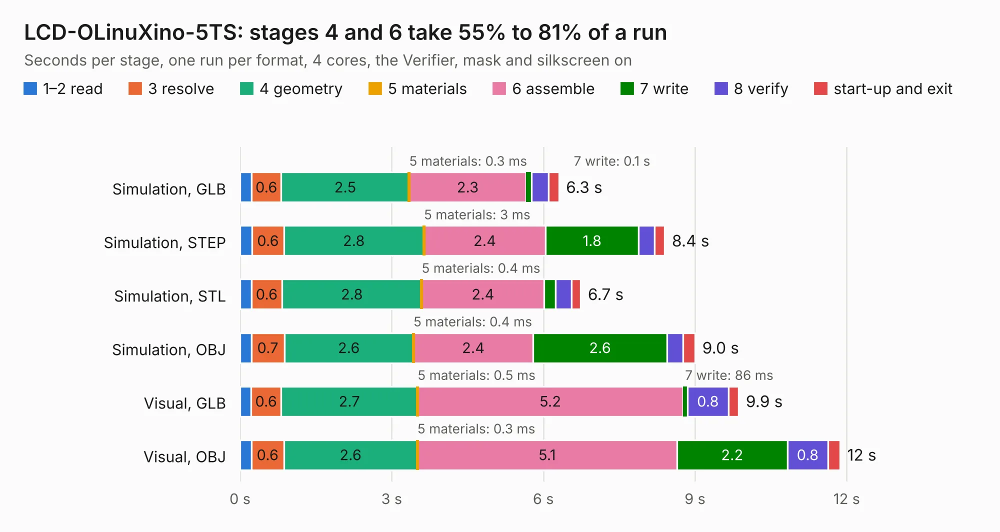

# 1952. LCD-OLinuXino-5TS

Board 1,952 of the 3,121 of [Corpus Testing](../Corpus-Testing.md), on [Corpus Page 19](../CorpusTestingPages/Corpus-Testing-19.md#1952-lcd-olinuxino-5ts).

| Mode and format | 1–2 read | 3 resolve | 4 geometry | 5 materials | 6 assemble | 7 write | 8 verify | start-up and exit | Total |
|---|---:|---:|---:|---:|---:|---:|---:|---:|---:|
| Simulation, GLB | 0.2 | 0.6 | 2.5 | 0.3&nbsp;ms | 2.3 | 0.1 | 0.3 | 0.2 | 6.3 |
| Simulation, STEP | 0.2 | 0.6 | 2.8 | 3&nbsp;ms | 2.4 | 1.8 | 0.3 | 0.2 | 8.4 |
| Simulation, STL | 0.2 | 0.6 | 2.8 | 0.4&nbsp;ms | 2.4 | 0.2 | 0.3 | 0.2 | 6.7 |
| Simulation, OBJ | 0.2 | 0.7 | 2.6 | 0.4&nbsp;ms | 2.4 | 2.6 | 0.3 | 0.2 | 9.0 |
| Visual, GLB | 0.2 | 0.6 | 2.7 | 0.5&nbsp;ms | 5.2 | 86&nbsp;ms | 0.8 | 0.2 | 9.9 |
| Visual, OBJ | 0.2 | 0.6 | 2.6 | 0.3&nbsp;ms | 5.1 | 2.2 | 0.8 | 0.2 | 11.9 |

<table align="center"><tr><td valign="top">

| Board | Repo: [OLIMEX/OLINUXINO](https://github.com/OLIMEX/OLINUXINO) Board: `LCD-OLinuXino-5TS.kicad_pcb` |
|---|---|
| Folder | HARDWARE / LCDs / LCD-OLinuXino-5CTS / Hardware revision A |
| Complexity | 209&nbsp;/&nbsp;1000 (size&nbsp;174, features&nbsp;35) |
| KESE&nbsp;features | through vias, filled zones |
| Tested | 9th November 2026 |
| Copper&nbsp;layers | 2 |
| File&nbsp;format | KiCad 4 (4) |
| Parts,&nbsp;tracks,&nbsp;vias | 33, 1,168, 96 |
| Triangles,&nbsp;simulation | 618,012 in 82 parts |
| Verifier | PASS in all six runs |

</td><td valign="top">

<table>
<tr><th>File type</th><th>File size</th><th>Peak memory used</th></tr>
<tr><th colspan="3" align="left">Simulation</th></tr>
<tr><td>GLB</td><td align="right">23&nbsp;MB</td><td align="right">380&nbsp;MB</td></tr>
<tr><td>STEP</td><td align="right">122&nbsp;MB</td><td align="right">441&nbsp;MB</td></tr>
<tr><td>STL</td><td align="right">31&nbsp;MB</td><td align="right">380&nbsp;MB</td></tr>
<tr><td>OBJ</td><td align="right">65&nbsp;MB</td><td align="right">474&nbsp;MB</td></tr>
<tr><th colspan="3" align="left">Visual</th></tr>
<tr><td>GLB</td><td align="right">19&nbsp;MB</td><td align="right">492&nbsp;MB</td></tr>
<tr><td>OBJ</td><td align="right">57&nbsp;MB</td><td align="right">517&nbsp;MB</td></tr>
</table>

</td></tr></table>

| Previous | Next |
|:---|---:|
| [1951. LCD-OLinuXino-15.6FHD_Rev_H](b1951b_OLINUXINO_LCD-OLinuXino-15-6FHD-Rev-H.md) | [1953. LCD-OLinuXino-5TS_Rev.B](b1953b_OLINUXINO_LCD-OLinuXino-5TS-Rev-B.md) |
