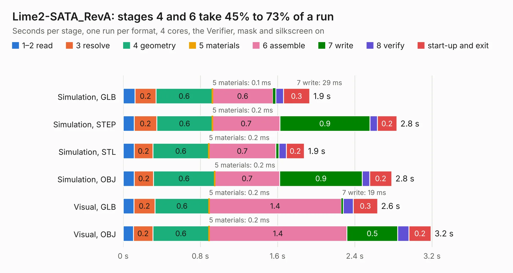

# 1952. Lime2-SATA_RevA

Board 1,952 of the 3,119 of [Corpus Testing](../Corpus-Testing.md), on [Corpus Page 19](../CorpusTestingPages/Corpus-Testing-19.md#1952-lime2-sata_reva).

| Mode and format | 1–2 read | 3 resolve | 4 geometry | 5 materials | 6 assemble | 7 write | 8 verify | start-up and exit | Total |
|---|---:|---:|---:|---:|---:|---:|---:|---:|---:|
| Simulation, GLB | 0.1 | 0.2 | 0.6 | 0.1&nbsp;ms | 0.6 | 29&nbsp;ms | 78&nbsp;ms | 0.3 | 1.9 |
| Simulation, STEP | 0.1 | 0.2 | 0.6 | 0.2&nbsp;ms | 0.7 | 0.9 | 76&nbsp;ms | 0.2 | 2.8 |
| Simulation, STL | 0.1 | 0.2 | 0.6 | 0.2&nbsp;ms | 0.7 | 33&nbsp;ms | 77&nbsp;ms | 0.2 | 1.9 |
| Simulation, OBJ | 0.1 | 0.2 | 0.6 | 0.2&nbsp;ms | 0.7 | 0.9 | 77&nbsp;ms | 0.2 | 2.8 |
| Visual, GLB | 0.1 | 0.2 | 0.6 | 0.2&nbsp;ms | 1.4 | 19&nbsp;ms | 0.1 | 0.3 | 2.6 |
| Visual, OBJ | 0.1 | 0.2 | 0.6 | 0.2&nbsp;ms | 1.4 | 0.5 | 0.1 | 0.2 | 3.2 |

<table align="center"><tr><td valign="top">

| Board | Repo: [OLIMEX/OLINUXINO](https://github.com/OLIMEX/OLINUXINO) Board: `Lime2-SATA_RevA.kicad_pcb` |
|---|---|
| Folder | HARDWARE / Lime2-SATA / Lime2-SATA_RevA |
| Complexity | 194&nbsp;/&nbsp;1000 (size&nbsp;109, features&nbsp;85) |
| KESE&nbsp;features | through vias, slotted holes, filled zones, curved board outline, stack-up, dielectric εr and tanδ |
| Tested | 9th November 2026 |
| Copper&nbsp;layers | 2 |
| File&nbsp;format | KiCad 6 (20190905) |
| Parts,&nbsp;tracks,&nbsp;vias | 3, 75, 12 |
| Triangles,&nbsp;simulation | 137,156 in 24 parts |
| Verifier | PASS in all six runs |

</td><td valign="top">

<table>
<tr><th>File type</th><th>File size</th><th>Peak memory used</th></tr>
<tr><th colspan="3" align="left">Simulation</th></tr>
<tr><td>GLB</td><td align="right">4.9&nbsp;MB</td><td align="right">197&nbsp;MB</td></tr>
<tr><td>STEP</td><td align="right">24&nbsp;MB</td><td align="right">201&nbsp;MB</td></tr>
<tr><td>STL</td><td align="right">6.9&nbsp;MB</td><td align="right">197&nbsp;MB</td></tr>
<tr><td>OBJ</td><td align="right">14&nbsp;MB</td><td align="right">192&nbsp;MB</td></tr>
<tr><th colspan="3" align="left">Visual</th></tr>
<tr><td>GLB</td><td align="right">3.6&nbsp;MB</td><td align="right">159&nbsp;MB</td></tr>
<tr><td>OBJ</td><td align="right">10&nbsp;MB</td><td align="right">161&nbsp;MB</td></tr>
</table>

</td></tr></table>

| Previous | Next |
|:---|---:|
| [1951. LCD-OLinuXino-5TS_Rev.B](b1951b_OLINUXINO_LCD-OLinuXino-5TS-Rev-B.md) | [1953. STMP157-OLinuXino-LIME2_Rev_B1](b1953b_OLINUXINO_STMP157-OLinuXino-LIME2-Rev-B1.md) |
