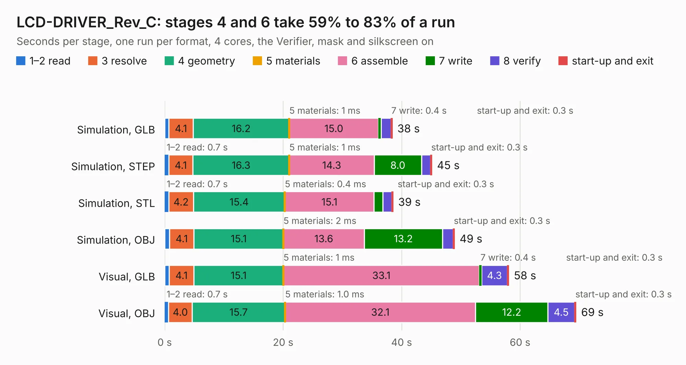

# 1953. LCD-DRIVER_Rev_C

Board 1,953 of the 3,126 of [Corpus Testing](../Corpus-Testing.md), on [Corpus Page 19](../CorpusTestingPages/Corpus-Testing-19.md#1953-lcd-driver_rev_c).

| Mode and format | 1–2 read | 3 resolve | 4 geometry | 5 materials | 6 assemble | 7 write | 8 verify | start-up and exit | Total |
|---|---:|---:|---:|---:|---:|---:|---:|---:|---:|
| Simulation, GLB | 0.7 | 4.1 | 16.2 | 1&nbsp;ms | 15.0 | 0.4 | 1.7 | 0.3 | 38.5 |
| Simulation, STEP | 0.7 | 4.1 | 16.3 | 1&nbsp;ms | 14.3 | 8.0 | 1.5 | 0.3 | 45.1 |
| Simulation, STL | 0.7 | 4.2 | 15.4 | 0.4&nbsp;ms | 15.1 | 1.5 | 1.5 | 0.3 | 38.6 |
| Simulation, OBJ | 0.8 | 4.1 | 15.1 | 2&nbsp;ms | 13.6 | 13.2 | 1.8 | 0.3 | 49.0 |
| Visual, GLB | 0.8 | 4.1 | 15.1 | 1&nbsp;ms | 33.1 | 0.4 | 4.3 | 0.3 | 58.1 |
| Visual, OBJ | 0.7 | 4.0 | 15.7 | 1.0&nbsp;ms | 32.1 | 12.2 | 4.5 | 0.3 | 69.5 |

<table align="center"><tr><td valign="top">

| Board | Repo: [OLIMEX/OLINUXINO](https://github.com/OLIMEX/OLINUXINO) Board: `LCD-DRIVER_Rev_C.kicad_pcb` |
|---|---|
| Folder | HARDWARE / LCDs / LCD-DRIVER / Hardware revision C |
| Complexity | 262&nbsp;/&nbsp;1000 (size&nbsp;217, features&nbsp;45) |
| KESE&nbsp;features | through vias, rounded, trapezoid or chamfered pads, filled zones |
| Tested | 9th November 2026 |
| Copper&nbsp;layers | 2 |
| File&nbsp;format | KiCad 5 (20171130) |
| Parts,&nbsp;tracks,&nbsp;vias | 131, 5,701, 732 |
| Triangles,&nbsp;simulation | 2,732,380 in 106 parts |
| Verifier | PASS in all six runs |

</td><td valign="top">

<table>
<tr><th>File type</th><th>File size</th><th>Peak memory used</th></tr>
<tr><th colspan="3" align="left">Simulation</th></tr>
<tr><td>GLB</td><td align="right">96&nbsp;MB</td><td align="right">967&nbsp;MB</td></tr>
<tr><td>STEP</td><td align="right">519&nbsp;MB</td><td align="right">1.3&nbsp;GB</td></tr>
<tr><td>STL</td><td align="right">137&nbsp;MB</td><td align="right">933&nbsp;MB</td></tr>
<tr><td>OBJ</td><td align="right">293&nbsp;MB</td><td align="right">1.8&nbsp;GB</td></tr>
<tr><th colspan="3" align="left">Visual</th></tr>
<tr><td>GLB</td><td align="right">84&nbsp;MB</td><td align="right">1.5&nbsp;GB</td></tr>
<tr><td>OBJ</td><td align="right">262&nbsp;MB</td><td align="right">1.8&nbsp;GB</td></tr>
</table>

</td></tr></table>

| Previous | Next |
|:---|---:|
| [1952. LCD-DRIVER_Rev_B](b1952b_OLINUXINO_LCD-DRIVER-Rev-B.md) | [1954. LCD-DRIVER_Rev_D](b1954b_OLINUXINO_LCD-DRIVER-Rev-D.md) |
