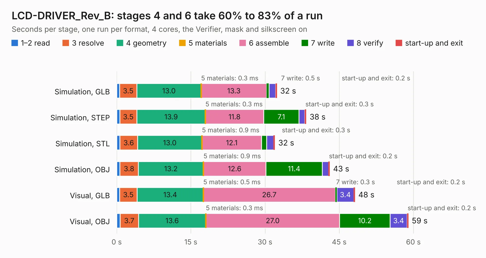

# 1954. LCD-DRIVER_Rev_B

Board 1,954 of the 3,130 of [Corpus Testing](../Corpus-Testing.md), on [Corpus Page 19](../CorpusTestingPages/Corpus-Testing-19.md#1954-lcd-driver_rev_b).

| Mode and format | 1–2 read | 3 resolve | 4 geometry | 5 materials | 6 assemble | 7 write | 8 verify | start-up and exit | Total |
|---|---:|---:|---:|---:|---:|---:|---:|---:|---:|
| Simulation, GLB | 0.6 | 3.5 | 13.0 | 0.3&nbsp;ms | 13.3 | 0.5 | 1.3 | 0.2 | 32.4 |
| Simulation, STEP | 0.6 | 3.5 | 13.9 | 0.3&nbsp;ms | 11.8 | 7.1 | 1.2 | 0.3 | 38.3 |
| Simulation, STL | 0.6 | 3.6 | 13.0 | 0.9&nbsp;ms | 12.1 | 1.0 | 1.4 | 0.3 | 32.0 |
| Simulation, OBJ | 0.6 | 3.8 | 13.2 | 0.9&nbsp;ms | 12.6 | 11.4 | 1.2 | 0.2 | 43.1 |
| Visual, GLB | 0.6 | 3.5 | 13.4 | 0.5&nbsp;ms | 26.7 | 0.3 | 3.4 | 0.2 | 48.2 |
| Visual, OBJ | 0.7 | 3.7 | 13.6 | 0.3&nbsp;ms | 27.0 | 10.2 | 3.4 | 0.2 | 59.0 |

<table align="center"><tr><td valign="top">

| Board | Repo: [OLIMEX/OLINUXINO](https://github.com/OLIMEX/OLINUXINO) Board: `LCD-DRIVER_Rev_B.kicad_pcb` |
|---|---|
| Folder | HARDWARE / LCDs / LCD-DRIVER / Hardware revision B |
| Complexity | 261&nbsp;/&nbsp;1000 (size&nbsp;216, features&nbsp;45) |
| KESE&nbsp;features | through vias, rounded, trapezoid or chamfered pads, filled zones |
| Tested | 9th November 2026 |
| Copper&nbsp;layers | 2 |
| File&nbsp;format | KiCad 5 (20171130) |
| Parts,&nbsp;tracks,&nbsp;vias | 129, 5,589, 731 |
| Triangles,&nbsp;simulation | 2,732,634 in 106 parts |
| Verifier | PASS in all six runs |

</td><td valign="top">

<table>
<tr><th>File type</th><th>File size</th><th>Peak memory used</th></tr>
<tr><th colspan="3" align="left">Simulation</th></tr>
<tr><td>GLB</td><td align="right">96&nbsp;MB</td><td align="right">989&nbsp;MB</td></tr>
<tr><td>STEP</td><td align="right">521&nbsp;MB</td><td align="right">1.3&nbsp;GB</td></tr>
<tr><td>STL</td><td align="right">137&nbsp;MB</td><td align="right">1.1&nbsp;GB</td></tr>
<tr><td>OBJ</td><td align="right">293&nbsp;MB</td><td align="right">1.8&nbsp;GB</td></tr>
<tr><th colspan="3" align="left">Visual</th></tr>
<tr><td>GLB</td><td align="right">84&nbsp;MB</td><td align="right">1.4&nbsp;GB</td></tr>
<tr><td>OBJ</td><td align="right">262&nbsp;MB</td><td align="right">1.8&nbsp;GB</td></tr>
</table>

</td></tr></table>

| Previous | Next |
|:---|---:|
| [1953. A64-OlinuXino_Rev_G1](b1953b_OLINUXINO_A64-OlinuXino-Rev-G1.md) | [1955. LCD-DRIVER_Rev_C](b1955b_OLINUXINO_LCD-DRIVER-Rev-C.md) |
