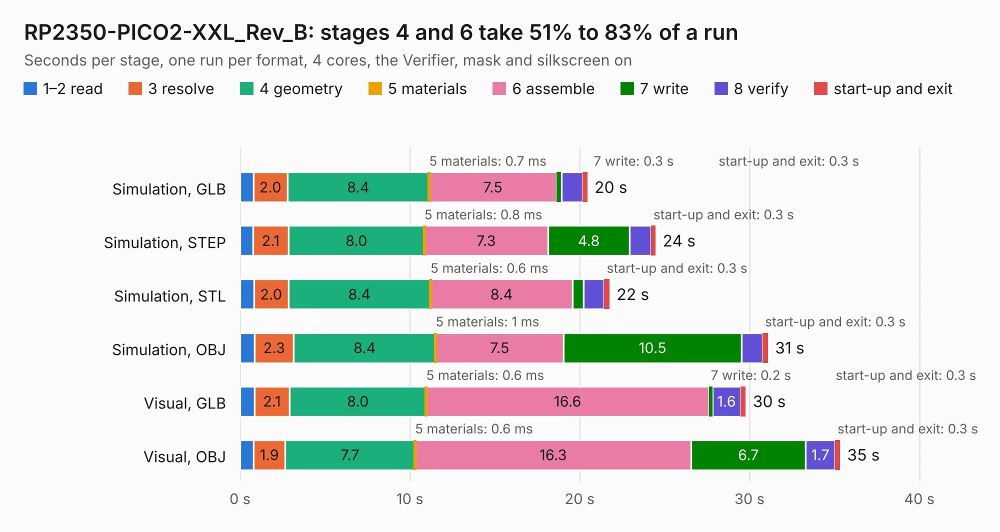

# 1955. RP2350-PICO2-XXL_Rev_B

Board 1,955 of the 3,109 of [Corpus Testing](../Corpus-Testing.md), on [Corpus Page 19](../CorpusTestingPages/Corpus-Testing-19.md#1955-rp2350-pico2-xxl_rev_b).

| Mode and format | 1–2 read | 3 resolve | 4 geometry | 5 materials | 6 assemble | 7 write | 8 verify | start-up and exit | Total |
|---|---:|---:|---:|---:|---:|---:|---:|---:|---:|
| Simulation, GLB | 0.8 | 2.0 | 8.4 | 0.7&nbsp;ms | 7.5 | 0.3 | 1.2 | 0.3 | 20.5 |
| Simulation, STEP | 0.8 | 2.1 | 8.0 | 0.8&nbsp;ms | 7.3 | 4.8 | 1.3 | 0.3 | 24.5 |
| Simulation, STL | 0.8 | 2.0 | 8.4 | 0.6&nbsp;ms | 8.4 | 0.6 | 1.2 | 0.3 | 21.8 |
| Simulation, OBJ | 0.9 | 2.3 | 8.4 | 1&nbsp;ms | 7.5 | 10.5 | 1.2 | 0.3 | 31.1 |
| Visual, GLB | 0.8 | 2.1 | 8.0 | 0.6&nbsp;ms | 16.6 | 0.2 | 1.6 | 0.3 | 29.8 |
| Visual, OBJ | 0.8 | 1.9 | 7.7 | 0.6&nbsp;ms | 16.3 | 6.7 | 1.7 | 0.3 | 35.3 |

<table align="center"><tr><td valign="top">

| Board | Repo: [OLIMEX/RP2350-PICO2-XXL](https://github.com/OLIMEX/RP2350-PICO2-XXL) Board: `RP2350-PICO2-XXL_Rev_B.kicad_pcb` |
|---|---|
| Folder | HARDWARE / RP2350-PICO2-XXL-Rev.B |
| Complexity | 372&nbsp;/&nbsp;1000 (size&nbsp;252, features&nbsp;120) |
| KESE&nbsp;features | through vias, slotted holes, arc tracks, filled zones, copper text, knockout text, stack-up, dielectric εr and tanδ, mask and silkscreen colours |
| Tested | 9th November 2026 |
| Copper&nbsp;layers | 4 |
| File&nbsp;format | KiCad 7 (20221018) |
| Parts,&nbsp;tracks,&nbsp;vias | 73, 2,738, 164 |
| Triangles,&nbsp;simulation | 1,815,236 in 110 parts |
| Verifier | PASS in all six runs |

</td><td valign="top">

<table>
<tr><th>File type</th><th>File size</th><th>Peak memory used</th></tr>
<tr><th colspan="3" align="left">Simulation</th></tr>
<tr><td>GLB</td><td align="right">64&nbsp;MB</td><td align="right">649&nbsp;MB</td></tr>
<tr><td>STEP</td><td align="right">299&nbsp;MB</td><td align="right">756&nbsp;MB</td></tr>
<tr><td>STL</td><td align="right">91&nbsp;MB</td><td align="right">594&nbsp;MB</td></tr>
<tr><td>OBJ</td><td align="right">193&nbsp;MB</td><td align="right">1.3&nbsp;GB</td></tr>
<tr><th colspan="3" align="left">Visual</th></tr>
<tr><td>GLB</td><td align="right">40&nbsp;MB</td><td align="right">758&nbsp;MB</td></tr>
<tr><td>OBJ</td><td align="right">122&nbsp;MB</td><td align="right">919&nbsp;MB</td></tr>
</table>

</td></tr></table>

| Previous | Next |
|:---|---:|
| [1954. RP2350-PICO2-XXL_Rev_A](b1954b_RP2350-PICO2-XXL_RP2350-PICO2-XXL-Rev-A.md) | [1956. RP2350-PICO2-XXL_Rev_C](b1956b_RP2350-PICO2-XXL_RP2350-PICO2-XXL-Rev-C.md) |
