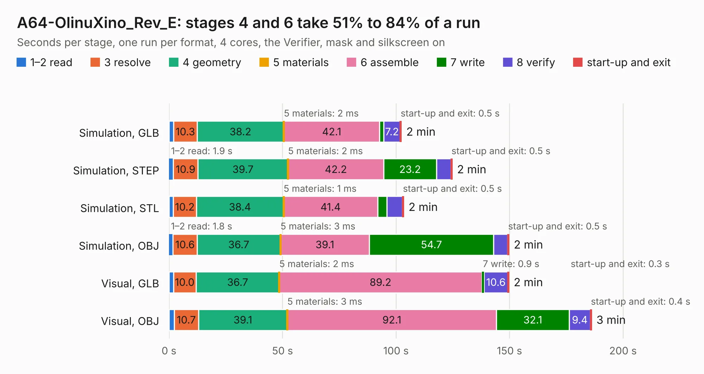

# 1957 A64-OlinuXino_Rev_E

Board 1,957 of the 3,138 of [Corpus Testing](../Corpus-Testing.md), on [Corpus Page 19](../CorpusTestingPages/Corpus-Testing-19.md#1957-a64-olinuxino_rev_e).

| Mode and format | 1–2 read | 3 resolve | 4 geometry | 5 materials | 6 assemble | 7 write | 8 verify | start-up and exit | Total |
|---|---:|---:|---:|---:|---:|---:|---:|---:|---:|
| Simulation, GLB | 2.0 | 10.3 | 38.2 | 2&nbsp;ms | 42.1 | 1.9 | 7.2 | 0.5 | 102.3 |
| Simulation, STEP | 1.9 | 10.9 | 39.7 | 2&nbsp;ms | 42.2 | 23.2 | 6.4 | 0.5 | 124.7 |
| Simulation, STL | 1.9 | 10.2 | 38.4 | 1&nbsp;ms | 41.4 | 4.1 | 6.8 | 0.5 | 103.3 |
| Simulation, OBJ | 1.8 | 10.6 | 36.7 | 3&nbsp;ms | 39.1 | 54.7 | 6.2 | 0.5 | 149.7 |
| Visual, GLB | 1.9 | 10.0 | 36.7 | 2&nbsp;ms | 89.2 | 0.9 | 10.6 | 0.3 | 149.6 |
| Visual, OBJ | 2.3 | 10.7 | 39.1 | 3&nbsp;ms | 92.1 | 32.1 | 9.4 | 0.4 | 186.1 |

<table align="center"><tr><td valign="top">

| Board | Repo: [OLIMEX/OLINUXINO](https://github.com/OLIMEX/OLINUXINO) Board: `A64-OlinuXino_Rev_E.kicad_pcb` |
|---|---|
| Folder | HARDWARE / A64-OLinuXino / 2. Older hardware revisions / A64-OLinuXino hardware revision E |
| Complexity | 393&nbsp;/&nbsp;1000 (size&nbsp;338, features&nbsp;55) |
| KESE&nbsp;features | through vias, slotted holes, filled zones, copper text |
| Tested | 9th November 2026 |
| Copper&nbsp;layers | 6 |
| File&nbsp;format | KiCad 5 (20171130) |
| Parts,&nbsp;tracks,&nbsp;vias | 412, 16,943, 1,171 |
| Triangles,&nbsp;simulation | 10,318,354 in 473 parts |
| Verifier | PASS in all six runs |

</td><td valign="top">

<table>
<tr><th>File type</th><th>File size</th><th>Peak memory used</th></tr>
<tr><th colspan="3" align="left">Simulation</th></tr>
<tr><td>GLB</td><td align="right">359&nbsp;MB</td><td align="right">2.2&nbsp;GB</td></tr>
<tr><td>STEP</td><td align="right">1.5&nbsp;GB</td><td align="right">3.2&nbsp;GB</td></tr>
<tr><td>STL</td><td align="right">516&nbsp;MB</td><td align="right">2.2&nbsp;GB</td></tr>
<tr><td>OBJ</td><td align="right">1.1&nbsp;GB</td><td align="right">6.5&nbsp;GB</td></tr>
<tr><th colspan="3" align="left">Visual</th></tr>
<tr><td>GLB</td><td align="right">201&nbsp;MB</td><td align="right">3.1&nbsp;GB</td></tr>
<tr><td>OBJ</td><td align="right">655&nbsp;MB</td><td align="right">4.1&nbsp;GB</td></tr>
</table>

</td></tr></table>

| Previous | Next |
|:---|---:|
| [1956 A64-OlinuXino_Rev_D](b1956b_OLINUXINO_A64-OlinuXino-Rev-D.md) | [1958 A64-OlinuXino_Rev_G](b1958b_OLINUXINO_A64-OlinuXino-Rev-G.md) |
