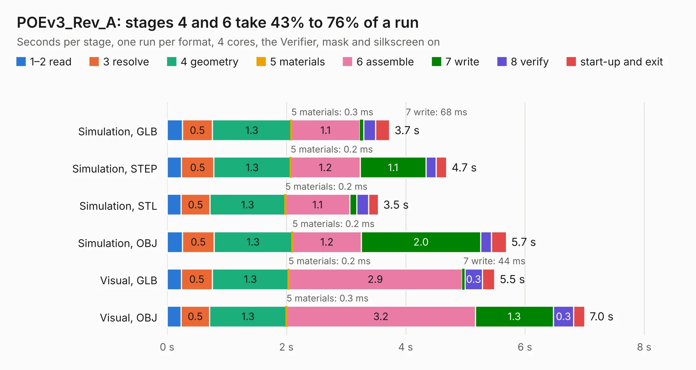

# 1957. POEv3_Rev_A

Board 1,957 of the 3,120 of [Corpus Testing](../Corpus-Testing.md), on [Corpus Page 19](../CorpusTestingPages/Corpus-Testing-19.md#1957-poev3_rev_a).

| Mode and format | 1–2 read | 3 resolve | 4 geometry | 5 materials | 6 assemble | 7 write | 8 verify | start-up and exit | Total |
|---|---:|---:|---:|---:|---:|---:|---:|---:|---:|
| Simulation, GLB | 0.3 | 0.5 | 1.3 | 0.3&nbsp;ms | 1.1 | 68&nbsp;ms | 0.2 | 0.2 | 3.7 |
| Simulation, STEP | 0.2 | 0.5 | 1.3 | 0.2&nbsp;ms | 1.2 | 1.1 | 0.2 | 0.2 | 4.7 |
| Simulation, STL | 0.2 | 0.5 | 1.3 | 0.2&nbsp;ms | 1.1 | 0.1 | 0.2 | 0.2 | 3.5 |
| Simulation, OBJ | 0.3 | 0.5 | 1.3 | 0.2&nbsp;ms | 1.2 | 2.0 | 0.2 | 0.3 | 5.7 |
| Visual, GLB | 0.2 | 0.5 | 1.3 | 0.2&nbsp;ms | 2.9 | 44&nbsp;ms | 0.3 | 0.2 | 5.5 |
| Visual, OBJ | 0.2 | 0.5 | 1.3 | 0.3&nbsp;ms | 3.2 | 1.3 | 0.3 | 0.2 | 7.0 |

<table align="center"><tr><td valign="top">

| Board | Repo: [OLIMEX/POEv3](https://github.com/OLIMEX/POEv3) Board: `POEv3_Rev_A.kicad_pcb` |
|---|---|
| Folder | Hardware / POEv3 hardware revision A |
| Complexity | 302&nbsp;/&nbsp;1000 (size&nbsp;192, features&nbsp;110) |
| KESE&nbsp;features | through vias, arc tracks, filled zones, copper text, knockout text, stack-up, dielectric εr and tanδ, mask and silkscreen colours |
| Tested | 9th November 2026 |
| Copper&nbsp;layers | 4 |
| File&nbsp;format | KiCad 7 (20221018) |
| Parts,&nbsp;tracks,&nbsp;vias | 24, 1,448, 145 |
| Triangles,&nbsp;simulation | 500,756 in 37 parts |
| Verifier | PASS in all six runs |

</td><td valign="top">

<table>
<tr><th>File type</th><th>File size</th><th>Peak memory used</th></tr>
<tr><th colspan="3" align="left">Simulation</th></tr>
<tr><td>GLB</td><td align="right">17&nbsp;MB</td><td align="right">297&nbsp;MB</td></tr>
<tr><td>STEP</td><td align="right">54&nbsp;MB</td><td align="right">306&nbsp;MB</td></tr>
<tr><td>STL</td><td align="right">25&nbsp;MB</td><td align="right">292&nbsp;MB</td></tr>
<tr><td>OBJ</td><td align="right">50&nbsp;MB</td><td align="right">380&nbsp;MB</td></tr>
<tr><th colspan="3" align="left">Visual</th></tr>
<tr><td>GLB</td><td align="right">11&nbsp;MB</td><td align="right">283&nbsp;MB</td></tr>
<tr><td>OBJ</td><td align="right">33&nbsp;MB</td><td align="right">302&nbsp;MB</td></tr>
</table>

</td></tr></table>

| Previous | Next |
|:---|---:|
| [1956. PICO-EVB_Rev_A](b1956b_PICO-EVB_PICO-EVB-Rev-A.md) | [1958. RK3328-SOM-EVB_Rev_A](b1958b_RK3328-SOM-EBV_RK3328-SOM-EVB-Rev-A.md) |
