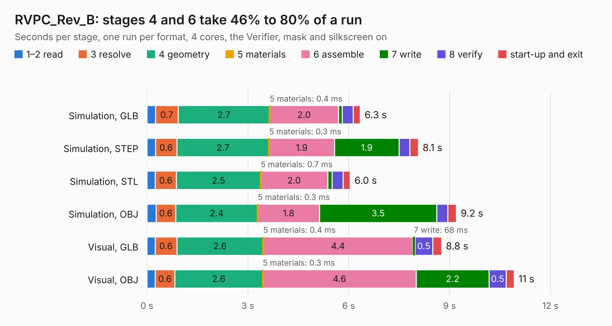

# 1957. RVPC_Rev_B

Board 1,957 of the 3,105 of [Corpus Testing](../Corpus-Testing.md), on [Corpus Page 19](../CorpusTestingPages/Corpus-Testing-19.md#1957-rvpc_rev_b).

| Mode and format | 1–2 read | 3 resolve | 4 geometry | 5 materials | 6 assemble | 7 write | 8 verify | start-up and exit | Total |
|---|---:|---:|---:|---:|---:|---:|---:|---:|---:|
| Simulation, GLB | 0.3 | 0.7 | 2.7 | 0.4&nbsp;ms | 2.0 | 0.1 | 0.3 | 0.2 | 6.3 |
| Simulation, STEP | 0.3 | 0.6 | 2.7 | 0.3&nbsp;ms | 1.9 | 1.9 | 0.3 | 0.3 | 8.1 |
| Simulation, STL | 0.2 | 0.6 | 2.5 | 0.7&nbsp;ms | 2.0 | 0.1 | 0.3 | 0.2 | 6.0 |
| Simulation, OBJ | 0.3 | 0.6 | 2.4 | 0.3&nbsp;ms | 1.8 | 3.5 | 0.3 | 0.3 | 9.2 |
| Visual, GLB | 0.2 | 0.6 | 2.6 | 0.4&nbsp;ms | 4.4 | 68&nbsp;ms | 0.5 | 0.3 | 8.8 |
| Visual, OBJ | 0.2 | 0.6 | 2.6 | 0.3&nbsp;ms | 4.6 | 2.2 | 0.5 | 0.2 | 10.9 |

<table align="center"><tr><td valign="top">

| Board | Repo: [OLIMEX/RVPC](https://github.com/OLIMEX/RVPC) Board: `RVPC_Rev_B.kicad_pcb` |
|---|---|
| Folder | HARDWARE / RVPC_Rev.B |
| Complexity | 258&nbsp;/&nbsp;1000 (size&nbsp;153, features&nbsp;105) |
| KESE&nbsp;features | through vias, slotted holes, rounded, trapezoid or chamfered pads, filled zones, knockout text, stack-up, dielectric εr and tanδ, mask and silkscreen colours |
| Tested | 9th November 2026 |
| Copper&nbsp;layers | 2 |
| File&nbsp;format | KiCad 7 (20221018) |
| Parts,&nbsp;tracks,&nbsp;vias | 21, 407, 44 |
| Triangles,&nbsp;simulation | 562,602 in 44 parts |
| Verifier | PASS in all six runs |

</td><td valign="top">

<table>
<tr><th>File type</th><th>File size</th><th>Peak memory used</th></tr>
<tr><th colspan="3" align="left">Simulation</th></tr>
<tr><td>GLB</td><td align="right">20&nbsp;MB</td><td align="right">302&nbsp;MB</td></tr>
<tr><td>STEP</td><td align="right">101&nbsp;MB</td><td align="right">335&nbsp;MB</td></tr>
<tr><td>STL</td><td align="right">28&nbsp;MB</td><td align="right">303&nbsp;MB</td></tr>
<tr><td>OBJ</td><td align="right">58&nbsp;MB</td><td align="right">421&nbsp;MB</td></tr>
<tr><th colspan="3" align="left">Visual</th></tr>
<tr><td>GLB</td><td align="right">13&nbsp;MB</td><td align="right">327&nbsp;MB</td></tr>
<tr><td>OBJ</td><td align="right">38&nbsp;MB</td><td align="right">342&nbsp;MB</td></tr>
</table>

</td></tr></table>

| Previous | Next |
|:---|---:|
| [1956. RVPC_Rev_A](b1956b_RVPC_RVPC-Rev-A.md) | [1958. exposed_power_rails](b1958b_RVPC_exposed-power-rails.md) |
