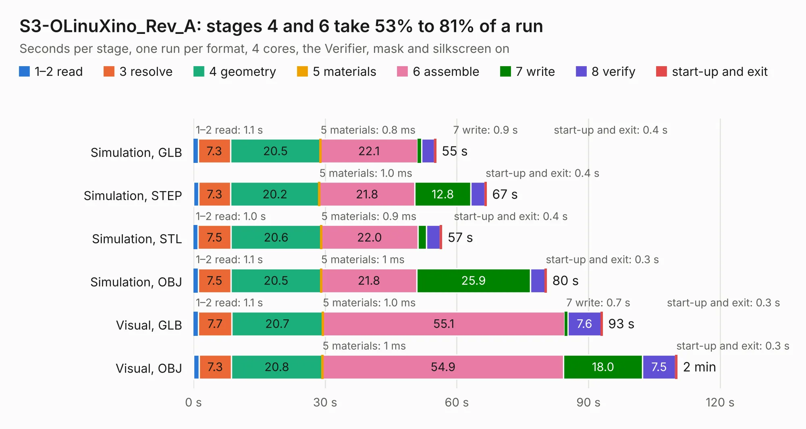

# 1957. S3-OLinuXino_Rev_A

Board 1,957 of the 3,102 of [Corpus Testing](../Corpus-Testing.md), on [Corpus Page 19](../CorpusTestingPages/Corpus-Testing-19.md#1957-s3-olinuxino_rev_a).

| Mode and format | 1–2 read | 3 resolve | 4 geometry | 5 materials | 6 assemble | 7 write | 8 verify | start-up and exit | Total |
|---|---:|---:|---:|---:|---:|---:|---:|---:|---:|
| Simulation, GLB | 1.1 | 7.3 | 20.5 | 0.8&nbsp;ms | 22.1 | 0.9 | 2.9 | 0.4 | 55.2 |
| Simulation, STEP | 1.2 | 7.3 | 20.2 | 1.0&nbsp;ms | 21.8 | 12.8 | 3.2 | 0.4 | 66.7 |
| Simulation, STL | 1.0 | 7.5 | 20.6 | 0.9&nbsp;ms | 22.0 | 2.0 | 3.1 | 0.4 | 56.6 |
| Simulation, OBJ | 1.1 | 7.5 | 20.5 | 1&nbsp;ms | 21.8 | 25.9 | 3.4 | 0.3 | 80.4 |
| Visual, GLB | 1.1 | 7.7 | 20.7 | 1.0&nbsp;ms | 55.1 | 0.7 | 7.6 | 0.3 | 93.2 |
| Visual, OBJ | 1.3 | 7.3 | 20.8 | 1&nbsp;ms | 54.9 | 18.0 | 7.5 | 0.3 | 110.2 |

<table align="center"><tr><td valign="top">

| Board | Repo: [OLIMEX/S3-OLinuXino](https://github.com/OLIMEX/S3-OLinuXino) Board: `S3-OLinuXino_Rev_A.kicad_pcb` |
|---|---|
| Folder | HARDWARE / S3-OLinuXino_Rev_A-release |
| Complexity | 347&nbsp;/&nbsp;1000 (size&nbsp;292, features&nbsp;55) |
| KESE&nbsp;features | through vias, slotted holes, filled zones, copper text |
| Tested | 9th November 2026 |
| Copper&nbsp;layers | 4 |
| File&nbsp;format | KiCad 5 (20171130) |
| Parts,&nbsp;tracks,&nbsp;vias | 217, 5,459, 627 |
| Triangles,&nbsp;simulation | 4,938,436 in 305 parts |
| Verifier | PASS in all six runs |

</td><td valign="top">

<table>
<tr><th>File type</th><th>File size</th><th>Peak memory used</th></tr>
<tr><th colspan="3" align="left">Simulation</th></tr>
<tr><td>GLB</td><td align="right">172&nbsp;MB</td><td align="right">1.4&nbsp;GB</td></tr>
<tr><td>STEP</td><td align="right">820&nbsp;MB</td><td align="right">1.7&nbsp;GB</td></tr>
<tr><td>STL</td><td align="right">247&nbsp;MB</td><td align="right">1.4&nbsp;GB</td></tr>
<tr><td>OBJ</td><td align="right">535&nbsp;MB</td><td align="right">3.2&nbsp;GB</td></tr>
<tr><th colspan="3" align="left">Visual</th></tr>
<tr><td>GLB</td><td align="right">116&nbsp;MB</td><td align="right">1.9&nbsp;GB</td></tr>
<tr><td>OBJ</td><td align="right">368&nbsp;MB</td><td align="right">2.4&nbsp;GB</td></tr>
</table>

</td></tr></table>

| Previous | Next |
|:---|---:|
| [1956. S3-OLinuXino_Rev_A](b1956b_S3-OLinuXino_HARDWARE-S3-OLinuXino-Rev-A-preliminary_S3-OLinuXino-Rev-A.md) | [1958. smd-protoboard](b1958b_SMT-PROTOBOARD_smd-protoboard.md) |
