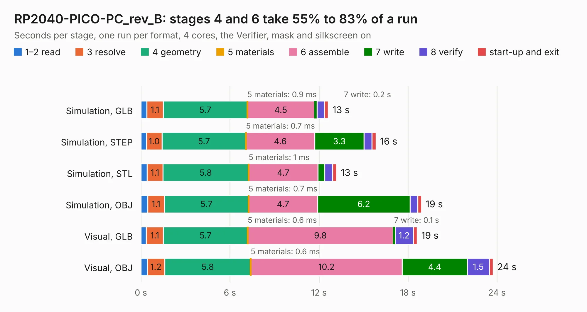

# 1958. RP2040-PICO-PC_rev_B

Board 1,958 of the 3,119 of [Corpus Testing](../Corpus-Testing.md), on [Corpus Page 19](../CorpusTestingPages/Corpus-Testing-19.md#1958-rp2040-pico-pc_rev_b).

| Mode and format | 1–2 read | 3 resolve | 4 geometry | 5 materials | 6 assemble | 7 write | 8 verify | start-up and exit | Total |
|---|---:|---:|---:|---:|---:|---:|---:|---:|---:|
| Simulation, GLB | 0.4 | 1.1 | 5.7 | 0.9&nbsp;ms | 4.5 | 0.2 | 0.5 | 0.3 | 12.6 |
| Simulation, STEP | 0.4 | 1.0 | 5.7 | 0.7&nbsp;ms | 4.6 | 3.3 | 0.5 | 0.3 | 15.8 |
| Simulation, STL | 0.4 | 1.1 | 5.8 | 1&nbsp;ms | 4.7 | 0.5 | 0.5 | 0.3 | 13.2 |
| Simulation, OBJ | 0.5 | 1.1 | 5.7 | 0.7&nbsp;ms | 4.7 | 6.2 | 0.5 | 0.3 | 18.9 |
| Visual, GLB | 0.4 | 1.1 | 5.7 | 0.6&nbsp;ms | 9.8 | 0.1 | 1.2 | 0.3 | 18.6 |
| Visual, OBJ | 0.4 | 1.2 | 5.8 | 0.6&nbsp;ms | 10.2 | 4.4 | 1.5 | 0.3 | 23.7 |

<table align="center"><tr><td valign="top">

| Board | Repo: [OLIMEX/RP2040-PICO-PC](https://github.com/OLIMEX/RP2040-PICO-PC) Board: `RP2040-PICO-PC_rev_B.kicad_pcb` |
|---|---|
| Folder | HARDWARE / RP2040-PICO-PC hardware revision B |
| Complexity | 219&nbsp;/&nbsp;1000 (size&nbsp;174, features&nbsp;45) |
| KESE&nbsp;features | through vias, slotted holes, filled zones |
| Tested | 9th November 2026 |
| Copper&nbsp;layers | 2 |
| File&nbsp;format | KiCad 5 (20171130) |
| Parts,&nbsp;tracks,&nbsp;vias | 57, 750, 86 |
| Triangles,&nbsp;simulation | 1,166,386 in 83 parts |
| Verifier | PASS in all six runs |

</td><td valign="top">

<table>
<tr><th>File type</th><th>File size</th><th>Peak memory used</th></tr>
<tr><th colspan="3" align="left">Simulation</th></tr>
<tr><td>GLB</td><td align="right">41&nbsp;MB</td><td align="right">506&nbsp;MB</td></tr>
<tr><td>STEP</td><td align="right">211&nbsp;MB</td><td align="right">562&nbsp;MB</td></tr>
<tr><td>STL</td><td align="right">58&nbsp;MB</td><td align="right">487&nbsp;MB</td></tr>
<tr><td>OBJ</td><td align="right">121&nbsp;MB</td><td align="right">807&nbsp;MB</td></tr>
<tr><th colspan="3" align="left">Visual</th></tr>
<tr><td>GLB</td><td align="right">30&nbsp;MB</td><td align="right">612&nbsp;MB</td></tr>
<tr><td>OBJ</td><td align="right">90&nbsp;MB</td><td align="right">699&nbsp;MB</td></tr>
</table>

</td></tr></table>

| Previous | Next |
|:---|---:|
| [1957. RK3328-SOM-EVB_Rev_A](b1957b_RK3328-SOM-EBV_RK3328-SOM-EVB-Rev-A.md) | [1959. RP2040-PICO-PC_rev_C](b1959b_RP2040-PICO-PC_RP2040-PICO-PC-rev-C.md) |
