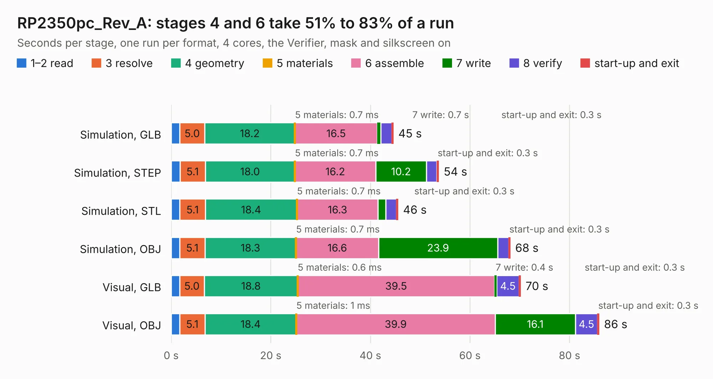

# 1959. RP2350pc_Rev_A

Board 1,959 of the 3,111 of [Corpus Testing](../Corpus-Testing.md), on [Corpus Page 19](../CorpusTestingPages/Corpus-Testing-19.md#1959-rp2350pc_rev_a).

| Mode and format | 1–2 read | 3 resolve | 4 geometry | 5 materials | 6 assemble | 7 write | 8 verify | start-up and exit | Total |
|---|---:|---:|---:|---:|---:|---:|---:|---:|---:|
| Simulation, GLB | 1.7 | 5.0 | 18.2 | 0.7&nbsp;ms | 16.5 | 0.7 | 2.2 | 0.3 | 44.6 |
| Simulation, STEP | 1.8 | 5.1 | 18.0 | 0.7&nbsp;ms | 16.2 | 10.2 | 2.1 | 0.3 | 53.7 |
| Simulation, STL | 1.7 | 5.1 | 18.4 | 0.7&nbsp;ms | 16.3 | 1.5 | 2.2 | 0.3 | 45.5 |
| Simulation, OBJ | 1.7 | 5.1 | 18.3 | 0.7&nbsp;ms | 16.6 | 23.9 | 2.2 | 0.3 | 68.1 |
| Visual, GLB | 1.7 | 5.0 | 18.8 | 0.6&nbsp;ms | 39.5 | 0.4 | 4.5 | 0.3 | 70.2 |
| Visual, OBJ | 1.7 | 5.1 | 18.4 | 1&nbsp;ms | 39.9 | 16.1 | 4.5 | 0.3 | 85.9 |

<table align="center"><tr><td valign="top">

| Board | Repo: [OLIMEX/RP2350pc](https://github.com/OLIMEX/RP2350pc) Board: `RP2350pc_Rev_A.kicad_pcb` |
|---|---|
| Folder | HARDWARE / RP2350pc-Rev.A |
| Complexity | 401&nbsp;/&nbsp;1000 (size&nbsp;286, features&nbsp;115) |
| KESE&nbsp;features | through vias, slotted holes, rounded, trapezoid or chamfered pads, filled zones, copper text, knockout text, stack-up, dielectric εr and tanδ, mask and silkscreen colours |
| Tested | 9th November 2026 |
| Copper&nbsp;layers | 4 |
| File&nbsp;format | KiCad 7 (20221018) |
| Parts,&nbsp;tracks,&nbsp;vias | 270, 5,295, 601 |
| Triangles,&nbsp;simulation | 3,923,056 in 228 parts |
| Verifier | PASS in all six runs |

</td><td valign="top">

<table>
<tr><th>File type</th><th>File size</th><th>Peak memory used</th></tr>
<tr><th colspan="3" align="left">Simulation</th></tr>
<tr><td>GLB</td><td align="right">138&nbsp;MB</td><td align="right">1.2&nbsp;GB</td></tr>
<tr><td>STEP</td><td align="right">634&nbsp;MB</td><td align="right">1.6&nbsp;GB</td></tr>
<tr><td>STL</td><td align="right">196&nbsp;MB</td><td align="right">1.3&nbsp;GB</td></tr>
<tr><td>OBJ</td><td align="right">426&nbsp;MB</td><td align="right">2.7&nbsp;GB</td></tr>
<tr><th colspan="3" align="left">Visual</th></tr>
<tr><td>GLB</td><td align="right">92&nbsp;MB</td><td align="right">1.5&nbsp;GB</td></tr>
<tr><td>OBJ</td><td align="right">288&nbsp;MB</td><td align="right">2.0&nbsp;GB</td></tr>
</table>

</td></tr></table>

| Previous | Next |
|:---|---:|
| [1958. RP2350-PICO2-XXL_Rev_C](b1958b_RP2350-PICO2-XXL_RP2350-PICO2-XXL-Rev-C.md) | [1960. RT1010Py_Rev.C](b1960b_RT1010Py_RT1010Py-Rev-C.md) |
