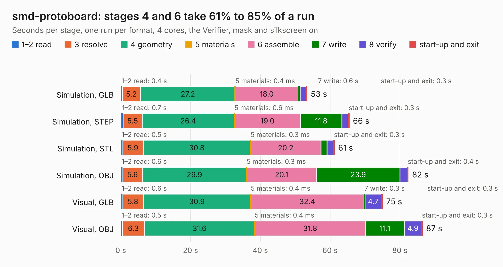

# 1960. smd-protoboard

Board 1,960 of the 3,104 of [Corpus Testing](../Corpus-Testing.md), on [Corpus Page 19](../CorpusTestingPages/Corpus-Testing-19.md#1960-smd-protoboard).

| Mode and format | 1–2 read | 3 resolve | 4 geometry | 5 materials | 6 assemble | 7 write | 8 verify | start-up and exit | Total |
|---|---:|---:|---:|---:|---:|---:|---:|---:|---:|
| Simulation, GLB | 0.4 | 5.2 | 27.2 | 0.4&nbsp;ms | 18.0 | 0.6 | 1.7 | 0.3 | 53.4 |
| Simulation, STEP | 0.7 | 5.5 | 26.4 | 0.6&nbsp;ms | 19.0 | 11.8 | 1.9 | 0.3 | 65.5 |
| Simulation, STL | 0.5 | 5.9 | 30.8 | 0.3&nbsp;ms | 20.2 | 1.8 | 1.8 | 0.3 | 61.3 |
| Simulation, OBJ | 0.6 | 5.6 | 29.9 | 0.3&nbsp;ms | 20.1 | 23.9 | 2.1 | 0.4 | 82.5 |
| Visual, GLB | 0.6 | 5.8 | 30.9 | 0.4&nbsp;ms | 32.4 | 0.3 | 4.7 | 0.3 | 75.1 |
| Visual, OBJ | 0.5 | 6.3 | 31.6 | 0.4&nbsp;ms | 31.8 | 11.1 | 4.9 | 0.3 | 86.5 |

<table align="center"><tr><td valign="top">

| Board | Repo: [OLIMEX/SMT-PROTOBOARD](https://github.com/OLIMEX/SMT-PROTOBOARD) Board: `smd-protoboard.kicad_pcb` |
|---|---|
| Complexity | 262&nbsp;/&nbsp;1000 (size&nbsp;237, features&nbsp;25) |
| KESE&nbsp;features | through vias, rounded, trapezoid or chamfered pads |
| Tested | 9th November 2026 |
| Copper&nbsp;layers | 2 |
| File&nbsp;format | KiCad 4 (4) |
| Parts,&nbsp;tracks,&nbsp;vias | 96, 1,869, 46 |
| Triangles,&nbsp;simulation | 4,300,772 in 12 parts |
| Verifier | PASS in all six runs |

</td><td valign="top">

<table>
<tr><th>File type</th><th>File size</th><th>Peak memory used</th></tr>
<tr><th colspan="3" align="left">Simulation</th></tr>
<tr><td>GLB</td><td align="right">149&nbsp;MB</td><td align="right">1.4&nbsp;GB</td></tr>
<tr><td>STEP</td><td align="right">610&nbsp;MB</td><td align="right">1.8&nbsp;GB</td></tr>
<tr><td>STL</td><td align="right">215&nbsp;MB</td><td align="right">1.4&nbsp;GB</td></tr>
<tr><td>OBJ</td><td align="right">463&nbsp;MB</td><td align="right">2.8&nbsp;GB</td></tr>
<tr><th colspan="3" align="left">Visual</th></tr>
<tr><td>GLB</td><td align="right">74&nbsp;MB</td><td align="right">1.5&nbsp;GB</td></tr>
<tr><td>OBJ</td><td align="right">230&nbsp;MB</td><td align="right">1.7&nbsp;GB</td></tr>
</table>

</td></tr></table>

| Previous | Next |
|:---|---:|
| [1959. S3-OLinuXino_Rev_A](b1959b_S3-OLinuXino_HARDWARE-S3-OLinuXino-Rev-A-release_S3-OLinuXino-Rev-A.md) | [1961. STMP1(A13)-SOM-EVB_Rev_B](b1961b_STMP1-A13-EVB_STMP1-A13-SOM-EVB-Rev-B.md) |
