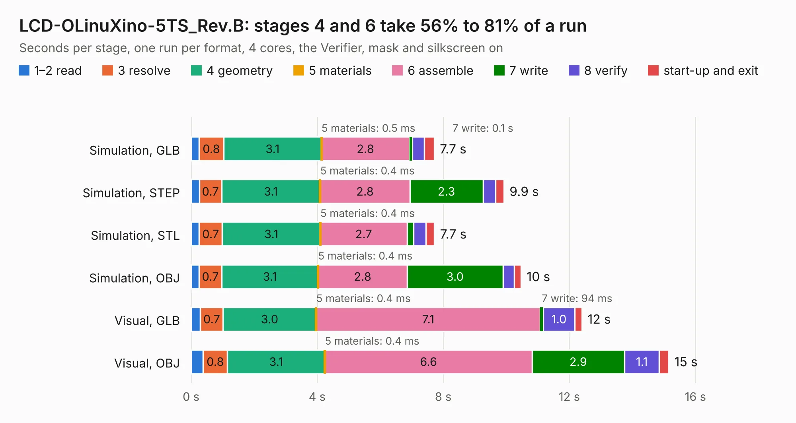

# 1961. LCD-OLinuXino-5TS_Rev.B

Board 1,961 of the 3,132 of [Corpus Testing](../Corpus-Testing.md), on [Corpus Page 19](../CorpusTestingPages/Corpus-Testing-19.md#1961-lcd-olinuxino-5ts_revb).

| Mode and format | 1–2 read | 3 resolve | 4 geometry | 5 materials | 6 assemble | 7 write | 8 verify | start-up and exit | Total |
|---|---:|---:|---:|---:|---:|---:|---:|---:|---:|
| Simulation, GLB | 0.3 | 0.8 | 3.1 | 0.5&nbsp;ms | 2.8 | 0.1 | 0.4 | 0.3 | 7.7 |
| Simulation, STEP | 0.3 | 0.7 | 3.1 | 0.4&nbsp;ms | 2.8 | 2.3 | 0.4 | 0.3 | 9.9 |
| Simulation, STL | 0.3 | 0.7 | 3.1 | 0.4&nbsp;ms | 2.7 | 0.2 | 0.4 | 0.3 | 7.7 |
| Simulation, OBJ | 0.3 | 0.7 | 3.1 | 0.4&nbsp;ms | 2.8 | 3.0 | 0.4 | 0.2 | 10.5 |
| Visual, GLB | 0.3 | 0.7 | 3.0 | 0.4&nbsp;ms | 7.1 | 94&nbsp;ms | 1.0 | 0.2 | 12.4 |
| Visual, OBJ | 0.4 | 0.8 | 3.1 | 0.4&nbsp;ms | 6.6 | 2.9 | 1.1 | 0.3 | 15.2 |

<table align="center"><tr><td valign="top">

| Board | Repo: [OLIMEX/OLINUXINO](https://github.com/OLIMEX/OLINUXINO) Board: `LCD-OLinuXino-5TS_Rev.B.kicad_pcb` |
|---|---|
| Folder | HARDWARE / LCDs / LCD-OLinuXino-5CTS / Hardware revision B |
| Complexity | 207&nbsp;/&nbsp;1000 (size&nbsp;172, features&nbsp;35) |
| KESE&nbsp;features | through vias, filled zones |
| Tested | 9th November 2026 |
| Copper&nbsp;layers | 2 |
| File&nbsp;format | KiCad 5 (20160815) |
| Parts,&nbsp;tracks,&nbsp;vias | 32, 1,037, 86 |
| Triangles,&nbsp;simulation | 575,658 in 73 parts |
| Verifier | PASS in all six runs |

</td><td valign="top">

<table>
<tr><th>File type</th><th>File size</th><th>Peak memory used</th></tr>
<tr><th colspan="3" align="left">Simulation</th></tr>
<tr><td>GLB</td><td align="right">21&nbsp;MB</td><td align="right">371&nbsp;MB</td></tr>
<tr><td>STEP</td><td align="right">112&nbsp;MB</td><td align="right">427&nbsp;MB</td></tr>
<tr><td>STL</td><td align="right">29&nbsp;MB</td><td align="right">377&nbsp;MB</td></tr>
<tr><td>OBJ</td><td align="right">60&nbsp;MB</td><td align="right">463&nbsp;MB</td></tr>
<tr><th colspan="3" align="left">Visual</th></tr>
<tr><td>GLB</td><td align="right">18&nbsp;MB</td><td align="right">480&nbsp;MB</td></tr>
<tr><td>OBJ</td><td align="right">53&nbsp;MB</td><td align="right">445&nbsp;MB</td></tr>
</table>

</td></tr></table>

| Previous | Next |
|:---|---:|
| [1960. LCD-OLinuXino-5TS](b1960b_OLINUXINO_LCD-OLinuXino-5TS.md) | [1962. Lime2-SATA_RevA](b1962b_OLINUXINO_Lime2-SATA-RevA.md) |
