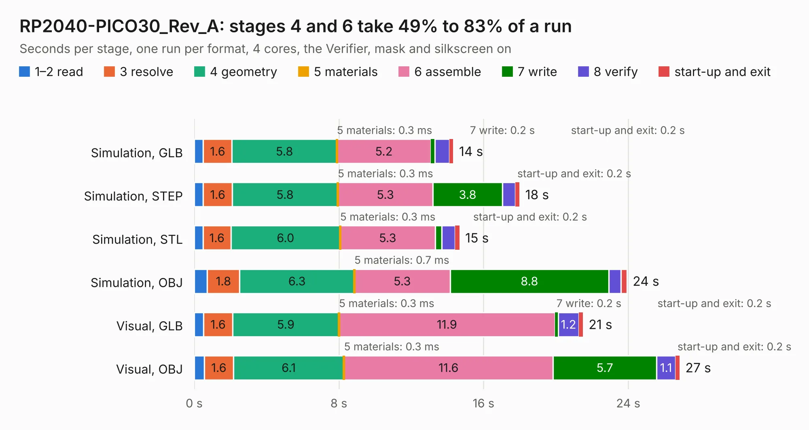

# 1961. RP2040-PICO30_Rev_A

Board 1,961 of the 3,119 of [Corpus Testing](../Corpus-Testing.md), on [Corpus Page 19](../CorpusTestingPages/Corpus-Testing-19.md#1961-rp2040-pico30_rev_a).

| Mode and format | 1–2 read | 3 resolve | 4 geometry | 5 materials | 6 assemble | 7 write | 8 verify | start-up and exit | Total |
|---|---:|---:|---:|---:|---:|---:|---:|---:|---:|
| Simulation, GLB | 0.5 | 1.6 | 5.8 | 0.3&nbsp;ms | 5.2 | 0.2 | 0.8 | 0.2 | 14.3 |
| Simulation, STEP | 0.5 | 1.6 | 5.8 | 0.3&nbsp;ms | 5.3 | 3.8 | 0.7 | 0.2 | 18.0 |
| Simulation, STL | 0.5 | 1.6 | 6.0 | 0.3&nbsp;ms | 5.3 | 0.4 | 0.7 | 0.2 | 14.7 |
| Simulation, OBJ | 0.7 | 1.8 | 6.3 | 0.7&nbsp;ms | 5.3 | 8.8 | 0.7 | 0.3 | 23.9 |
| Visual, GLB | 0.5 | 1.6 | 5.9 | 0.3&nbsp;ms | 11.9 | 0.2 | 1.2 | 0.2 | 21.5 |
| Visual, OBJ | 0.6 | 1.6 | 6.1 | 0.3&nbsp;ms | 11.6 | 5.7 | 1.1 | 0.2 | 26.8 |

<table align="center"><tr><td valign="top">

| Board | Repo: [OLIMEX/RP2040-PICO30](https://github.com/OLIMEX/RP2040-PICO30) Board: `RP2040-PICO30_Rev_A.kicad_pcb` |
|---|---|
| Folder | HARDWARE / RP2040-PICO30_Rev_A |
| Complexity | 296&nbsp;/&nbsp;1000 (size&nbsp;241, features&nbsp;55) |
| KESE&nbsp;features | through vias, slotted holes, filled zones, copper text |
| Tested | 9th November 2026 |
| Copper&nbsp;layers | 4 |
| File&nbsp;format | KiCad 5 (20171130) |
| Parts,&nbsp;tracks,&nbsp;vias | 53, 1,623, 105 |
| Triangles,&nbsp;simulation | 1,415,004 in 82 parts |
| Verifier | PASS in all six runs |

</td><td valign="top">

<table>
<tr><th>File type</th><th>File size</th><th>Peak memory used</th></tr>
<tr><th colspan="3" align="left">Simulation</th></tr>
<tr><td>GLB</td><td align="right">50&nbsp;MB</td><td align="right">492&nbsp;MB</td></tr>
<tr><td>STEP</td><td align="right">237&nbsp;MB</td><td align="right">626&nbsp;MB</td></tr>
<tr><td>STL</td><td align="right">71&nbsp;MB</td><td align="right">501&nbsp;MB</td></tr>
<tr><td>OBJ</td><td align="right">151&nbsp;MB</td><td align="right">981&nbsp;MB</td></tr>
<tr><th colspan="3" align="left">Visual</th></tr>
<tr><td>GLB</td><td align="right">32&nbsp;MB</td><td align="right">637&nbsp;MB</td></tr>
<tr><td>OBJ</td><td align="right">95&nbsp;MB</td><td align="right">766&nbsp;MB</td></tr>
</table>

</td></tr></table>

| Previous | Next |
|:---|---:|
| [1960. RP2040-PICO-PC_rev_D](b1960b_RP2040-PICO-PC_RP2040-PICO-PC-rev-D.md) | [1962. RP2040pc_Rev_B](b1962b_RP2040pc_RP2040pc-Rev-B.md) |
