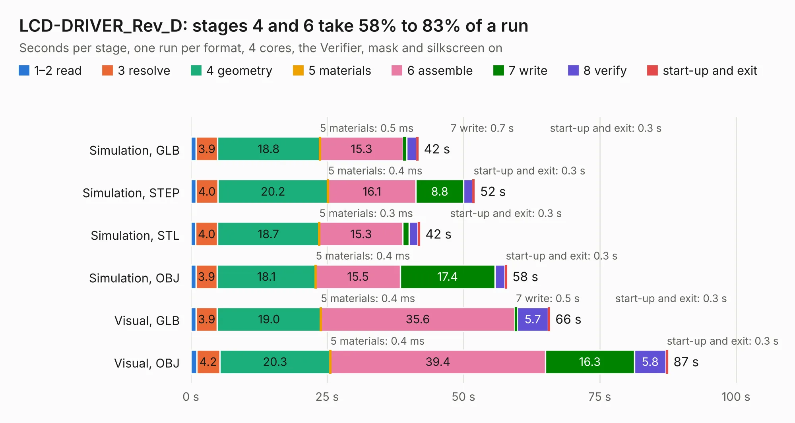

# 1962. LCD-DRIVER_Rev_D

Board 1,962 of the 3,139 of [Corpus Testing](../Corpus-Testing.md), on [Corpus Page 19](../CorpusTestingPages/Corpus-Testing-19.md#1962-lcd-driver_rev_d).

| Mode and format | 1–2 read | 3 resolve | 4 geometry | 5 materials | 6 assemble | 7 write | 8 verify | start-up and exit | Total |
|---|---:|---:|---:|---:|---:|---:|---:|---:|---:|
| Simulation, GLB | 1.0 | 3.9 | 18.8 | 0.5&nbsp;ms | 15.3 | 0.7 | 1.8 | 0.3 | 41.7 |
| Simulation, STEP | 0.9 | 4.0 | 20.2 | 0.4&nbsp;ms | 16.1 | 8.8 | 1.7 | 0.3 | 52.0 |
| Simulation, STL | 0.9 | 4.0 | 18.7 | 0.3&nbsp;ms | 15.3 | 1.1 | 1.6 | 0.3 | 42.0 |
| Simulation, OBJ | 0.9 | 3.9 | 18.1 | 0.4&nbsp;ms | 15.5 | 17.4 | 1.8 | 0.3 | 57.9 |
| Visual, GLB | 1.0 | 3.9 | 19.0 | 0.4&nbsp;ms | 35.6 | 0.5 | 5.7 | 0.3 | 65.8 |
| Visual, OBJ | 1.1 | 4.2 | 20.3 | 0.4&nbsp;ms | 39.4 | 16.3 | 5.8 | 0.3 | 87.5 |

<table align="center"><tr><td valign="top">

| Board | Repo: [OLIMEX/OLINUXINO](https://github.com/OLIMEX/OLINUXINO) Board: `LCD-DRIVER_Rev_D.kicad_pcb` |
|---|---|
| Folder | HARDWARE / LCDs / LCD-DRIVER / Hardware revision D |
| Complexity | 263&nbsp;/&nbsp;1000 (size&nbsp;218, features&nbsp;45) |
| KESE&nbsp;features | through vias, filled zones, copper text |
| Tested | 9th November 2026 |
| Copper&nbsp;layers | 2 |
| File&nbsp;format | KiCad 5 (20171130) |
| Parts,&nbsp;tracks,&nbsp;vias | 134, 6,106, 746 |
| Triangles,&nbsp;simulation | 2,775,296 in 106 parts |
| Verifier | PASS in all six runs |

</td><td valign="top">

<table>
<tr><th>File type</th><th>File size</th><th>Peak memory used</th></tr>
<tr><th colspan="3" align="left">Simulation</th></tr>
<tr><td>GLB</td><td align="right">98&nbsp;MB</td><td align="right">1.0&nbsp;GB</td></tr>
<tr><td>STEP</td><td align="right">488&nbsp;MB</td><td align="right">1.4&nbsp;GB</td></tr>
<tr><td>STL</td><td align="right">139&nbsp;MB</td><td align="right">1.0&nbsp;GB</td></tr>
<tr><td>OBJ</td><td align="right">299&nbsp;MB</td><td align="right">1.9&nbsp;GB</td></tr>
<tr><th colspan="3" align="left">Visual</th></tr>
<tr><td>GLB</td><td align="right">87&nbsp;MB</td><td align="right">1.4&nbsp;GB</td></tr>
<tr><td>OBJ</td><td align="right">273&nbsp;MB</td><td align="right">1.9&nbsp;GB</td></tr>
</table>

</td></tr></table>

| Previous | Next |
|:---|---:|
| [1961. LCD-DRIVER_Rev_C](b1961b_OLINUXINO_LCD-DRIVER-Rev-C.md) | [1963. LCD-OLinuXino-15.6FHD_Rev_H](b1963b_OLINUXINO_LCD-OLinuXino-15-6FHD-Rev-H.md) |
