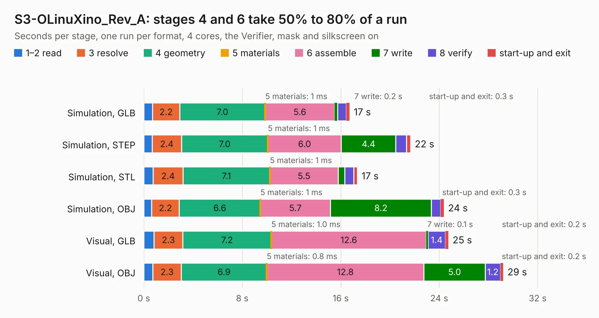

# 1962. S3-OLinuXino_Rev_A

Board 1,962 of the 3,108 of [Corpus Testing](../Corpus-Testing.md), on [Corpus Page 19](../CorpusTestingPages/Corpus-Testing-19.md#1962-s3-olinuxino_rev_a).

| Mode and format | 1–2 read | 3 resolve | 4 geometry | 5 materials | 6 assemble | 7 write | 8 verify | start-up and exit | Total |
|---|---:|---:|---:|---:|---:|---:|---:|---:|---:|
| Simulation, GLB | 0.7 | 2.2 | 7.0 | 1&nbsp;ms | 5.6 | 0.2 | 0.7 | 0.3 | 16.7 |
| Simulation, STEP | 0.7 | 2.4 | 7.0 | 1&nbsp;ms | 6.0 | 4.4 | 0.9 | 0.3 | 21.7 |
| Simulation, STL | 0.8 | 2.4 | 7.1 | 1&nbsp;ms | 5.5 | 0.5 | 0.7 | 0.3 | 17.3 |
| Simulation, OBJ | 0.6 | 2.2 | 6.6 | 1&nbsp;ms | 5.7 | 8.2 | 0.8 | 0.3 | 24.4 |
| Visual, GLB | 0.8 | 2.3 | 7.2 | 1.0&nbsp;ms | 12.6 | 0.1 | 1.4 | 0.2 | 24.7 |
| Visual, OBJ | 0.7 | 2.3 | 6.9 | 0.8&nbsp;ms | 12.8 | 5.0 | 1.2 | 0.2 | 29.2 |

<table align="center"><tr><td valign="top">

| Board | Repo: [OLIMEX/S3-OLinuXino](https://github.com/OLIMEX/S3-OLinuXino) Board: `S3-OLinuXino_Rev_A.kicad_pcb` |
|---|---|
| Folder | HARDWARE / S3-OLinuXino-Rev_A-preliminary |
| Complexity | 176&nbsp;/&nbsp;1000 (size&nbsp;156, features&nbsp;20) |
| KESE&nbsp;features | slotted holes, copper text |
| Tested | 9th November 2026 |
| Copper&nbsp;layers | 6 |
| File&nbsp;format | KiCad 6 (20190905) |
| Parts,&nbsp;tracks,&nbsp;vias | 222, 0, 0 |
| Triangles,&nbsp;simulation | 1,309,978 in 308 parts |
| Note | mostly unrouted |
| Verifier | PASS in all six runs |

</td><td valign="top">

<table>
<tr><th>File type</th><th>File size</th><th>Peak memory used</th></tr>
<tr><th colspan="3" align="left">Simulation</th></tr>
<tr><td>GLB</td><td align="right">45&nbsp;MB</td><td align="right">542&nbsp;MB</td></tr>
<tr><td>STEP</td><td align="right">188&nbsp;MB</td><td align="right">634&nbsp;MB</td></tr>
<tr><td>STL</td><td align="right">66&nbsp;MB</td><td align="right">513&nbsp;MB</td></tr>
<tr><td>OBJ</td><td align="right">140&nbsp;MB</td><td align="right">925&nbsp;MB</td></tr>
<tr><th colspan="3" align="left">Visual</th></tr>
<tr><td>GLB</td><td align="right">28&nbsp;MB</td><td align="right">630&nbsp;MB</td></tr>
<tr><td>OBJ</td><td align="right">84&nbsp;MB</td><td align="right">662&nbsp;MB</td></tr>
</table>

</td></tr></table>

| Previous | Next |
|:---|---:|
| [1961. exposed_power_rails](b1961b_RVPC_exposed-power-rails.md) | [1963. S3-OLinuXino_Rev_A](b1963b_S3-OLinuXino_HARDWARE-S3-OLinuXino-Rev-A-release_S3-OLinuXino-Rev-A.md) |
