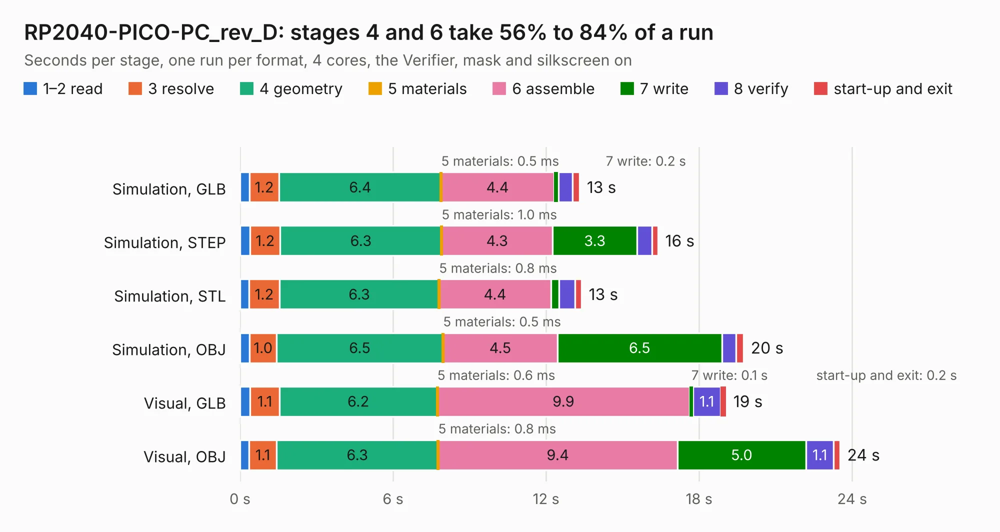

# 1964. RP2040-PICO-PC_rev_D

Board 1,964 of the 3,123 of [Corpus Testing](../Corpus-Testing.md), on [Corpus Page 19](../CorpusTestingPages/Corpus-Testing-19.md#1964-rp2040-pico-pc_rev_d).

| Mode and format | 1–2 read | 3 resolve | 4 geometry | 5 materials | 6 assemble | 7 write | 8 verify | start-up and exit | Total |
|---|---:|---:|---:|---:|---:|---:|---:|---:|---:|
| Simulation, GLB | 0.4 | 1.2 | 6.4 | 0.5&nbsp;ms | 4.4 | 0.2 | 0.5 | 0.3 | 13.3 |
| Simulation, STEP | 0.4 | 1.2 | 6.3 | 1.0&nbsp;ms | 4.3 | 3.3 | 0.6 | 0.2 | 16.4 |
| Simulation, STL | 0.3 | 1.2 | 6.3 | 0.8&nbsp;ms | 4.4 | 0.3 | 0.6 | 0.3 | 13.4 |
| Simulation, OBJ | 0.4 | 1.0 | 6.5 | 0.5&nbsp;ms | 4.5 | 6.5 | 0.6 | 0.3 | 19.7 |
| Visual, GLB | 0.4 | 1.1 | 6.2 | 0.6&nbsp;ms | 9.9 | 0.1 | 1.1 | 0.2 | 19.1 |
| Visual, OBJ | 0.4 | 1.1 | 6.3 | 0.8&nbsp;ms | 9.4 | 5.0 | 1.1 | 0.2 | 23.5 |

<table align="center"><tr><td valign="top">

| Board | Repo: [OLIMEX/RP2040-PICO-PC](https://github.com/OLIMEX/RP2040-PICO-PC) Board: `RP2040-PICO-PC_rev_D.kicad_pcb` |
|---|---|
| Folder | HARDWARE / RP2040-PICO-PC hardware revision D |
| Complexity | 224&nbsp;/&nbsp;1000 (size&nbsp;179, features&nbsp;45) |
| KESE&nbsp;features | through vias, slotted holes, filled zones |
| Tested | 9th November 2026 |
| Copper&nbsp;layers | 2 |
| File&nbsp;format | KiCad 5 (20171130) |
| Parts,&nbsp;tracks,&nbsp;vias | 61, 934, 110 |
| Triangles,&nbsp;simulation | 1,133,746 in 85 parts |
| Verifier | PASS in all six runs |

</td><td valign="top">

<table>
<tr><th>File type</th><th>File size</th><th>Peak memory used</th></tr>
<tr><th colspan="3" align="left">Simulation</th></tr>
<tr><td>GLB</td><td align="right">40&nbsp;MB</td><td align="right">499&nbsp;MB</td></tr>
<tr><td>STEP</td><td align="right">201&nbsp;MB</td><td align="right">598&nbsp;MB</td></tr>
<tr><td>STL</td><td align="right">57&nbsp;MB</td><td align="right">489&nbsp;MB</td></tr>
<tr><td>OBJ</td><td align="right">118&nbsp;MB</td><td align="right">811&nbsp;MB</td></tr>
<tr><th colspan="3" align="left">Visual</th></tr>
<tr><td>GLB</td><td align="right">29&nbsp;MB</td><td align="right">681&nbsp;MB</td></tr>
<tr><td>OBJ</td><td align="right">88&nbsp;MB</td><td align="right">694&nbsp;MB</td></tr>
</table>

</td></tr></table>

| Previous | Next |
|:---|---:|
| [1963. RP2040-PICO-PC_rev_C](b1963b_RP2040-PICO-PC_RP2040-PICO-PC-rev-C.md) | [1965. RP2040-PICO30_Rev_A](b1965b_RP2040-PICO30_RP2040-PICO30-Rev-A.md) |
