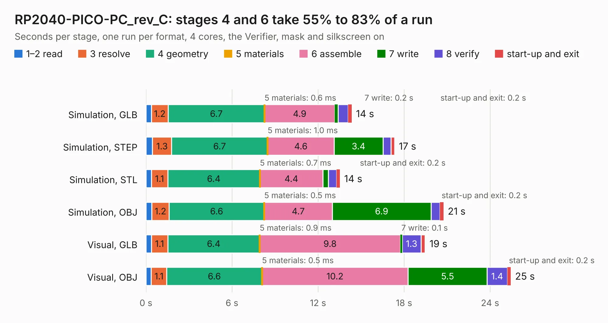

# 1965. RP2040-PICO-PC_rev_C

Board 1,965 of the 3,128 of [Corpus Testing](../Corpus-Testing.md), on [Corpus Page 19](../CorpusTestingPages/Corpus-Testing-19.md#1965-rp2040-pico-pc_rev_c).

| Mode and format | 1–2 read | 3 resolve | 4 geometry | 5 materials | 6 assemble | 7 write | 8 verify | start-up and exit | Total |
|---|---:|---:|---:|---:|---:|---:|---:|---:|---:|
| Simulation, GLB | 0.4 | 1.2 | 6.7 | 0.6&nbsp;ms | 4.9 | 0.2 | 0.7 | 0.2 | 14.3 |
| Simulation, STEP | 0.5 | 1.3 | 6.7 | 1.0&nbsp;ms | 4.6 | 3.4 | 0.5 | 0.3 | 17.3 |
| Simulation, STL | 0.4 | 1.1 | 6.4 | 0.7&nbsp;ms | 4.4 | 0.4 | 0.6 | 0.2 | 13.5 |
| Simulation, OBJ | 0.4 | 1.2 | 6.6 | 0.5&nbsp;ms | 4.7 | 6.9 | 0.6 | 0.2 | 20.7 |
| Visual, GLB | 0.4 | 1.1 | 6.4 | 0.9&nbsp;ms | 9.8 | 0.1 | 1.3 | 0.3 | 19.5 |
| Visual, OBJ | 0.4 | 1.1 | 6.6 | 0.5&nbsp;ms | 10.2 | 5.5 | 1.4 | 0.2 | 25.4 |

<table align="center"><tr><td valign="top">

| Board | Repo: [OLIMEX/RP2040-PICO-PC](https://github.com/OLIMEX/RP2040-PICO-PC) Board: `RP2040-PICO-PC_rev_C.kicad_pcb` |
|---|---|
| Folder | HARDWARE / RP2040-PICO-PC hardware revision C |
| Complexity | 223&nbsp;/&nbsp;1000 (size&nbsp;178, features&nbsp;45) |
| KESE&nbsp;features | through vias, slotted holes, filled zones |
| Tested | 9th November 2026 |
| Copper&nbsp;layers | 2 |
| File&nbsp;format | KiCad 5 (20171130) |
| Parts,&nbsp;tracks,&nbsp;vias | 61, 893, 105 |
| Triangles,&nbsp;simulation | 1,135,846 in 85 parts |
| Verifier | PASS in all six runs |

</td><td valign="top">

<table>
<tr><th>File type</th><th>File size</th><th>Peak memory used</th></tr>
<tr><th colspan="3" align="left">Simulation</th></tr>
<tr><td>GLB</td><td align="right">40&nbsp;MB</td><td align="right">513&nbsp;MB</td></tr>
<tr><td>STEP</td><td align="right">201&nbsp;MB</td><td align="right">565&nbsp;MB</td></tr>
<tr><td>STL</td><td align="right">57&nbsp;MB</td><td align="right">511&nbsp;MB</td></tr>
<tr><td>OBJ</td><td align="right">118&nbsp;MB</td><td align="right">815&nbsp;MB</td></tr>
<tr><th colspan="3" align="left">Visual</th></tr>
<tr><td>GLB</td><td align="right">29&nbsp;MB</td><td align="right">635&nbsp;MB</td></tr>
<tr><td>OBJ</td><td align="right">87&nbsp;MB</td><td align="right">669&nbsp;MB</td></tr>
</table>

</td></tr></table>

| Previous | Next |
|:---|---:|
| [1964. RP2040-PICO-PC_rev_B](b1964b_RP2040-PICO-PC_RP2040-PICO-PC-rev-B.md) | [1966. RP2040-PICO-PC_rev_D](b1966b_RP2040-PICO-PC_RP2040-PICO-PC-rev-D.md) |
