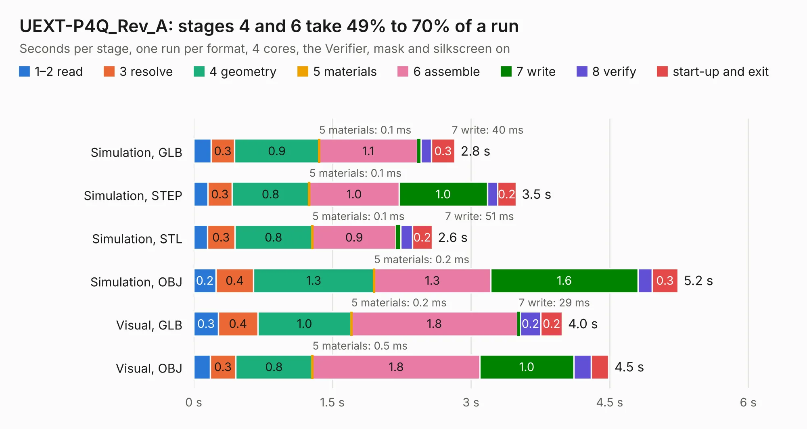

# 1967. UEXT-P4Q_Rev_A

Board 1,967 of the 3,102 of [Corpus Testing](../Corpus-Testing.md), on [Corpus Page 19](../CorpusTestingPages/Corpus-Testing-19.md#1967-uext-p4q_rev_a).

| Mode and format | 1–2 read | 3 resolve | 4 geometry | 5 materials | 6 assemble | 7 write | 8 verify | start-up and exit | Total |
|---|---:|---:|---:|---:|---:|---:|---:|---:|---:|
| Simulation, GLB | 0.2 | 0.3 | 0.9 | 0.1&nbsp;ms | 1.1 | 40&nbsp;ms | 0.1 | 0.3 | 2.8 |
| Simulation, STEP | 0.2 | 0.3 | 0.8 | 0.1&nbsp;ms | 1.0 | 1.0 | 0.1 | 0.2 | 3.5 |
| Simulation, STL | 0.1 | 0.3 | 0.8 | 0.1&nbsp;ms | 0.9 | 51&nbsp;ms | 0.1 | 0.2 | 2.6 |
| Simulation, OBJ | 0.2 | 0.4 | 1.3 | 0.2&nbsp;ms | 1.3 | 1.6 | 0.2 | 0.3 | 5.2 |
| Visual, GLB | 0.3 | 0.4 | 1.0 | 0.2&nbsp;ms | 1.8 | 29&nbsp;ms | 0.2 | 0.2 | 4.0 |
| Visual, OBJ | 0.2 | 0.3 | 0.8 | 0.5&nbsp;ms | 1.8 | 1.0 | 0.2 | 0.2 | 4.5 |

<table align="center"><tr><td valign="top">

| Board | Repo: [OLIMEX/UEXT-ADAPTERS](https://github.com/OLIMEX/UEXT-ADAPTERS) Board: `UEXT-P4Q_Rev_A.kicad_pcb` |
|---|---|
| Folder | UEXT-P4Q / Hardware |
| Complexity | 185&nbsp;/&nbsp;1000 (size&nbsp;130, features&nbsp;55) |
| KESE&nbsp;features | through vias, rounded, trapezoid or chamfered pads, filled zones, curved board outline |
| Tested | 9th November 2026 |
| Copper&nbsp;layers | 2 |
| File&nbsp;format | KiCad 5 (20171130) |
| Parts,&nbsp;tracks,&nbsp;vias | 6, 149, 44 |
| Triangles,&nbsp;simulation | 216,154 in 21 parts |
| Verifier | PASS in all six runs |

</td><td valign="top">

<table>
<tr><th>File type</th><th>File size</th><th>Peak memory used</th></tr>
<tr><th colspan="3" align="left">Simulation</th></tr>
<tr><td>GLB</td><td align="right">7.8&nbsp;MB</td><td align="right">222&nbsp;MB</td></tr>
<tr><td>STEP</td><td align="right">37&nbsp;MB</td><td align="right">250&nbsp;MB</td></tr>
<tr><td>STL</td><td align="right">11&nbsp;MB</td><td align="right">222&nbsp;MB</td></tr>
<tr><td>OBJ</td><td align="right">22&nbsp;MB</td><td align="right">222&nbsp;MB</td></tr>
<tr><th colspan="3" align="left">Visual</th></tr>
<tr><td>GLB</td><td align="right">6.5&nbsp;MB</td><td align="right">202&nbsp;MB</td></tr>
<tr><td>OBJ</td><td align="right">19&nbsp;MB</td><td align="right">200&nbsp;MB</td></tr>
</table>

</td></tr></table>

| Previous | Next |
|:---|---:|
| [1966. UEXT-MPQ_Rev_A](b1966b_UEXT-ADAPTERS_UEXT-MPQ-Rev-A.md) | [1968. UEXT-PQ_Rev_A](b1968b_UEXT-ADAPTERS_UEXT-PQ-Rev-A.md) |
