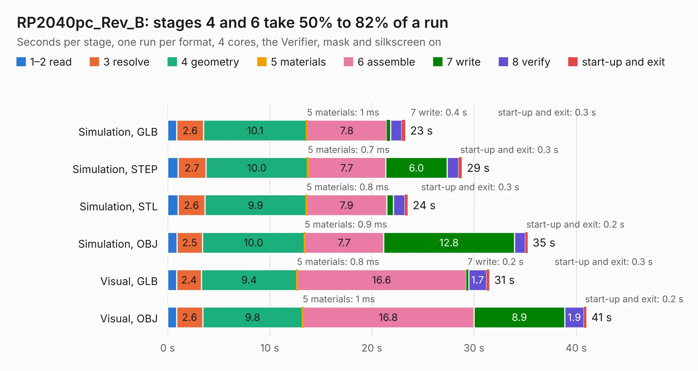

# 1968. RP2040pc_Rev_B

Board 1,968 of the 3,128 of [Corpus Testing](../Corpus-Testing.md), on [Corpus Page 19](../CorpusTestingPages/Corpus-Testing-19.md#1968-rp2040pc_rev_b).

| Mode and format | 1–2 read | 3 resolve | 4 geometry | 5 materials | 6 assemble | 7 write | 8 verify | start-up and exit | Total |
|---|---:|---:|---:|---:|---:|---:|---:|---:|---:|
| Simulation, GLB | 0.9 | 2.6 | 10.1 | 1&nbsp;ms | 7.8 | 0.4 | 1.1 | 0.3 | 23.3 |
| Simulation, STEP | 1.0 | 2.7 | 10.0 | 0.7&nbsp;ms | 7.7 | 6.0 | 1.1 | 0.3 | 28.8 |
| Simulation, STL | 1.0 | 2.6 | 9.9 | 0.8&nbsp;ms | 7.9 | 0.7 | 1.1 | 0.3 | 23.5 |
| Simulation, OBJ | 0.9 | 2.5 | 10.0 | 0.9&nbsp;ms | 7.7 | 12.8 | 1.1 | 0.2 | 35.2 |
| Visual, GLB | 0.9 | 2.4 | 9.4 | 0.8&nbsp;ms | 16.6 | 0.2 | 1.7 | 0.3 | 31.5 |
| Visual, OBJ | 0.9 | 2.6 | 9.8 | 1&nbsp;ms | 16.8 | 8.9 | 1.9 | 0.2 | 41.0 |

<table align="center"><tr><td valign="top">

| Board | Repo: [OLIMEX/RP2040pc](https://github.com/OLIMEX/RP2040pc) Board: `RP2040pc_Rev_B.kicad_pcb` |
|---|---|
| Folder | HARDWARE / RP2040pc-REV.B |
| Complexity | 372&nbsp;/&nbsp;1000 (size&nbsp;257, features&nbsp;115) |
| KESE&nbsp;features | through vias, slotted holes, rounded, trapezoid or chamfered pads, filled zones, copper text, knockout text, stack-up, dielectric εr and tanδ, mask and silkscreen colours |
| Tested | 9th November 2026 |
| Copper&nbsp;layers | 4 |
| File&nbsp;format | KiCad 7 (20221018) |
| Parts,&nbsp;tracks,&nbsp;vias | 142, 2,121, 239 |
| Triangles,&nbsp;simulation | 2,204,422 in 150 parts |
| Verifier | PASS in all six runs |

</td><td valign="top">

<table>
<tr><th>File type</th><th>File size</th><th>Peak memory used</th></tr>
<tr><th colspan="3" align="left">Simulation</th></tr>
<tr><td>GLB</td><td align="right">78&nbsp;MB</td><td align="right">837&nbsp;MB</td></tr>
<tr><td>STEP</td><td align="right">379&nbsp;MB</td><td align="right">957&nbsp;MB</td></tr>
<tr><td>STL</td><td align="right">110&nbsp;MB</td><td align="right">820&nbsp;MB</td></tr>
<tr><td>OBJ</td><td align="right">238&nbsp;MB</td><td align="right">1.6&nbsp;GB</td></tr>
<tr><th colspan="3" align="left">Visual</th></tr>
<tr><td>GLB</td><td align="right">54&nbsp;MB</td><td align="right">958&nbsp;MB</td></tr>
<tr><td>OBJ</td><td align="right">165&nbsp;MB</td><td align="right">1.2&nbsp;GB</td></tr>
</table>

</td></tr></table>

| Previous | Next |
|:---|---:|
| [1967. RP2040-PICO30_Rev_A](b1967b_RP2040-PICO30_RP2040-PICO30-Rev-A.md) | [1969. PICO2-BB48_Rev_A](b1969b_RP2350-PICO2-BB48_PICO2-BB48-Rev-A.md) |
