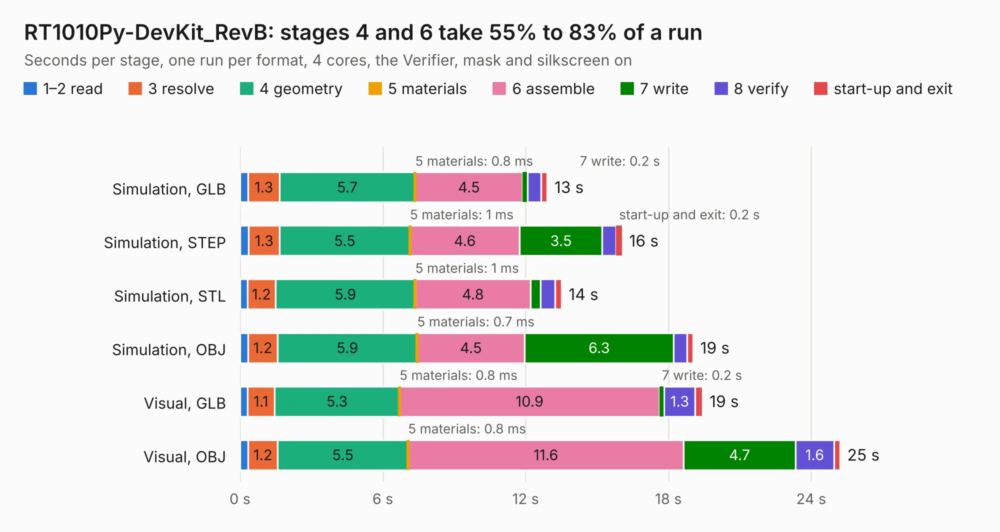

# 1968. RT1010Py-DevKit_RevB

Board 1,968 of the 3,118 of [Corpus Testing](../Corpus-Testing.md), on [Corpus Page 19](../CorpusTestingPages/Corpus-Testing-19.md#1968-rt1010py-devkit_revb).

| Mode and format | 1–2 read | 3 resolve | 4 geometry | 5 materials | 6 assemble | 7 write | 8 verify | start-up and exit | Total |
|---|---:|---:|---:|---:|---:|---:|---:|---:|---:|
| Simulation, GLB | 0.3 | 1.3 | 5.7 | 0.8&nbsp;ms | 4.5 | 0.2 | 0.6 | 0.3 | 12.9 |
| Simulation, STEP | 0.4 | 1.3 | 5.5 | 1&nbsp;ms | 4.6 | 3.5 | 0.6 | 0.2 | 16.1 |
| Simulation, STL | 0.3 | 1.2 | 5.9 | 1&nbsp;ms | 4.8 | 0.4 | 0.6 | 0.3 | 13.5 |
| Simulation, OBJ | 0.3 | 1.2 | 5.9 | 0.7&nbsp;ms | 4.5 | 6.3 | 0.6 | 0.3 | 19.0 |
| Visual, GLB | 0.3 | 1.1 | 5.3 | 0.8&nbsp;ms | 10.9 | 0.2 | 1.3 | 0.3 | 19.4 |
| Visual, OBJ | 0.3 | 1.2 | 5.5 | 0.8&nbsp;ms | 11.6 | 4.7 | 1.6 | 0.3 | 25.2 |

<table align="center"><tr><td valign="top">

| Board | Repo: [OLIMEX/RT1010Py-DevKit](https://github.com/OLIMEX/RT1010Py-DevKit) Board: `RT1010Py-DevKit_RevB.kicad_pcb` |
|---|---|
| Folder | HARDWARE / RT1010Py-DevKit-B |
| Complexity | 231&nbsp;/&nbsp;1000 (size&nbsp;176, features&nbsp;55) |
| KESE&nbsp;features | through vias, slotted holes, rounded, trapezoid or chamfered pads, filled zones |
| Tested | 9th November 2026 |
| Copper&nbsp;layers | 2 |
| File&nbsp;format | KiCad 5 (20171130) |
| Parts,&nbsp;tracks,&nbsp;vias | 38, 1,028, 140 |
| Triangles,&nbsp;simulation | 1,252,158 in 74 parts |
| Verifier | PASS in all six runs |

</td><td valign="top">

<table>
<tr><th>File type</th><th>File size</th><th>Peak memory used</th></tr>
<tr><th colspan="3" align="left">Simulation</th></tr>
<tr><td>GLB</td><td align="right">44&nbsp;MB</td><td align="right">554&nbsp;MB</td></tr>
<tr><td>STEP</td><td align="right">231&nbsp;MB</td><td align="right">620&nbsp;MB</td></tr>
<tr><td>STL</td><td align="right">63&nbsp;MB</td><td align="right">533&nbsp;MB</td></tr>
<tr><td>OBJ</td><td align="right">130&nbsp;MB</td><td align="right">853&nbsp;MB</td></tr>
<tr><th colspan="3" align="left">Visual</th></tr>
<tr><td>GLB</td><td align="right">34&nbsp;MB</td><td align="right">673&nbsp;MB</td></tr>
<tr><td>OBJ</td><td align="right">101&nbsp;MB</td><td align="right">736&nbsp;MB</td></tr>
</table>

</td></tr></table>

| Previous | Next |
|:---|---:|
| [1967. RT1010Py_Rev.C](b1967b_RT1010Py_RT1010Py-Rev-C.md) | [1969. RVPC_Rev_A](b1969b_RVPC_RVPC-Rev-A.md) |
