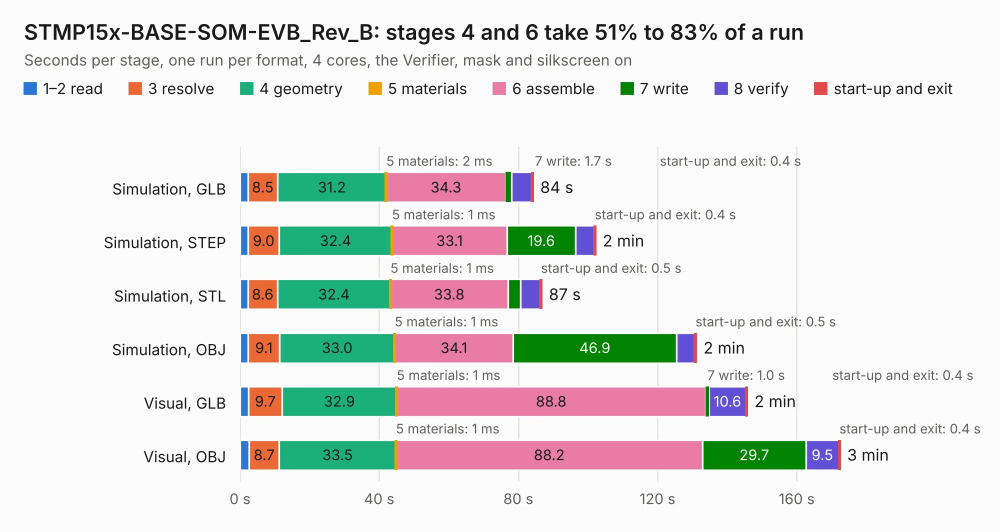

# 1968. STMP15x-BASE-SOM-EVB_Rev_B

Board 1,968 of the 3,109 of [Corpus Testing](../Corpus-Testing.md), on [Corpus Page 19](../CorpusTestingPages/Corpus-Testing-19.md#1968-stmp15x-base-som-evb_rev_b).

| Mode and format | 1–2 read | 3 resolve | 4 geometry | 5 materials | 6 assemble | 7 write | 8 verify | start-up and exit | Total |
|---|---:|---:|---:|---:|---:|---:|---:|---:|---:|
| Simulation, GLB | 2.3 | 8.5 | 31.2 | 2&nbsp;ms | 34.3 | 1.7 | 5.7 | 0.4 | 84.2 |
| Simulation, STEP | 2.3 | 9.0 | 32.4 | 1&nbsp;ms | 33.1 | 19.6 | 5.4 | 0.4 | 102.2 |
| Simulation, STL | 2.3 | 8.6 | 32.4 | 1&nbsp;ms | 33.8 | 3.5 | 5.7 | 0.5 | 86.7 |
| Simulation, OBJ | 2.3 | 9.1 | 33.0 | 1&nbsp;ms | 34.1 | 46.9 | 5.2 | 0.5 | 131.1 |
| Visual, GLB | 2.4 | 9.7 | 32.9 | 1&nbsp;ms | 88.8 | 1.0 | 10.6 | 0.4 | 145.8 |
| Visual, OBJ | 2.6 | 8.7 | 33.5 | 1&nbsp;ms | 88.2 | 29.7 | 9.5 | 0.4 | 172.5 |

<table align="center"><tr><td valign="top">

| Board | Repo: [OLIMEX/STMP157-BASE-SOM-EVB](https://github.com/OLIMEX/STMP157-BASE-SOM-EVB) Board: `STMP15x-BASE-SOM-EVB_Rev_B.kicad_pcb` |
|---|---|
| Folder | HARDWARE / STMP157-BASE-SOM-EVB-Rev.B |
| Complexity | 363&nbsp;/&nbsp;1000 (size&nbsp;298, features&nbsp;65) |
| KESE&nbsp;features | through vias, slotted holes, rounded, trapezoid or chamfered pads, filled zones, copper text |
| Tested | 9th November 2026 |
| Copper&nbsp;layers | 4 |
| File&nbsp;format | KiCad 5 (20171130) |
| Parts,&nbsp;tracks,&nbsp;vias | 263, 7,876, 1,294 |
| Triangles,&nbsp;simulation | 8,488,618 in 387 parts |
| Verifier | PASS in all six runs |

</td><td valign="top">

<table>
<tr><th>File type</th><th>File size</th><th>Peak memory used</th></tr>
<tr><th colspan="3" align="left">Simulation</th></tr>
<tr><td>GLB</td><td align="right">294&nbsp;MB</td><td align="right">2.4&nbsp;GB</td></tr>
<tr><td>STEP</td><td align="right">1.3&nbsp;GB</td><td align="right">3.1&nbsp;GB</td></tr>
<tr><td>STL</td><td align="right">424&nbsp;MB</td><td align="right">2.3&nbsp;GB</td></tr>
<tr><td>OBJ</td><td align="right">930&nbsp;MB</td><td align="right">5.4&nbsp;GB</td></tr>
<tr><th colspan="3" align="left">Visual</th></tr>
<tr><td>GLB</td><td align="right">203&nbsp;MB</td><td align="right">3.1&nbsp;GB</td></tr>
<tr><td>OBJ</td><td align="right">652&nbsp;MB</td><td align="right">4.2&nbsp;GB</td></tr>
</table>

</td></tr></table>

| Previous | Next |
|:---|---:|
| [1967. STMP1-OLinuXino_Rev_A](b1967b_STMP1-OLinuXino_STMP1-OLinuXino-Rev-A.md) | [1969. STMP15x-SHIELD_Rev_A](b1969b_STMP15X-SHIELD_STMP15x-SHIELD-Rev-A.md) |
