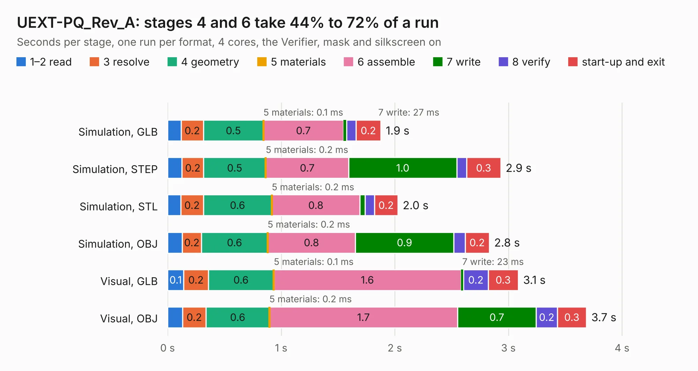

# 1968. UEXT-PQ_Rev_A

Board 1,968 of the 3,102 of [Corpus Testing](../Corpus-Testing.md), on [Corpus Page 19](../CorpusTestingPages/Corpus-Testing-19.md#1968-uext-pq_rev_a).

| Mode and format | 1–2 read | 3 resolve | 4 geometry | 5 materials | 6 assemble | 7 write | 8 verify | start-up and exit | Total |
|---|---:|---:|---:|---:|---:|---:|---:|---:|---:|
| Simulation, GLB | 0.1 | 0.2 | 0.5 | 0.1&nbsp;ms | 0.7 | 27&nbsp;ms | 83&nbsp;ms | 0.2 | 1.9 |
| Simulation, STEP | 0.1 | 0.2 | 0.5 | 0.2&nbsp;ms | 0.7 | 1.0 | 86&nbsp;ms | 0.3 | 2.9 |
| Simulation, STL | 0.1 | 0.2 | 0.6 | 0.2&nbsp;ms | 0.8 | 46&nbsp;ms | 82&nbsp;ms | 0.2 | 2.0 |
| Simulation, OBJ | 0.1 | 0.2 | 0.6 | 0.2&nbsp;ms | 0.8 | 0.9 | 0.1 | 0.2 | 2.8 |
| Visual, GLB | 0.1 | 0.2 | 0.6 | 0.1&nbsp;ms | 1.6 | 23&nbsp;ms | 0.2 | 0.3 | 3.1 |
| Visual, OBJ | 0.1 | 0.2 | 0.6 | 0.2&nbsp;ms | 1.7 | 0.7 | 0.2 | 0.3 | 3.7 |

<table align="center"><tr><td valign="top">

| Board | Repo: [OLIMEX/UEXT-ADAPTERS](https://github.com/OLIMEX/UEXT-ADAPTERS) Board: `UEXT-PQ_Rev_A.kicad_pcb` |
|---|---|
| Folder | UEXT-PQ / Hardware |
| Complexity | 171&nbsp;/&nbsp;1000 (size&nbsp;116, features&nbsp;55) |
| KESE&nbsp;features | through vias, rounded, trapezoid or chamfered pads, filled zones, curved board outline |
| Tested | 9th November 2026 |
| Copper&nbsp;layers | 2 |
| File&nbsp;format | KiCad 5 (20171130) |
| Parts,&nbsp;tracks,&nbsp;vias | 3, 82, 29 |
| Triangles,&nbsp;simulation | 160,958 in 21 parts |
| Verifier | PASS in all six runs |

</td><td valign="top">

<table>
<tr><th>File type</th><th>File size</th><th>Peak memory used</th></tr>
<tr><th colspan="3" align="left">Simulation</th></tr>
<tr><td>GLB</td><td align="right">5.7&nbsp;MB</td><td align="right">211&nbsp;MB</td></tr>
<tr><td>STEP</td><td align="right">28&nbsp;MB</td><td align="right">222&nbsp;MB</td></tr>
<tr><td>STL</td><td align="right">8.0&nbsp;MB</td><td align="right">204&nbsp;MB</td></tr>
<tr><td>OBJ</td><td align="right">16&nbsp;MB</td><td align="right">207&nbsp;MB</td></tr>
<tr><th colspan="3" align="left">Visual</th></tr>
<tr><td>GLB</td><td align="right">4.7&nbsp;MB</td><td align="right">173&nbsp;MB</td></tr>
<tr><td>OBJ</td><td align="right">13&nbsp;MB</td><td align="right">183&nbsp;MB</td></tr>
</table>

</td></tr></table>

| Previous | Next |
|:---|---:|
| [1967. UEXT-P4Q_Rev_A](b1967b_UEXT-ADAPTERS_UEXT-P4Q-Rev-A.md) | [1969. UEXT-LVL-SHIFT_Rev_A](b1969b_UEXT-LVL-SHIFT_UEXT-LVL-SHIFT-Rev-A.md) |
