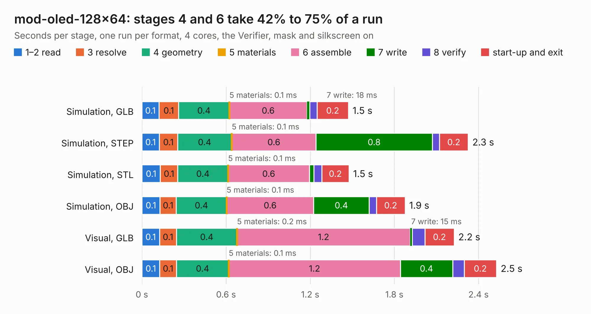

# 1970. mod-oled-128x64

Board 1,970 of the 3,101 of [Corpus Testing](../Corpus-Testing.md), on [Corpus Page 19](../CorpusTestingPages/Corpus-Testing-19.md#1970-mod-oled-128x64).

| Mode and format | 1–2 read | 3 resolve | 4 geometry | 5 materials | 6 assemble | 7 write | 8 verify | start-up and exit | Total |
|---|---:|---:|---:|---:|---:|---:|---:|---:|---:|
| Simulation, GLB | 0.1 | 0.1 | 0.4 | 0.1&nbsp;ms | 0.6 | 18&nbsp;ms | 53&nbsp;ms | 0.2 | 1.5 |
| Simulation, STEP | 0.1 | 0.1 | 0.4 | 0.1&nbsp;ms | 0.6 | 0.8 | 51&nbsp;ms | 0.2 | 2.3 |
| Simulation, STL | 0.1 | 0.1 | 0.4 | 0.1&nbsp;ms | 0.6 | 32&nbsp;ms | 56&nbsp;ms | 0.2 | 1.5 |
| Simulation, OBJ | 0.1 | 0.1 | 0.4 | 0.1&nbsp;ms | 0.6 | 0.4 | 53&nbsp;ms | 0.2 | 1.9 |
| Visual, GLB | 0.1 | 0.1 | 0.4 | 0.2&nbsp;ms | 1.2 | 15&nbsp;ms | 90&nbsp;ms | 0.2 | 2.2 |
| Visual, OBJ | 0.1 | 0.1 | 0.4 | 0.1&nbsp;ms | 1.2 | 0.4 | 82&nbsp;ms | 0.2 | 2.5 |

<table align="center"><tr><td valign="top">

| Board | Repo: [OLIMEX/UEXT-MODULES](https://github.com/OLIMEX/UEXT-MODULES) Board: `mod-oled-128x64.kicad_pcb` |
|---|---|
| Folder | MOD-OLED-128x64 |
| Complexity | 165&nbsp;/&nbsp;1000 (size&nbsp;130, features&nbsp;35) |
| KESE&nbsp;features | through vias, filled zones |
| Tested | 9th November 2026 |
| Copper&nbsp;layers | 2 |
| File&nbsp;format | KiCad 4 (4) |
| Parts,&nbsp;tracks,&nbsp;vias | 11, 174, 7 |
| Triangles,&nbsp;simulation | 69,228 in 29 parts |
| Verifier | PASS in all six runs |

</td><td valign="top">

<table>
<tr><th>File type</th><th>File size</th><th>Peak memory used</th></tr>
<tr><th colspan="3" align="left">Simulation</th></tr>
<tr><td>GLB</td><td align="right">2.6&nbsp;MB</td><td align="right">181&nbsp;MB</td></tr>
<tr><td>STEP</td><td align="right">15&nbsp;MB</td><td align="right">189&nbsp;MB</td></tr>
<tr><td>STL</td><td align="right">3.5&nbsp;MB</td><td align="right">179&nbsp;MB</td></tr>
<tr><td>OBJ</td><td align="right">7.0&nbsp;MB</td><td align="right">185&nbsp;MB</td></tr>
<tr><th colspan="3" align="left">Visual</th></tr>
<tr><td>GLB</td><td align="right">2.5&nbsp;MB</td><td align="right">153&nbsp;MB</td></tr>
<tr><td>OBJ</td><td align="right">6.8&nbsp;MB</td><td align="right">154&nbsp;MB</td></tr>
</table>

</td></tr></table>

| Previous | Next |
|:---|---:|
| [1969. mod-gyro](b1969b_UEXT-MODULES_mod-gyro.md) | [1971. Ultra_Sound_Levitation_Rev_B](b1971b_Ultra-Sound-Levitation_Ultra-Sound-Levitation-Rev-B.md) |
