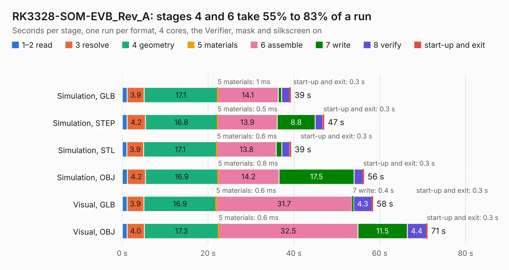

# 1971. RK3328-SOM-EVB_Rev_A

Board 1,971 of the 3,139 of [Corpus Testing](../Corpus-Testing.md), on [Corpus Page 19](../CorpusTestingPages/Corpus-Testing-19.md#1971-rk3328-som-evb_rev_a).

| Mode and format | 1–2 read | 3 resolve | 4 geometry | 5 materials | 6 assemble | 7 write | 8 verify | start-up and exit | Total |
|---|---:|---:|---:|---:|---:|---:|---:|---:|---:|
| Simulation, GLB | 1.2 | 3.9 | 17.1 | 1&nbsp;ms | 14.1 | 0.8 | 1.9 | 0.3 | 39.3 |
| Simulation, STEP | 1.2 | 4.2 | 16.8 | 0.5&nbsp;ms | 13.9 | 8.8 | 1.8 | 0.3 | 47.1 |
| Simulation, STL | 1.1 | 3.9 | 17.1 | 0.6&nbsp;ms | 13.8 | 1.3 | 1.9 | 0.3 | 39.3 |
| Simulation, OBJ | 1.2 | 4.2 | 16.9 | 0.8&nbsp;ms | 14.2 | 17.5 | 2.0 | 0.3 | 56.3 |
| Visual, GLB | 1.1 | 3.9 | 16.9 | 0.6&nbsp;ms | 31.7 | 0.4 | 4.3 | 0.3 | 58.4 |
| Visual, OBJ | 1.1 | 4.0 | 17.3 | 0.6&nbsp;ms | 32.5 | 11.5 | 4.4 | 0.3 | 71.2 |

<table align="center"><tr><td valign="top">

| Board | Repo: [OLIMEX/RK3328-SOM-EBV](https://github.com/OLIMEX/RK3328-SOM-EBV) Board: `RK3328-SOM-EVB_Rev_A.kicad_pcb` |
|---|---|
| Folder | HARDWARE / RK3328-SOM-EVB_Rev-A |
| Complexity | 319&nbsp;/&nbsp;1000 (size&nbsp;264, features&nbsp;55) |
| KESE&nbsp;features | through vias, slotted holes, filled zones, copper text |
| Tested | 9th November 2026 |
| Copper&nbsp;layers | 4 |
| File&nbsp;format | KiCad 5 (20171130) |
| Parts,&nbsp;tracks,&nbsp;vias | 129, 2,983, 520 |
| Triangles,&nbsp;simulation | 3,451,558 in 197 parts |
| Verifier | PASS in all six runs |

</td><td valign="top">

<table>
<tr><th>File type</th><th>File size</th><th>Peak memory used</th></tr>
<tr><th colspan="3" align="left">Simulation</th></tr>
<tr><td>GLB</td><td align="right">120&nbsp;MB</td><td align="right">1.1&nbsp;GB</td></tr>
<tr><td>STEP</td><td align="right">468&nbsp;MB</td><td align="right">1.4&nbsp;GB</td></tr>
<tr><td>STL</td><td align="right">173&nbsp;MB</td><td align="right">1.1&nbsp;GB</td></tr>
<tr><td>OBJ</td><td align="right">370&nbsp;MB</td><td align="right">2.3&nbsp;GB</td></tr>
<tr><th colspan="3" align="left">Visual</th></tr>
<tr><td>GLB</td><td align="right">75&nbsp;MB</td><td align="right">1.2&nbsp;GB</td></tr>
<tr><td>OBJ</td><td align="right">234&nbsp;MB</td><td align="right">1.6&nbsp;GB</td></tr>
</table>

</td></tr></table>

| Previous | Next |
|:---|---:|
| [1970. POEv3_Rev_A](b1970b_POEv3_POEv3-Rev-A.md) | [1972. RP2040-PICO-PC_rev_B](b1972b_RP2040-PICO-PC_RP2040-PICO-PC-rev-B.md) |
