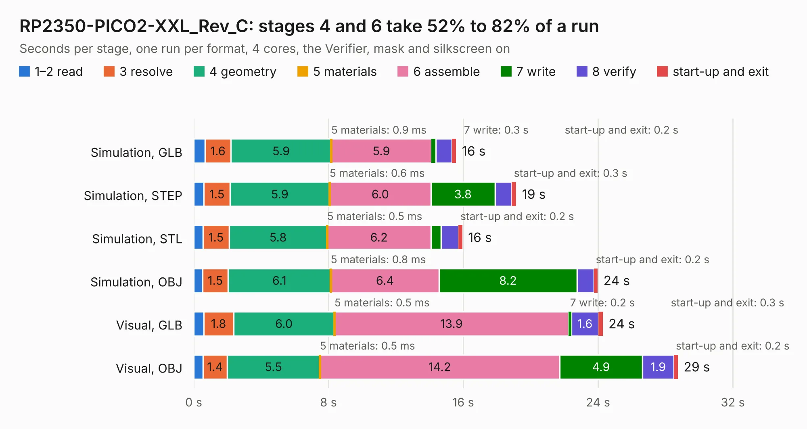

# 1972. RP2350-PICO2-XXL_Rev_C

Board 1,972 of the 3,127 of [Corpus Testing](../Corpus-Testing.md), on [Corpus Page 19](../CorpusTestingPages/Corpus-Testing-19.md#1972-rp2350-pico2-xxl_rev_c).

| Mode and format | 1–2 read | 3 resolve | 4 geometry | 5 materials | 6 assemble | 7 write | 8 verify | start-up and exit | Total |
|---|---:|---:|---:|---:|---:|---:|---:|---:|---:|
| Simulation, GLB | 0.7 | 1.6 | 5.9 | 0.9&nbsp;ms | 5.9 | 0.3 | 1.0 | 0.2 | 15.6 |
| Simulation, STEP | 0.6 | 1.5 | 5.9 | 0.6&nbsp;ms | 6.0 | 3.8 | 1.0 | 0.3 | 19.1 |
| Simulation, STL | 0.6 | 1.5 | 5.8 | 0.5&nbsp;ms | 6.2 | 0.6 | 1.0 | 0.2 | 15.9 |
| Simulation, OBJ | 0.5 | 1.5 | 6.1 | 0.8&nbsp;ms | 6.4 | 8.2 | 1.0 | 0.2 | 24.0 |
| Visual, GLB | 0.6 | 1.8 | 6.0 | 0.5&nbsp;ms | 13.9 | 0.2 | 1.6 | 0.3 | 24.3 |
| Visual, OBJ | 0.6 | 1.4 | 5.5 | 0.5&nbsp;ms | 14.2 | 4.9 | 1.9 | 0.2 | 28.7 |

<table align="center"><tr><td valign="top">

| Board | Repo: [OLIMEX/RP2350-PICO2-XXL](https://github.com/OLIMEX/RP2350-PICO2-XXL) Board: `RP2350-PICO2-XXL_Rev_C.kicad_pcb` |
|---|---|
| Folder | HARDWARE / RP2350-PICO2-XXL-Rev.C |
| Complexity | 358&nbsp;/&nbsp;1000 (size&nbsp;253, features&nbsp;105) |
| KESE&nbsp;features | through vias, slotted holes, filled zones, copper text, knockout text, stack-up, dielectric εr and tanδ, mask and silkscreen colours |
| Tested | 9th November 2026 |
| Copper&nbsp;layers | 4 |
| File&nbsp;format | KiCad 7 (20221018) |
| Parts,&nbsp;tracks,&nbsp;vias | 73, 2,912, 163 |
| Triangles,&nbsp;simulation | 1,868,782 in 110 parts |
| Verifier | PASS in all six runs |

</td><td valign="top">

<table>
<tr><th>File type</th><th>File size</th><th>Peak memory used</th></tr>
<tr><th colspan="3" align="left">Simulation</th></tr>
<tr><td>GLB</td><td align="right">65&nbsp;MB</td><td align="right">667&nbsp;MB</td></tr>
<tr><td>STEP</td><td align="right">313&nbsp;MB</td><td align="right">799&nbsp;MB</td></tr>
<tr><td>STL</td><td align="right">93&nbsp;MB</td><td align="right">638&nbsp;MB</td></tr>
<tr><td>OBJ</td><td align="right">199&nbsp;MB</td><td align="right">1.3&nbsp;GB</td></tr>
<tr><th colspan="3" align="left">Visual</th></tr>
<tr><td>GLB</td><td align="right">41&nbsp;MB</td><td align="right">773&nbsp;MB</td></tr>
<tr><td>OBJ</td><td align="right">125&nbsp;MB</td><td align="right">945&nbsp;MB</td></tr>
</table>

</td></tr></table>

| Previous | Next |
|:---|---:|
| [1971. RP2350-PICO2-XXL_Rev_B](b1971b_RP2350-PICO2-XXL_RP2350-PICO2-XXL-Rev-B.md) | [1973. RP2350pc_Rev_A](b1973b_RP2350pc_RP2350pc-Rev-A.md) |
