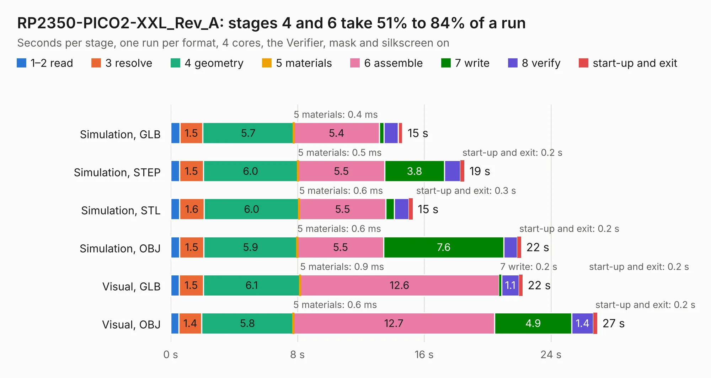

# 1974. RP2350-PICO2-XXL_Rev_A

Board 1,974 of the 3,132 of [Corpus Testing](../Corpus-Testing.md), on [Corpus Page 19](../CorpusTestingPages/Corpus-Testing-19.md#1974-rp2350-pico2-xxl_rev_a).

| Mode and format | 1–2 read | 3 resolve | 4 geometry | 5 materials | 6 assemble | 7 write | 8 verify | start-up and exit | Total |
|---|---:|---:|---:|---:|---:|---:|---:|---:|---:|
| Simulation, GLB | 0.6 | 1.5 | 5.7 | 0.4&nbsp;ms | 5.4 | 0.3 | 0.9 | 0.3 | 14.6 |
| Simulation, STEP | 0.6 | 1.5 | 6.0 | 0.5&nbsp;ms | 5.5 | 3.8 | 1.0 | 0.2 | 18.5 |
| Simulation, STL | 0.6 | 1.6 | 6.0 | 0.6&nbsp;ms | 5.5 | 0.5 | 0.9 | 0.3 | 15.3 |
| Simulation, OBJ | 0.6 | 1.5 | 5.9 | 0.6&nbsp;ms | 5.5 | 7.6 | 0.9 | 0.2 | 22.1 |
| Visual, GLB | 0.5 | 1.5 | 6.1 | 0.9&nbsp;ms | 12.6 | 0.2 | 1.1 | 0.2 | 22.2 |
| Visual, OBJ | 0.5 | 1.4 | 5.8 | 0.6&nbsp;ms | 12.7 | 4.9 | 1.4 | 0.2 | 26.9 |

<table align="center"><tr><td valign="top">

| Board | Repo: [OLIMEX/RP2350-PICO2-XXL](https://github.com/OLIMEX/RP2350-PICO2-XXL) Board: `RP2350-PICO2-XXL_Rev_A.kicad_pcb` |
|---|---|
| Folder | HARDWARE / RP2350-PICO2-XXL-Rev.A |
| Complexity | 372&nbsp;/&nbsp;1000 (size&nbsp;252, features&nbsp;120) |
| KESE&nbsp;features | through vias, slotted holes, arc tracks, filled zones, copper text, knockout text, stack-up, dielectric εr and tanδ, mask and silkscreen colours |
| Tested | 9th November 2026 |
| Copper&nbsp;layers | 4 |
| File&nbsp;format | KiCad 7 (20221018) |
| Parts,&nbsp;tracks,&nbsp;vias | 72, 2,698, 164 |
| Triangles,&nbsp;simulation | 1,808,992 in 110 parts |
| Verifier | PASS in all six runs |

</td><td valign="top">

<table>
<tr><th>File type</th><th>File size</th><th>Peak memory used</th></tr>
<tr><th colspan="3" align="left">Simulation</th></tr>
<tr><td>GLB</td><td align="right">63&nbsp;MB</td><td align="right">577&nbsp;MB</td></tr>
<tr><td>STEP</td><td align="right">296&nbsp;MB</td><td align="right">743&nbsp;MB</td></tr>
<tr><td>STL</td><td align="right">90&nbsp;MB</td><td align="right">615&nbsp;MB</td></tr>
<tr><td>OBJ</td><td align="right">192&nbsp;MB</td><td align="right">1.3&nbsp;GB</td></tr>
<tr><th colspan="3" align="left">Visual</th></tr>
<tr><td>GLB</td><td align="right">40&nbsp;MB</td><td align="right">791&nbsp;MB</td></tr>
<tr><td>OBJ</td><td align="right">121&nbsp;MB</td><td align="right">935&nbsp;MB</td></tr>
</table>

</td></tr></table>

| Previous | Next |
|:---|---:|
| [1973. PICO2-BB48_Rev_A](b1973b_RP2350-PICO2-BB48_PICO2-BB48-Rev-A.md) | [1975. RP2350-PICO2-XXL_Rev_B](b1975b_RP2350-PICO2-XXL_RP2350-PICO2-XXL-Rev-B.md) |
