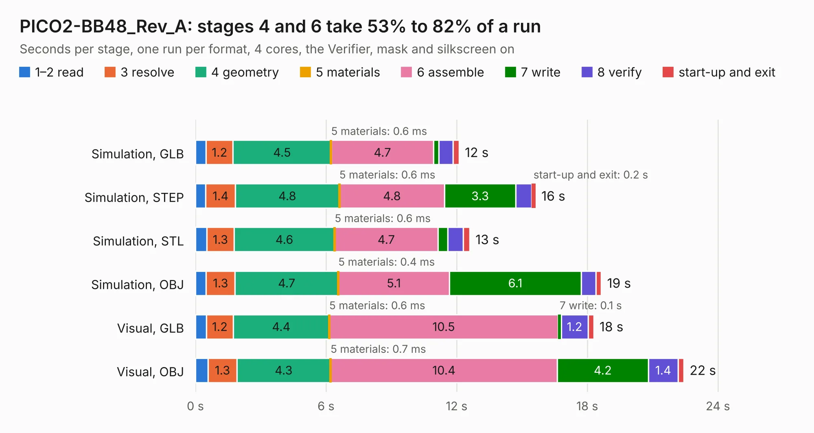

# 1977. PICO2-BB48_Rev_A

Board 1,977 of the 3,138 of [Corpus Testing](../Corpus-Testing.md), on [Corpus Page 19](../CorpusTestingPages/Corpus-Testing-19.md#1977-pico2-bb48_rev_a).

| Mode and format | 1–2 read | 3 resolve | 4 geometry | 5 materials | 6 assemble | 7 write | 8 verify | start-up and exit | Total |
|---|---:|---:|---:|---:|---:|---:|---:|---:|---:|
| Simulation, GLB | 0.5 | 1.2 | 4.5 | 0.6&nbsp;ms | 4.7 | 0.2 | 0.7 | 0.3 | 12.1 |
| Simulation, STEP | 0.5 | 1.4 | 4.8 | 0.6&nbsp;ms | 4.8 | 3.3 | 0.7 | 0.2 | 15.6 |
| Simulation, STL | 0.5 | 1.3 | 4.6 | 0.6&nbsp;ms | 4.7 | 0.5 | 0.7 | 0.3 | 12.6 |
| Simulation, OBJ | 0.5 | 1.3 | 4.7 | 0.4&nbsp;ms | 5.1 | 6.1 | 0.7 | 0.2 | 18.6 |
| Visual, GLB | 0.5 | 1.2 | 4.4 | 0.6&nbsp;ms | 10.5 | 0.1 | 1.2 | 0.3 | 18.3 |
| Visual, OBJ | 0.6 | 1.3 | 4.3 | 0.7&nbsp;ms | 10.4 | 4.2 | 1.4 | 0.3 | 22.4 |

<table align="center"><tr><td valign="top">

| Board | Repo: [OLIMEX/RP2350-PICO2-BB48](https://github.com/OLIMEX/RP2350-PICO2-BB48) Board: `PICO2-BB48_Rev_A.kicad_pcb` |
|---|---|
| Folder | HARDWARE / RP2350-PICO2-BB48.REV.A |
| Complexity | 348&nbsp;/&nbsp;1000 (size&nbsp;243, features&nbsp;105) |
| KESE&nbsp;features | through vias, slotted holes, filled zones, copper text, knockout text, stack-up, dielectric εr and tanδ, mask and silkscreen colours |
| Tested | 9th November 2026 |
| Copper&nbsp;layers | 4 |
| File&nbsp;format | KiCad 7 (20221018) |
| Parts,&nbsp;tracks,&nbsp;vias | 72, 1,486, 126 |
| Triangles,&nbsp;simulation | 1,477,790 in 109 parts |
| Verifier | PASS in all six runs |

</td><td valign="top">

<table>
<tr><th>File type</th><th>File size</th><th>Peak memory used</th></tr>
<tr><th colspan="3" align="left">Simulation</th></tr>
<tr><td>GLB</td><td align="right">52&nbsp;MB</td><td align="right">548&nbsp;MB</td></tr>
<tr><td>STEP</td><td align="right">255&nbsp;MB</td><td align="right">660&nbsp;MB</td></tr>
<tr><td>STL</td><td align="right">74&nbsp;MB</td><td align="right">517&nbsp;MB</td></tr>
<tr><td>OBJ</td><td align="right">157&nbsp;MB</td><td align="right">1.0&nbsp;GB</td></tr>
<tr><th colspan="3" align="left">Visual</th></tr>
<tr><td>GLB</td><td align="right">34&nbsp;MB</td><td align="right">742&nbsp;MB</td></tr>
<tr><td>OBJ</td><td align="right">104&nbsp;MB</td><td align="right">767&nbsp;MB</td></tr>
</table>

</td></tr></table>

| Previous | Next |
|:---|---:|
| [1976. RP2040pc_Rev_B](b1976b_RP2040pc_RP2040pc-Rev-B.md) | [1978. RP2350-PICO2-XXL_Rev_A](b1978b_RP2350-PICO2-XXL_RP2350-PICO2-XXL-Rev-A.md) |
