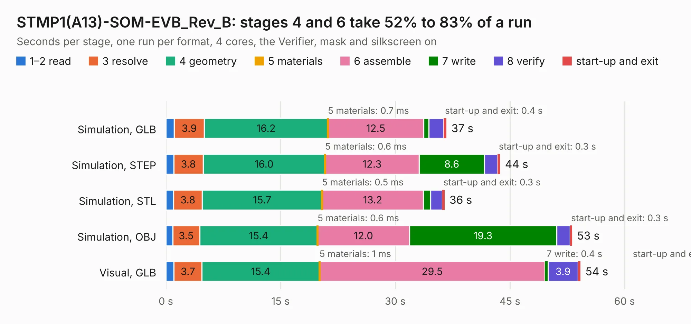

# 1977. STMP1(A13)-SOM-EVB_Rev_B

Board 1,977 of the 3,120 of [Corpus Testing](../Corpus-Testing.md), on [Corpus Page 19](../CorpusTestingPages/Corpus-Testing-19.md#1977-stmp1a13-som-evb_rev_b).

| Mode and format | 1–2 read | 3 resolve | 4 geometry | 5 materials | 6 assemble | 7 write | 8 verify | start-up and exit | Total |
|---|---:|---:|---:|---:|---:|---:|---:|---:|---:|
| Simulation, GLB | 1.1 | 3.9 | 16.2 | 0.7&nbsp;ms | 12.5 | 0.7 | 2.0 | 0.4 | 36.7 |
| Simulation, STEP | 1.0 | 3.8 | 16.0 | 0.6&nbsp;ms | 12.3 | 8.6 | 1.7 | 0.3 | 43.7 |
| Simulation, STL | 1.0 | 3.8 | 15.7 | 0.5&nbsp;ms | 13.2 | 1.0 | 1.6 | 0.3 | 36.5 |
| Simulation, OBJ | 0.9 | 3.5 | 15.4 | 0.6&nbsp;ms | 12.0 | 19.3 | 1.8 | 0.3 | 53.1 |
| Visual, GLB | 1.0 | 3.7 | 15.4 | 1&nbsp;ms | 29.5 | 0.4 | 3.9 | 0.3 | 54.2 |
| Visual, OBJ | 1.1 | 3.8 | 15.9 | 1&nbsp;ms | 30.6 | 13.3 | 3.6 | 0.3 | 68.7 |

<table align="center"><tr><td valign="top">

| Board | Repo: [OLIMEX/STMP1-A13-EVB](https://github.com/OLIMEX/STMP1-A13-EVB) Board: `STMP1(A13)-SOM-EVB_Rev_B.kicad_pcb` |
|---|---|
| Folder | HARDWARE / STMP1(A13)-SOM-EVB-Rev-B |
| Complexity | 342&nbsp;/&nbsp;1000 (size&nbsp;262, features&nbsp;80) |
| KESE&nbsp;features | through vias, slotted holes, custom pads, filled zones, copper drawings, copper text |
| Tested | 9th November 2026 |
| Copper&nbsp;layers | 4 |
| File&nbsp;format | KiCad 5 (20171130) |
| Parts,&nbsp;tracks,&nbsp;vias | 141, 2,429, 467 |
| Triangles,&nbsp;simulation | 3,366,994 in 208 parts |
| Verifier | PASS in all six runs |

</td><td valign="top">

<table>
<tr><th>File type</th><th>File size</th><th>Peak memory used</th></tr>
<tr><th colspan="3" align="left">Simulation</th></tr>
<tr><td>GLB</td><td align="right">117&nbsp;MB</td><td align="right">1.2&nbsp;GB</td></tr>
<tr><td>STEP</td><td align="right">476&nbsp;MB</td><td align="right">1.4&nbsp;GB</td></tr>
<tr><td>STL</td><td align="right">168&nbsp;MB</td><td align="right">1.1&nbsp;GB</td></tr>
<tr><td>OBJ</td><td align="right">361&nbsp;MB</td><td align="right">2.2&nbsp;GB</td></tr>
<tr><th colspan="3" align="left">Visual</th></tr>
<tr><td>GLB</td><td align="right">78&nbsp;MB</td><td align="right">1.6&nbsp;GB</td></tr>
<tr><td>OBJ</td><td align="right">244&nbsp;MB</td><td align="right">1.7&nbsp;GB</td></tr>
</table>

</td></tr></table>

| Previous | Next |
|:---|---:|
| [1976. smd-protoboard](b1976b_SMT-PROTOBOARD_smd-protoboard.md) | [1978. STMP1-OLinuXino_Rev_A](b1978b_STMP1-OLinuXino_STMP1-OLinuXino-Rev-A.md) |
