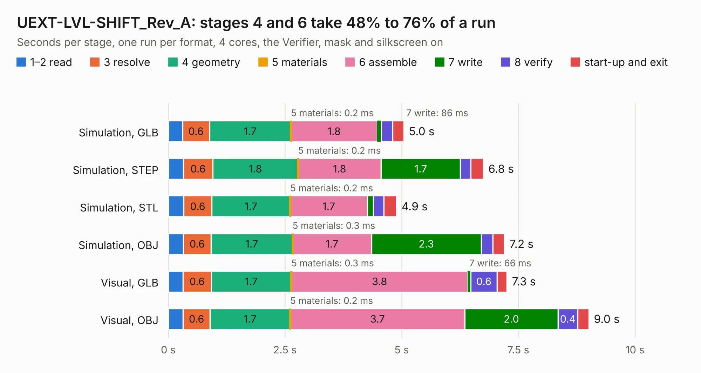

# 1977. UEXT-LVL-SHIFT_Rev_A

Board 1,977 of the 3,110 of [Corpus Testing](../Corpus-Testing.md), on [Corpus Page 19](../CorpusTestingPages/Corpus-Testing-19.md#1977-uext-lvl-shift_rev_a).

| Mode and format | 1–2 read | 3 resolve | 4 geometry | 5 materials | 6 assemble | 7 write | 8 verify | start-up and exit | Total |
|---|---:|---:|---:|---:|---:|---:|---:|---:|---:|
| Simulation, GLB | 0.3 | 0.6 | 1.7 | 0.2&nbsp;ms | 1.8 | 86&nbsp;ms | 0.2 | 0.2 | 5.0 |
| Simulation, STEP | 0.3 | 0.6 | 1.8 | 0.2&nbsp;ms | 1.8 | 1.7 | 0.2 | 0.3 | 6.8 |
| Simulation, STL | 0.3 | 0.6 | 1.7 | 0.2&nbsp;ms | 1.7 | 0.1 | 0.2 | 0.3 | 4.9 |
| Simulation, OBJ | 0.3 | 0.6 | 1.7 | 0.3&nbsp;ms | 1.7 | 2.3 | 0.3 | 0.2 | 7.2 |
| Visual, GLB | 0.3 | 0.6 | 1.7 | 0.3&nbsp;ms | 3.8 | 66&nbsp;ms | 0.6 | 0.2 | 7.3 |
| Visual, OBJ | 0.3 | 0.6 | 1.7 | 0.2&nbsp;ms | 3.7 | 2.0 | 0.4 | 0.2 | 9.0 |

<table align="center"><tr><td valign="top">

| Board | Repo: [OLIMEX/UEXT-LVL-SHIFT](https://github.com/OLIMEX/UEXT-LVL-SHIFT) Board: `UEXT-LVL-SHIFT_Rev_A.kicad_pcb` |
|---|---|
| Folder | HARDWARE / UEXT-LVL-SHIFT_Rev_A |
| Complexity | 264&nbsp;/&nbsp;1000 (size&nbsp;169, features&nbsp;95) |
| KESE&nbsp;features | through vias, rounded, trapezoid or chamfered pads, filled zones, knockout text, stack-up, dielectric εr and tanδ, mask and silkscreen colours |
| Tested | 9th November 2026 |
| Copper&nbsp;layers | 2 |
| File&nbsp;format | KiCad 10 (20260206) |
| Parts,&nbsp;tracks,&nbsp;vias | 28, 746, 130 |
| Triangles,&nbsp;simulation | 418,196 in 35 parts |
| Verifier | PASS in all six runs |

</td><td valign="top">

<table>
<tr><th>File type</th><th>File size</th><th>Peak memory used</th></tr>
<tr><th colspan="3" align="left">Simulation</th></tr>
<tr><td>GLB</td><td align="right">15&nbsp;MB</td><td align="right">295&nbsp;MB</td></tr>
<tr><td>STEP</td><td align="right">74&nbsp;MB</td><td align="right">336&nbsp;MB</td></tr>
<tr><td>STL</td><td align="right">21&nbsp;MB</td><td align="right">296&nbsp;MB</td></tr>
<tr><td>OBJ</td><td align="right">43&nbsp;MB</td><td align="right">342&nbsp;MB</td></tr>
<tr><th colspan="3" align="left">Visual</th></tr>
<tr><td>GLB</td><td align="right">12&nbsp;MB</td><td align="right">328&nbsp;MB</td></tr>
<tr><td>OBJ</td><td align="right">36&nbsp;MB</td><td align="right">327&nbsp;MB</td></tr>
</table>

</td></tr></table>

| Previous | Next |
|:---|---:|
| [1976. UEXT-PQ_Rev_A](b1976b_UEXT-ADAPTERS_UEXT-PQ-Rev-A.md) | [1978. mod-gyro](b1978b_UEXT-MODULES_mod-gyro.md) |
