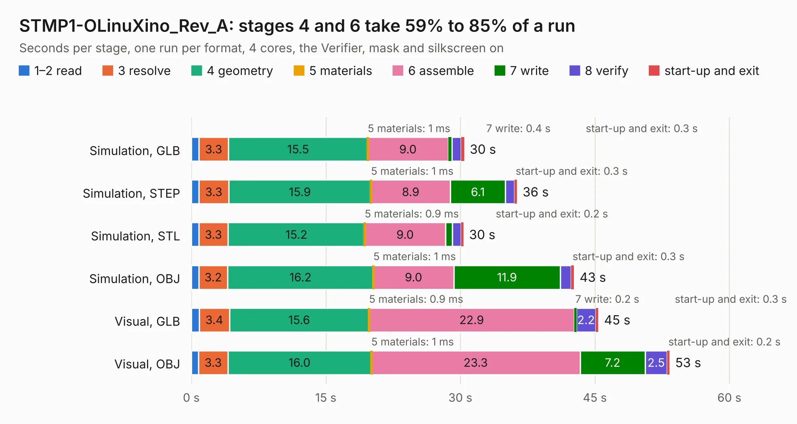

# 1984. STMP1-OLinuXino_Rev_A

Board 1,984 of the 3,129 of [Corpus Testing](../Corpus-Testing.md), on [Corpus Page 19](../CorpusTestingPages/Corpus-Testing-19.md#1984-stmp1-olinuxino_rev_a).

| Mode and format | 1–2 read | 3 resolve | 4 geometry | 5 materials | 6 assemble | 7 write | 8 verify | start-up and exit | Total |
|---|---:|---:|---:|---:|---:|---:|---:|---:|---:|
| Simulation, GLB | 0.8 | 3.3 | 15.5 | 1&nbsp;ms | 9.0 | 0.4 | 1.1 | 0.3 | 30.4 |
| Simulation, STEP | 0.8 | 3.3 | 15.9 | 1&nbsp;ms | 8.9 | 6.1 | 1.0 | 0.3 | 36.3 |
| Simulation, STL | 0.8 | 3.3 | 15.2 | 0.9&nbsp;ms | 9.0 | 0.8 | 1.0 | 0.2 | 30.3 |
| Simulation, OBJ | 0.8 | 3.2 | 16.2 | 1&nbsp;ms | 9.0 | 11.9 | 1.2 | 0.3 | 42.7 |
| Visual, GLB | 0.9 | 3.4 | 15.6 | 0.9&nbsp;ms | 22.9 | 0.2 | 2.2 | 0.3 | 45.4 |
| Visual, OBJ | 0.8 | 3.3 | 16.0 | 1&nbsp;ms | 23.3 | 7.2 | 2.5 | 0.2 | 53.3 |

<table align="center"><tr><td valign="top">

| Board | Repo: [OLIMEX/STMP1-OLinuXino](https://github.com/OLIMEX/STMP1-OLinuXino) Board: `STMP1-OLinuXino_Rev_A.kicad_pcb` |
|---|---|
| Folder | HARDWARE / STMP1-OLinuXino-REV.A |
| Complexity | 299&nbsp;/&nbsp;1000 (size&nbsp;274, features&nbsp;25) |
| KESE&nbsp;features | through vias, slotted holes |
| Tested | 9th November 2026 |
| Copper&nbsp;layers | 8 |
| File&nbsp;format | KiCad 5 (20171130) |
| Parts,&nbsp;tracks,&nbsp;vias | 388, 248, 25 |
| Triangles,&nbsp;simulation | 2,715,802 in 504 parts |
| Verifier | PASS in all six runs |

</td><td valign="top">

<table>
<tr><th>File type</th><th>File size</th><th>Peak memory used</th></tr>
<tr><th colspan="3" align="left">Simulation</th></tr>
<tr><td>GLB</td><td align="right">94&nbsp;MB</td><td align="right">895&nbsp;MB</td></tr>
<tr><td>STEP</td><td align="right">392&nbsp;MB</td><td align="right">1.1&nbsp;GB</td></tr>
<tr><td>STL</td><td align="right">136&nbsp;MB</td><td align="right">935&nbsp;MB</td></tr>
<tr><td>OBJ</td><td align="right">298&nbsp;MB</td><td align="right">1.9&nbsp;GB</td></tr>
<tr><th colspan="3" align="left">Visual</th></tr>
<tr><td>GLB</td><td align="right">57&nbsp;MB</td><td align="right">1.1&nbsp;GB</td></tr>
<tr><td>OBJ</td><td align="right">177&nbsp;MB</td><td align="right">1.3&nbsp;GB</td></tr>
</table>

</td></tr></table>

| Previous | Next |
|:---|---:|
| [1983. STMP1(A13)-SOM-EVB_Rev_B](b1983b_STMP1-A13-EVB_STMP1-A13-SOM-EVB-Rev-B.md) | [1985. STMP15x-BASE-SOM-EVB_Rev_B](b1985b_STMP157-BASE-SOM-EVB_STMP15x-BASE-SOM-EVB-Rev-B.md) |
