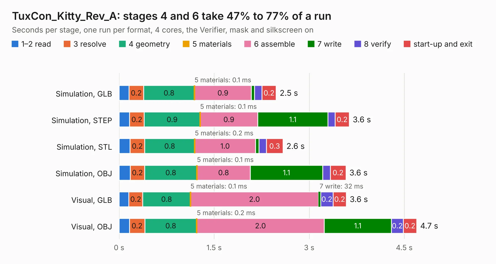

# 1984. TuxCon_Kitty_Rev_A

Board 1,984 of the 3,123 of [Corpus Testing](../Corpus-Testing.md), on [Corpus Page 19](../CorpusTestingPages/Corpus-Testing-19.md#1984-tuxcon_kitty_rev_a).

| Mode and format | 1–2 read | 3 resolve | 4 geometry | 5 materials | 6 assemble | 7 write | 8 verify | start-up and exit | Total |
|---|---:|---:|---:|---:|---:|---:|---:|---:|---:|
| Simulation, GLB | 0.2 | 0.2 | 0.8 | 0.1&nbsp;ms | 0.9 | 47&nbsp;ms | 0.1 | 0.2 | 2.5 |
| Simulation, STEP | 0.2 | 0.2 | 0.9 | 0.1&nbsp;ms | 0.9 | 1.1 | 0.1 | 0.2 | 3.6 |
| Simulation, STL | 0.2 | 0.2 | 0.8 | 0.2&nbsp;ms | 1.0 | 55&nbsp;ms | 0.1 | 0.3 | 2.6 |
| Simulation, OBJ | 0.2 | 0.2 | 0.8 | 0.1&nbsp;ms | 0.8 | 1.1 | 0.1 | 0.2 | 3.6 |
| Visual, GLB | 0.2 | 0.2 | 0.8 | 0.1&nbsp;ms | 2.0 | 32&nbsp;ms | 0.2 | 0.2 | 3.6 |
| Visual, OBJ | 0.2 | 0.2 | 0.8 | 0.2&nbsp;ms | 2.0 | 1.1 | 0.2 | 0.2 | 4.7 |

<table align="center"><tr><td valign="top">

| Board | Repo: [OLIMEX/TuxCon-Kitty](https://github.com/OLIMEX/TuxCon-Kitty) Board: `TuxCon_Kitty_Rev_A.kicad_pcb` |
|---|---|
| Folder | HARDWARE / REV-A |
| Complexity | 168&nbsp;/&nbsp;1000 (size&nbsp;123, features&nbsp;45) |
| KESE&nbsp;features | through vias, slotted holes, filled zones |
| Tested | 9th November 2026 |
| Copper&nbsp;layers | 2 |
| File&nbsp;format | KiCad 5 (20170922) |
| Parts,&nbsp;tracks,&nbsp;vias | 18, 74, 7 |
| Triangles,&nbsp;simulation | 205,834 in 28 parts |
| Verifier | PASS in all six runs |

</td><td valign="top">

<table>
<tr><th>File type</th><th>File size</th><th>Peak memory used</th></tr>
<tr><th colspan="3" align="left">Simulation</th></tr>
<tr><td>GLB</td><td align="right">7.3&nbsp;MB</td><td align="right">221&nbsp;MB</td></tr>
<tr><td>STEP</td><td align="right">45&nbsp;MB</td><td align="right">249&nbsp;MB</td></tr>
<tr><td>STL</td><td align="right">10&nbsp;MB</td><td align="right">211&nbsp;MB</td></tr>
<tr><td>OBJ</td><td align="right">21&nbsp;MB</td><td align="right">218&nbsp;MB</td></tr>
<tr><th colspan="3" align="left">Visual</th></tr>
<tr><td>GLB</td><td align="right">6.1&nbsp;MB</td><td align="right">217&nbsp;MB</td></tr>
<tr><td>OBJ</td><td align="right">18&nbsp;MB</td><td align="right">218&nbsp;MB</td></tr>
</table>

</td></tr></table>

| Previous | Next |
|:---|---:|
| [1983. STMP15x-SHIELD_Rev_A](b1983b_STMP15X-SHIELD_STMP15x-SHIELD-Rev-A.md) | [1985. UEXT-3TO5V_Rev_A](b1985b_UEXT-3TO5V_UEXT-3TO5V-Rev-A.md) |
