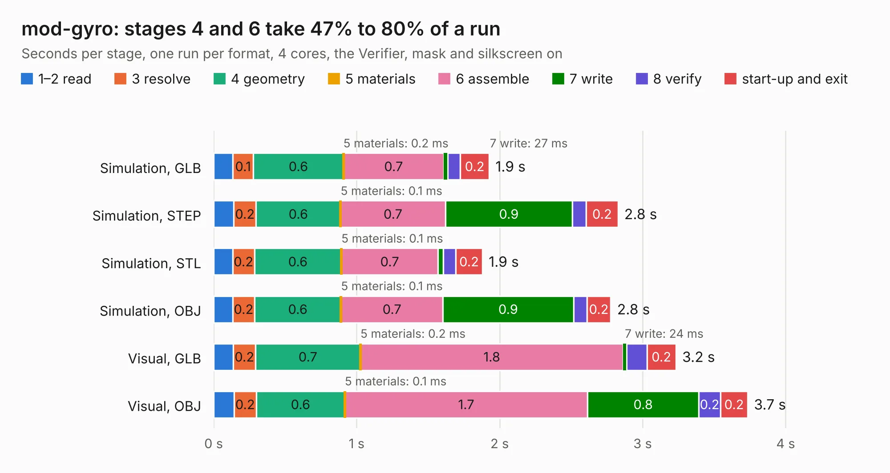

# 1984. mod-gyro

Board 1,984 of the 3,116 of [Corpus Testing](../Corpus-Testing.md), on [Corpus Page 19](../CorpusTestingPages/Corpus-Testing-19.md#1984-mod-gyro).

| Mode and format | 1–2 read | 3 resolve | 4 geometry | 5 materials | 6 assemble | 7 write | 8 verify | start-up and exit | Total |
|---|---:|---:|---:|---:|---:|---:|---:|---:|---:|
| Simulation, GLB | 0.1 | 0.1 | 0.6 | 0.2&nbsp;ms | 0.7 | 27&nbsp;ms | 88&nbsp;ms | 0.2 | 1.9 |
| Simulation, STEP | 0.1 | 0.2 | 0.6 | 0.1&nbsp;ms | 0.7 | 0.9 | 97&nbsp;ms | 0.2 | 2.8 |
| Simulation, STL | 0.1 | 0.2 | 0.6 | 0.1&nbsp;ms | 0.7 | 38&nbsp;ms | 87&nbsp;ms | 0.2 | 1.9 |
| Simulation, OBJ | 0.1 | 0.2 | 0.6 | 0.1&nbsp;ms | 0.7 | 0.9 | 94&nbsp;ms | 0.2 | 2.8 |
| Visual, GLB | 0.1 | 0.2 | 0.7 | 0.2&nbsp;ms | 1.8 | 24&nbsp;ms | 0.1 | 0.2 | 3.2 |
| Visual, OBJ | 0.1 | 0.2 | 0.6 | 0.1&nbsp;ms | 1.7 | 0.8 | 0.2 | 0.2 | 3.7 |

<table align="center"><tr><td valign="top">

| Board | Repo: [OLIMEX/UEXT-MODULES](https://github.com/OLIMEX/UEXT-MODULES) Board: `mod-gyro.kicad_pcb` |
|---|---|
| Folder | MOD-MPU9150 |
| Complexity | 164&nbsp;/&nbsp;1000 (size&nbsp;129, features&nbsp;35) |
| KESE&nbsp;features | through vias, filled zones |
| Tested | 9th November 2026 |
| Copper&nbsp;layers | 2 |
| File&nbsp;format | KiCad 4 (4) |
| Parts,&nbsp;tracks,&nbsp;vias | 14, 131, 9 |
| Triangles,&nbsp;simulation | 173,536 in 37 parts |
| Verifier | PASS in all six runs |

</td><td valign="top">

<table>
<tr><th>File type</th><th>File size</th><th>Peak memory used</th></tr>
<tr><th colspan="3" align="left">Simulation</th></tr>
<tr><td>GLB</td><td align="right">6.2&nbsp;MB</td><td align="right">209&nbsp;MB</td></tr>
<tr><td>STEP</td><td align="right">35&nbsp;MB</td><td align="right">234&nbsp;MB</td></tr>
<tr><td>STL</td><td align="right">8.7&nbsp;MB</td><td align="right">220&nbsp;MB</td></tr>
<tr><td>OBJ</td><td align="right">17&nbsp;MB</td><td align="right">212&nbsp;MB</td></tr>
<tr><th colspan="3" align="left">Visual</th></tr>
<tr><td>GLB</td><td align="right">5.6&nbsp;MB</td><td align="right">209&nbsp;MB</td></tr>
<tr><td>OBJ</td><td align="right">16&nbsp;MB</td><td align="right">208&nbsp;MB</td></tr>
</table>

</td></tr></table>

| Previous | Next |
|:---|---:|
| [1983. UEXT-LVL-SHIFT_Rev_A](b1983b_UEXT-LVL-SHIFT_UEXT-LVL-SHIFT-Rev-A.md) | [1985. mod-oled-128x64](b1985b_UEXT-MODULES_mod-oled-128x64.md) |
