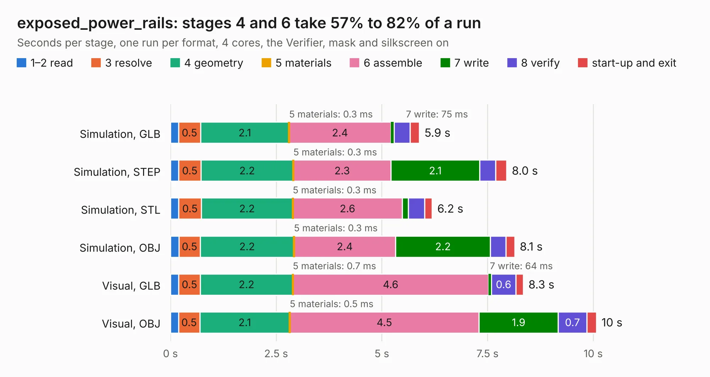

# 1986 exposed_power_rails

Board 1,986 of the 3,138 of [Corpus Testing](../Corpus-Testing.md), on [Corpus Page 19](../CorpusTestingPages/Corpus-Testing-19.md#1986-exposed_power_rails).

| Mode and format | 1–2 read | 3 resolve | 4 geometry | 5 materials | 6 assemble | 7 write | 8 verify | start-up and exit | Total |
|---|---:|---:|---:|---:|---:|---:|---:|---:|---:|
| Simulation, GLB | 0.2 | 0.5 | 2.1 | 0.3&nbsp;ms | 2.4 | 75&nbsp;ms | 0.4 | 0.2 | 5.9 |
| Simulation, STEP | 0.2 | 0.5 | 2.2 | 0.3&nbsp;ms | 2.3 | 2.1 | 0.4 | 0.3 | 8.0 |
| Simulation, STL | 0.2 | 0.5 | 2.2 | 0.3&nbsp;ms | 2.6 | 0.1 | 0.4 | 0.2 | 6.2 |
| Simulation, OBJ | 0.2 | 0.5 | 2.2 | 0.3&nbsp;ms | 2.4 | 2.2 | 0.4 | 0.2 | 8.1 |
| Visual, GLB | 0.2 | 0.5 | 2.2 | 0.7&nbsp;ms | 4.6 | 64&nbsp;ms | 0.6 | 0.2 | 8.3 |
| Visual, OBJ | 0.2 | 0.5 | 2.1 | 0.5&nbsp;ms | 4.5 | 1.9 | 0.7 | 0.2 | 10.1 |

<table align="center"><tr><td valign="top">

| Board | Repo: [OLIMEX/RVPC](https://github.com/OLIMEX/RVPC) Board: `exposed_power_rails.kicad_pcb` |
|---|---|
| Folder | SOFTWARE / rvpc / tools / esp32s2-cookbook / hardware / exposed_power_rails |
| Complexity | 272&nbsp;/&nbsp;1000 (size&nbsp;167, features&nbsp;105) |
| KESE&nbsp;features | through vias, slotted holes, rounded, trapezoid or chamfered pads, filled zones, copper drawings, curved board outline, stack-up, dielectric εr and tanδ |
| Tested | 9th November 2026 |
| Copper&nbsp;layers | 2 |
| File&nbsp;format | KiCad 6 (20211014) |
| Parts,&nbsp;tracks,&nbsp;vias | 37, 520, 124 |
| Triangles,&nbsp;simulation | 612,234 in 77 parts |
| Verifier | PASS in all six runs |

</td><td valign="top">

<table>
<tr><th>File type</th><th>File size</th><th>Peak memory used</th></tr>
<tr><th colspan="3" align="left">Simulation</th></tr>
<tr><td>GLB</td><td align="right">21&nbsp;MB</td><td align="right">362&nbsp;MB</td></tr>
<tr><td>STEP</td><td align="right">108&nbsp;MB</td><td align="right">428&nbsp;MB</td></tr>
<tr><td>STL</td><td align="right">31&nbsp;MB</td><td align="right">360&nbsp;MB</td></tr>
<tr><td>OBJ</td><td align="right">61&nbsp;MB</td><td align="right">437&nbsp;MB</td></tr>
<tr><th colspan="3" align="left">Visual</th></tr>
<tr><td>GLB</td><td align="right">17&nbsp;MB</td><td align="right">478&nbsp;MB</td></tr>
<tr><td>OBJ</td><td align="right">49&nbsp;MB</td><td align="right">473&nbsp;MB</td></tr>
</table>

</td></tr></table>

| Previous | Next |
|:---|---:|
| [1985 RVPC_Rev_B](b1985b_RVPC_RVPC-Rev-B.md) | [1987 S3-OLinuXino_Rev_A](b1987b_S3-OLinuXino_HARDWARE-S3-OLinuXino-Rev-A-preliminary_S3-OLinuXino-Rev-A.md) |
