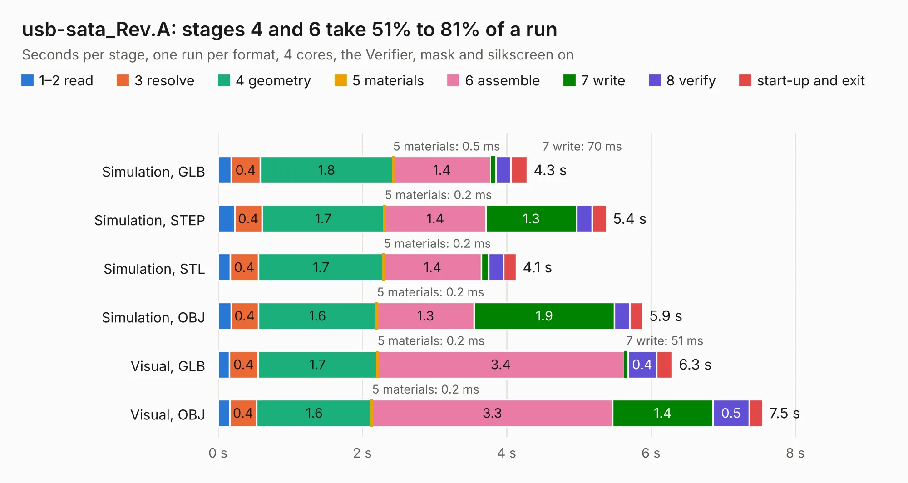

# 1987. usb-sata_Rev.A

Board 1,987 of the 3,108 of [Corpus Testing](../Corpus-Testing.md), on [Corpus Page 19](../CorpusTestingPages/Corpus-Testing-19.md#1987-usb-sata_reva).

| Mode and format | 1–2 read | 3 resolve | 4 geometry | 5 materials | 6 assemble | 7 write | 8 verify | start-up and exit | Total |
|---|---:|---:|---:|---:|---:|---:|---:|---:|---:|
| Simulation, GLB | 0.2 | 0.4 | 1.8 | 0.5&nbsp;ms | 1.4 | 70&nbsp;ms | 0.2 | 0.2 | 4.3 |
| Simulation, STEP | 0.2 | 0.4 | 1.7 | 0.2&nbsp;ms | 1.4 | 1.3 | 0.2 | 0.2 | 5.4 |
| Simulation, STL | 0.2 | 0.4 | 1.7 | 0.2&nbsp;ms | 1.4 | 0.1 | 0.2 | 0.2 | 4.1 |
| Simulation, OBJ | 0.2 | 0.4 | 1.6 | 0.2&nbsp;ms | 1.3 | 1.9 | 0.2 | 0.2 | 5.9 |
| Visual, GLB | 0.2 | 0.4 | 1.7 | 0.2&nbsp;ms | 3.4 | 51&nbsp;ms | 0.4 | 0.2 | 6.3 |
| Visual, OBJ | 0.2 | 0.4 | 1.6 | 0.2&nbsp;ms | 3.3 | 1.4 | 0.5 | 0.2 | 7.5 |

<table align="center"><tr><td valign="top">

| Board | Repo: [OLIMEX/USB-SATA](https://github.com/OLIMEX/USB-SATA) Board: `usb-sata_Rev.A.kicad_pcb` |
|---|---|
| Folder | HARDWARE / USB-SATA-REV.A |
| Complexity | 267&nbsp;/&nbsp;1000 (size&nbsp;222, features&nbsp;45) |
| KESE&nbsp;features | through vias, slotted holes, filled zones |
| Tested | 9th November 2026 |
| Copper&nbsp;layers | 4 |
| File&nbsp;format | KiCad 6 (20190516) |
| Parts,&nbsp;tracks,&nbsp;vias | 48, 506, 51 |
| Triangles,&nbsp;simulation | 453,362 in 55 parts |
| Verifier | PASS in all six runs |

</td><td valign="top">

<table>
<tr><th>File type</th><th>File size</th><th>Peak memory used</th></tr>
<tr><th colspan="3" align="left">Simulation</th></tr>
<tr><td>GLB</td><td align="right">16&nbsp;MB</td><td align="right">288&nbsp;MB</td></tr>
<tr><td>STEP</td><td align="right">73&nbsp;MB</td><td align="right">328&nbsp;MB</td></tr>
<tr><td>STL</td><td align="right">23&nbsp;MB</td><td align="right">275&nbsp;MB</td></tr>
<tr><td>OBJ</td><td align="right">47&nbsp;MB</td><td align="right">371&nbsp;MB</td></tr>
<tr><th colspan="3" align="left">Visual</th></tr>
<tr><td>GLB</td><td align="right">12&nbsp;MB</td><td align="right">319&nbsp;MB</td></tr>
<tr><td>OBJ</td><td align="right">35&nbsp;MB</td><td align="right">317&nbsp;MB</td></tr>
</table>

</td></tr></table>

| Previous | Next |
|:---|---:|
| [1986. USB-NeoHUB_Rev_A](b1986b_USB-NeoHub_USB-NeoHUB-Rev-A.md) | [1988. USB-SERIAL-L_Rev_B](b1988b_USB-SERIAL-L_USB-SERIAL-L-Rev-B.md) |
