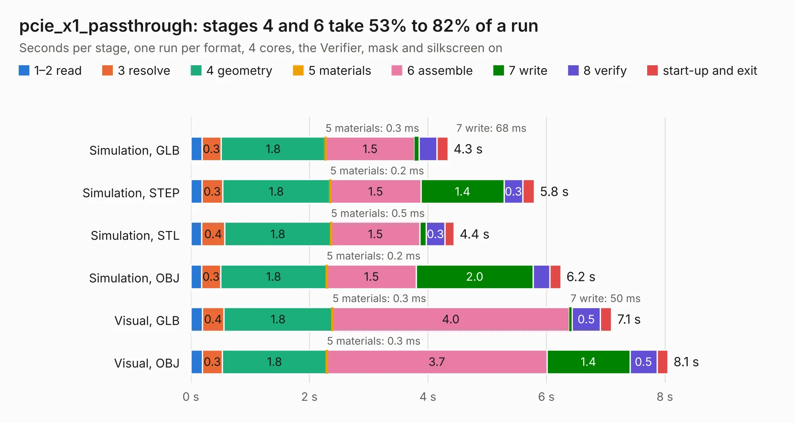

# 1987. pcie_x1_passthrough

Board 1,987 of the 3,102 of [Corpus Testing](../Corpus-Testing.md), on [Corpus Page 19](../CorpusTestingPages/Corpus-Testing-19.md#1987-pcie_x1_passthrough).

| Mode and format | 1–2 read | 3 resolve | 4 geometry | 5 materials | 6 assemble | 7 write | 8 verify | start-up and exit | Total |
|---|---:|---:|---:|---:|---:|---:|---:|---:|---:|
| Simulation, GLB | 0.2 | 0.3 | 1.8 | 0.3&nbsp;ms | 1.5 | 68&nbsp;ms | 0.3 | 0.2 | 4.3 |
| Simulation, STEP | 0.2 | 0.3 | 1.8 | 0.2&nbsp;ms | 1.5 | 1.4 | 0.3 | 0.2 | 5.8 |
| Simulation, STL | 0.2 | 0.4 | 1.8 | 0.5&nbsp;ms | 1.5 | 0.1 | 0.3 | 0.2 | 4.4 |
| Simulation, OBJ | 0.2 | 0.3 | 1.8 | 0.2&nbsp;ms | 1.5 | 2.0 | 0.3 | 0.2 | 6.2 |
| Visual, GLB | 0.2 | 0.4 | 1.8 | 0.3&nbsp;ms | 4.0 | 50&nbsp;ms | 0.5 | 0.2 | 7.1 |
| Visual, OBJ | 0.2 | 0.3 | 1.8 | 0.3&nbsp;ms | 3.7 | 1.4 | 0.5 | 0.2 | 8.1 |

<table align="center"><tr><td valign="top">

| Board | Repo: [olin-electric-motorsports/olin-electric-motorsports](https://github.com/olin-electric-motorsports/olin-electric-motorsports) Board: `pcie_x1_passthrough.kicad_pcb` |
|---|---|
| Folder | projects / PCIe Development / x1_passthrough |
| Complexity | 143&nbsp;/&nbsp;1000 (size&nbsp;133, features&nbsp;10) |
| KESE&nbsp;features | curved board outline |
| Tested | 9th November 2026 |
| Copper&nbsp;layers | 2 |
| File&nbsp;format | KiCad 7 (20221018) |
| Parts,&nbsp;tracks,&nbsp;vias | 3, 493, 0 |
| Triangles,&nbsp;simulation | 494,168 in 50 parts |
| Verifier | PASS in all six runs |

</td><td valign="top">

<table>
<tr><th>File type</th><th>File size</th><th>Peak memory used</th></tr>
<tr><th colspan="3" align="left">Simulation</th></tr>
<tr><td>GLB</td><td align="right">17&nbsp;MB</td><td align="right">311&nbsp;MB</td></tr>
<tr><td>STEP</td><td align="right">88&nbsp;MB</td><td align="right">340&nbsp;MB</td></tr>
<tr><td>STL</td><td align="right">25&nbsp;MB</td><td align="right">287&nbsp;MB</td></tr>
<tr><td>OBJ</td><td align="right">51&nbsp;MB</td><td align="right">374&nbsp;MB</td></tr>
<tr><th colspan="3" align="left">Visual</th></tr>
<tr><td>GLB</td><td align="right">13&nbsp;MB</td><td align="right">365&nbsp;MB</td></tr>
<tr><td>OBJ</td><td align="right">38&nbsp;MB</td><td align="right">370&nbsp;MB</td></tr>
</table>

</td></tr></table>

| Previous | Next |
|:---|---:|
| [1986. breakout_pcie](b1986b_olin-electric-motorsports_breakout-pcie.md) | [1988. imu](b1988b_olin-electric-motorsports_projects-telemetry-imu_imu.md) |
