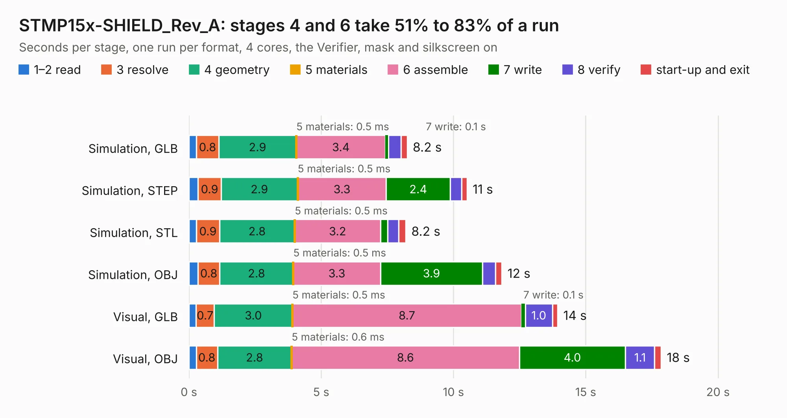

# 1988. STMP15x-SHIELD_Rev_A

Board 1,988 of the 3,131 of [Corpus Testing](../Corpus-Testing.md), on [Corpus Page 19](../CorpusTestingPages/Corpus-Testing-19.md#1988-stmp15x-shield_rev_a).

| Mode and format | 1–2 read | 3 resolve | 4 geometry | 5 materials | 6 assemble | 7 write | 8 verify | start-up and exit | Total |
|---|---:|---:|---:|---:|---:|---:|---:|---:|---:|
| Simulation, GLB | 0.3 | 0.8 | 2.9 | 0.5&nbsp;ms | 3.4 | 0.1 | 0.5 | 0.2 | 8.2 |
| Simulation, STEP | 0.3 | 0.9 | 2.9 | 0.5&nbsp;ms | 3.3 | 2.4 | 0.4 | 0.2 | 10.5 |
| Simulation, STL | 0.3 | 0.9 | 2.8 | 0.5&nbsp;ms | 3.2 | 0.3 | 0.4 | 0.3 | 8.2 |
| Simulation, OBJ | 0.3 | 0.8 | 2.8 | 0.5&nbsp;ms | 3.3 | 3.9 | 0.5 | 0.2 | 11.8 |
| Visual, GLB | 0.3 | 0.7 | 3.0 | 0.5&nbsp;ms | 8.7 | 0.1 | 1.0 | 0.2 | 13.9 |
| Visual, OBJ | 0.3 | 0.8 | 2.8 | 0.6&nbsp;ms | 8.6 | 4.0 | 1.1 | 0.2 | 17.8 |

<table align="center"><tr><td valign="top">

| Board | Repo: [OLIMEX/STMP15X-SHIELD](https://github.com/OLIMEX/STMP15X-SHIELD) Board: `STMP15x-SHIELD_Rev_A.kicad_pcb` |
|---|---|
| Folder | HARDWARE / STMP15x-SHIELD_Rev_A |
| Complexity | 226&nbsp;/&nbsp;1000 (size&nbsp;171, features&nbsp;55) |
| KESE&nbsp;features | through vias, rounded, trapezoid or chamfered pads, filled zones, copper text |
| Tested | 9th November 2026 |
| Copper&nbsp;layers | 2 |
| File&nbsp;format | KiCad 5 (20171130) |
| Parts,&nbsp;tracks,&nbsp;vias | 20, 1,155, 170 |
| Triangles,&nbsp;simulation | 883,270 in 132 parts |
| Verifier | PASS in all six runs |

</td><td valign="top">

<table>
<tr><th>File type</th><th>File size</th><th>Peak memory used</th></tr>
<tr><th colspan="3" align="left">Simulation</th></tr>
<tr><td>GLB</td><td align="right">31&nbsp;MB</td><td align="right">494&nbsp;MB</td></tr>
<tr><td>STEP</td><td align="right">162&nbsp;MB</td><td align="right">566&nbsp;MB</td></tr>
<tr><td>STL</td><td align="right">44&nbsp;MB</td><td align="right">494&nbsp;MB</td></tr>
<tr><td>OBJ</td><td align="right">91&nbsp;MB</td><td align="right">634&nbsp;MB</td></tr>
<tr><th colspan="3" align="left">Visual</th></tr>
<tr><td>GLB</td><td align="right">29&nbsp;MB</td><td align="right">638&nbsp;MB</td></tr>
<tr><td>OBJ</td><td align="right">89&nbsp;MB</td><td align="right">690&nbsp;MB</td></tr>
</table>

</td></tr></table>

| Previous | Next |
|:---|---:|
| [1987. STMP15x-BASE-SOM-EVB_Rev_B](b1987b_STMP157-BASE-SOM-EVB_STMP15x-BASE-SOM-EVB-Rev-B.md) | [1989. TuxCon_Kitty_Rev_A](b1989b_TuxCon-Kitty_TuxCon-Kitty-Rev-A.md) |
