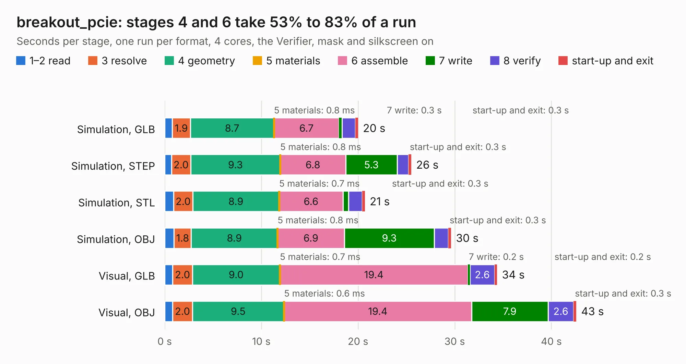

# 1988. breakout_pcie

Board 1,988 of the 3,104 of [Corpus Testing](../Corpus-Testing.md), on [Corpus Page 19](../CorpusTestingPages/Corpus-Testing-19.md#1988-breakout_pcie).

| Mode and format | 1–2 read | 3 resolve | 4 geometry | 5 materials | 6 assemble | 7 write | 8 verify | start-up and exit | Total |
|---|---:|---:|---:|---:|---:|---:|---:|---:|---:|
| Simulation, GLB | 0.8 | 1.9 | 8.7 | 0.8&nbsp;ms | 6.7 | 0.3 | 1.4 | 0.3 | 20.0 |
| Simulation, STEP | 0.7 | 2.0 | 9.3 | 0.8&nbsp;ms | 6.8 | 5.3 | 1.2 | 0.3 | 25.5 |
| Simulation, STL | 0.9 | 2.0 | 8.9 | 0.7&nbsp;ms | 6.6 | 0.6 | 1.4 | 0.3 | 20.7 |
| Simulation, OBJ | 1.0 | 1.8 | 8.9 | 0.8&nbsp;ms | 6.9 | 9.3 | 1.4 | 0.3 | 29.6 |
| Visual, GLB | 0.8 | 2.0 | 9.0 | 0.7&nbsp;ms | 19.4 | 0.2 | 2.6 | 0.2 | 34.4 |
| Visual, OBJ | 0.8 | 2.0 | 9.5 | 0.6&nbsp;ms | 19.4 | 7.9 | 2.6 | 0.3 | 42.6 |

<table align="center"><tr><td valign="top">

| Board | Repo: [olin-electric-motorsports/olin-electric-motorsports](https://github.com/olin-electric-motorsports/olin-electric-motorsports) Board: `breakout_pcie.kicad_pcb` |
|---|---|
| Folder | projects / PCIe Development / pcie_breakout |
| Complexity | 292&nbsp;/&nbsp;1000 (size&nbsp;172, features&nbsp;120) |
| KESE&nbsp;features | through vias, rounded, trapezoid or chamfered pads, filled zones, curved board outline, knockout text, TrueType text, stack-up, dielectric εr and tanδ, mask and silkscreen colours |
| Tested | 9th November 2026 |
| Copper&nbsp;layers | 2 |
| File&nbsp;format | KiCad 7 (20221018) |
| Parts,&nbsp;tracks,&nbsp;vias | 24, 1,292, 74 |
| Triangles,&nbsp;simulation | 2,137,812 in 95 parts |
| Verifier | PASS in all six runs |

</td><td valign="top">

<table>
<tr><th>File type</th><th>File size</th><th>Peak memory used</th></tr>
<tr><th colspan="3" align="left">Simulation</th></tr>
<tr><td>GLB</td><td align="right">74&nbsp;MB</td><td align="right">797&nbsp;MB</td></tr>
<tr><td>STEP</td><td align="right">354&nbsp;MB</td><td align="right">917&nbsp;MB</td></tr>
<tr><td>STL</td><td align="right">107&nbsp;MB</td><td align="right">794&nbsp;MB</td></tr>
<tr><td>OBJ</td><td align="right">226&nbsp;MB</td><td align="right">1.5&nbsp;GB</td></tr>
<tr><th colspan="3" align="left">Visual</th></tr>
<tr><td>GLB</td><td align="right">54&nbsp;MB</td><td align="right">1.0&nbsp;GB</td></tr>
<tr><td>OBJ</td><td align="right">165&nbsp;MB</td><td align="right">1.2&nbsp;GB</td></tr>
</table>

</td></tr></table>

| Previous | Next |
|:---|---:|
| [1987. hitl-primary](b1987b_olin-electric-motorsports_hitl-primary.md) | [1989. pcie_x1_passthrough](b1989b_olin-electric-motorsports_pcie-x1-passthrough.md) |
