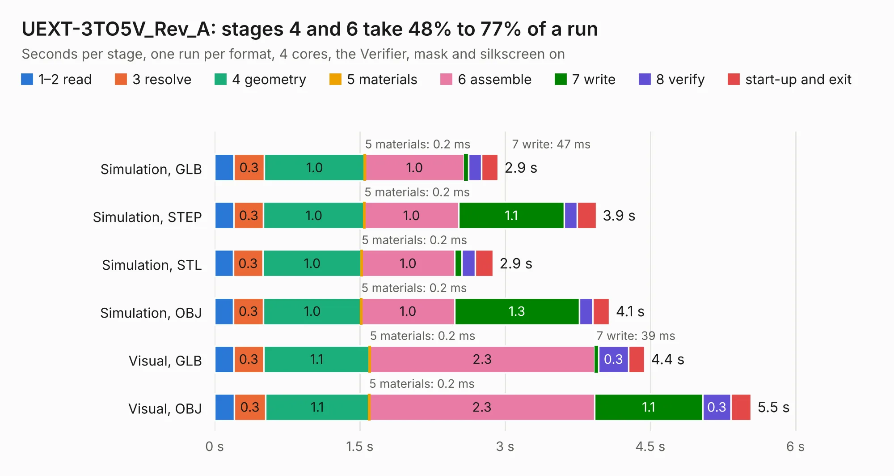

# 1989. UEXT-3TO5V_Rev_A

Board 1,989 of the 3,130 of [Corpus Testing](../Corpus-Testing.md), on [Corpus Page 19](../CorpusTestingPages/Corpus-Testing-19.md#1989-uext-3to5v_rev_a).

| Mode and format | 1–2 read | 3 resolve | 4 geometry | 5 materials | 6 assemble | 7 write | 8 verify | start-up and exit | Total |
|---|---:|---:|---:|---:|---:|---:|---:|---:|---:|
| Simulation, GLB | 0.2 | 0.3 | 1.0 | 0.2&nbsp;ms | 1.0 | 47&nbsp;ms | 0.1 | 0.2 | 2.9 |
| Simulation, STEP | 0.2 | 0.3 | 1.0 | 0.2&nbsp;ms | 1.0 | 1.1 | 0.1 | 0.2 | 3.9 |
| Simulation, STL | 0.2 | 0.3 | 1.0 | 0.2&nbsp;ms | 1.0 | 73&nbsp;ms | 0.1 | 0.2 | 2.9 |
| Simulation, OBJ | 0.2 | 0.3 | 1.0 | 0.2&nbsp;ms | 1.0 | 1.3 | 0.1 | 0.2 | 4.1 |
| Visual, GLB | 0.2 | 0.3 | 1.1 | 0.2&nbsp;ms | 2.3 | 39&nbsp;ms | 0.3 | 0.2 | 4.4 |
| Visual, OBJ | 0.2 | 0.3 | 1.1 | 0.2&nbsp;ms | 2.3 | 1.1 | 0.3 | 0.2 | 5.5 |

<table align="center"><tr><td valign="top">

| Board | Repo: [OLIMEX/UEXT-3TO5V](https://github.com/OLIMEX/UEXT-3TO5V) Board: `UEXT-3TO5V_Rev_A.kicad_pcb` |
|---|---|
| Folder | HARDWARE / UEXT-3TO5V-Rev.A |
| Complexity | 253&nbsp;/&nbsp;1000 (size&nbsp;158, features&nbsp;95) |
| KESE&nbsp;features | through vias, rounded, trapezoid or chamfered pads, filled zones, knockout text, stack-up, dielectric εr and tanδ, mask and silkscreen colours |
| Tested | 9th November 2026 |
| Copper&nbsp;layers | 2 |
| File&nbsp;format | KiCad 7 (20221018) |
| Parts,&nbsp;tracks,&nbsp;vias | 26, 419, 65 |
| Triangles,&nbsp;simulation | 331,836 in 33 parts |
| Verifier | PASS in all six runs |

</td><td valign="top">

<table>
<tr><th>File type</th><th>File size</th><th>Peak memory used</th></tr>
<tr><th colspan="3" align="left">Simulation</th></tr>
<tr><td>GLB</td><td align="right">12&nbsp;MB</td><td align="right">261&nbsp;MB</td></tr>
<tr><td>STEP</td><td align="right">66&nbsp;MB</td><td align="right">307&nbsp;MB</td></tr>
<tr><td>STL</td><td align="right">17&nbsp;MB</td><td align="right">274&nbsp;MB</td></tr>
<tr><td>OBJ</td><td align="right">35&nbsp;MB</td><td align="right">283&nbsp;MB</td></tr>
<tr><th colspan="3" align="left">Visual</th></tr>
<tr><td>GLB</td><td align="right">10.0&nbsp;MB</td><td align="right">277&nbsp;MB</td></tr>
<tr><td>OBJ</td><td align="right">29&nbsp;MB</td><td align="right">279&nbsp;MB</td></tr>
</table>

</td></tr></table>

| Previous | Next |
|:---|---:|
| [1988. TuxCon_Kitty_Rev_A](b1988b_TuxCon-Kitty_TuxCon-Kitty-Rev-A.md) | [1990. RPI-UEXT-MPQ_Rev_A](b1990b_UEXT-ADAPTERS_RPI-UEXT-MPQ-Rev-A.md) |
