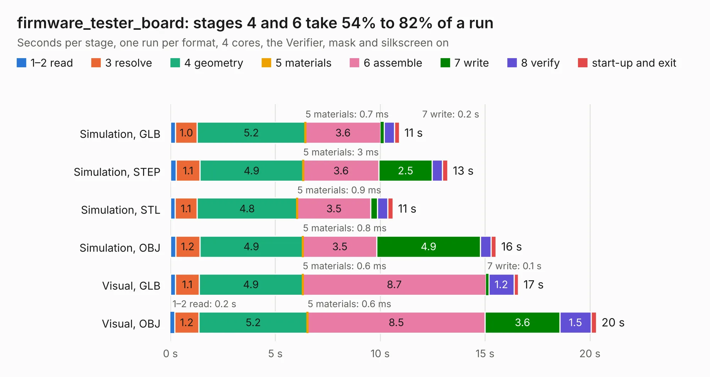

# 1989. firmware_tester_board

Board 1,989 of the 3,107 of [Corpus Testing](../Corpus-Testing.md), on [Corpus Page 19](../CorpusTestingPages/Corpus-Testing-19.md#1989-firmware_tester_board).

| Mode and format | 1–2 read | 3 resolve | 4 geometry | 5 materials | 6 assemble | 7 write | 8 verify | start-up and exit | Total |
|---|---:|---:|---:|---:|---:|---:|---:|---:|---:|
| Simulation, GLB | 0.2 | 1.0 | 5.2 | 0.7&nbsp;ms | 3.6 | 0.2 | 0.5 | 0.2 | 10.9 |
| Simulation, STEP | 0.3 | 1.1 | 4.9 | 3&nbsp;ms | 3.6 | 2.5 | 0.5 | 0.3 | 13.2 |
| Simulation, STL | 0.2 | 1.1 | 4.8 | 0.9&nbsp;ms | 3.5 | 0.3 | 0.5 | 0.3 | 10.6 |
| Simulation, OBJ | 0.2 | 1.2 | 4.9 | 0.8&nbsp;ms | 3.5 | 4.9 | 0.5 | 0.2 | 15.5 |
| Visual, GLB | 0.2 | 1.1 | 4.9 | 0.6&nbsp;ms | 8.7 | 0.1 | 1.2 | 0.2 | 16.6 |
| Visual, OBJ | 0.2 | 1.2 | 5.2 | 0.6&nbsp;ms | 8.5 | 3.6 | 1.5 | 0.3 | 20.3 |

<table align="center"><tr><td valign="top">

| Board | Repo: [olin-electric-motorsports/olin-electric-motorsports](https://github.com/olin-electric-motorsports/olin-electric-motorsports) Board: `firmware_tester_board.kicad_pcb` |
|---|---|
| Folder | projects / hitl / firmware_tester_board |
| Complexity | 260&nbsp;/&nbsp;1000 (size&nbsp;215, features&nbsp;45) |
| KESE&nbsp;features | through vias, filled zones, curved board outline |
| Tested | 9th November 2026 |
| Copper&nbsp;layers | 2 |
| File&nbsp;format | KiCad 6 (20211014) |
| Parts,&nbsp;tracks,&nbsp;vias | 55, 813, 100 |
| Triangles,&nbsp;simulation | 996,486 in 97 parts |
| Verifier | PASS in all six runs |

</td><td valign="top">

<table>
<tr><th>File type</th><th>File size</th><th>Peak memory used</th></tr>
<tr><th colspan="3" align="left">Simulation</th></tr>
<tr><td>GLB</td><td align="right">35&nbsp;MB</td><td align="right">465&nbsp;MB</td></tr>
<tr><td>STEP</td><td align="right">168&nbsp;MB</td><td align="right">518&nbsp;MB</td></tr>
<tr><td>STL</td><td align="right">50&nbsp;MB</td><td align="right">468&nbsp;MB</td></tr>
<tr><td>OBJ</td><td align="right">103&nbsp;MB</td><td align="right">714&nbsp;MB</td></tr>
<tr><th colspan="3" align="left">Visual</th></tr>
<tr><td>GLB</td><td align="right">25&nbsp;MB</td><td align="right">531&nbsp;MB</td></tr>
<tr><td>OBJ</td><td align="right">77&nbsp;MB</td><td align="right">590&nbsp;MB</td></tr>
</table>

</td></tr></table>

| Previous | Next |
|:---|---:|
| [1988. VGA2HDMI_Rev_C](b1988b_VGA2HDMI_VGA2HDMI-Rev-C.md) | [1990. hitl-primary](b1990b_olin-electric-motorsports_hitl-primary.md) |
