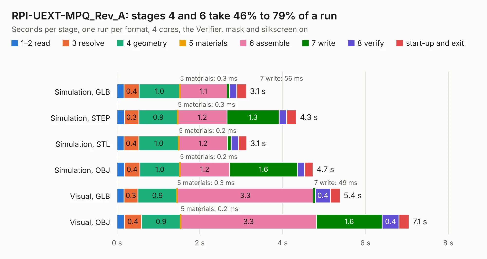

# 1990. RPI-UEXT-MPQ_Rev_A

Board 1,990 of the 3,130 of [Corpus Testing](../Corpus-Testing.md), on [Corpus Page 19](../CorpusTestingPages/Corpus-Testing-19.md#1990-rpi-uext-mpq_rev_a).

| Mode and format | 1–2 read | 3 resolve | 4 geometry | 5 materials | 6 assemble | 7 write | 8 verify | start-up and exit | Total |
|---|---:|---:|---:|---:|---:|---:|---:|---:|---:|
| Simulation, GLB | 0.2 | 0.4 | 1.0 | 0.3&nbsp;ms | 1.1 | 56&nbsp;ms | 0.2 | 0.2 | 3.1 |
| Simulation, STEP | 0.2 | 0.3 | 0.9 | 0.3&nbsp;ms | 1.2 | 1.3 | 0.2 | 0.2 | 4.3 |
| Simulation, STL | 0.2 | 0.4 | 1.0 | 0.2&nbsp;ms | 1.2 | 94&nbsp;ms | 0.2 | 0.2 | 3.1 |
| Simulation, OBJ | 0.2 | 0.4 | 1.0 | 0.2&nbsp;ms | 1.2 | 1.6 | 0.2 | 0.2 | 4.7 |
| Visual, GLB | 0.2 | 0.3 | 0.9 | 0.3&nbsp;ms | 3.3 | 49&nbsp;ms | 0.4 | 0.2 | 5.4 |
| Visual, OBJ | 0.2 | 0.4 | 0.9 | 0.2&nbsp;ms | 3.3 | 1.6 | 0.4 | 0.2 | 7.1 |

<table align="center"><tr><td valign="top">

| Board | Repo: [OLIMEX/UEXT-ADAPTERS](https://github.com/OLIMEX/UEXT-ADAPTERS) Board: `RPI-UEXT-MPQ_Rev_A.kicad_pcb` |
|---|---|
| Folder | RPI-UEXT-MPQ / Hardware |
| Complexity | 185&nbsp;/&nbsp;1000 (size&nbsp;140, features&nbsp;45) |
| KESE&nbsp;features | through vias, rounded, trapezoid or chamfered pads, filled zones |
| Tested | 9th November 2026 |
| Copper&nbsp;layers | 2 |
| File&nbsp;format | KiCad 5 (20171130) |
| Parts,&nbsp;tracks,&nbsp;vias | 5, 320, 77 |
| Triangles,&nbsp;simulation | 348,874 in 47 parts |
| Verifier | PASS in all six runs |

</td><td valign="top">

<table>
<tr><th>File type</th><th>File size</th><th>Peak memory used</th></tr>
<tr><th colspan="3" align="left">Simulation</th></tr>
<tr><td>GLB</td><td align="right">12&nbsp;MB</td><td align="right">302&nbsp;MB</td></tr>
<tr><td>STEP</td><td align="right">60&nbsp;MB</td><td align="right">309&nbsp;MB</td></tr>
<tr><td>STL</td><td align="right">17&nbsp;MB</td><td align="right">296&nbsp;MB</td></tr>
<tr><td>OBJ</td><td align="right">35&nbsp;MB</td><td align="right">294&nbsp;MB</td></tr>
<tr><th colspan="3" align="left">Visual</th></tr>
<tr><td>GLB</td><td align="right">11&nbsp;MB</td><td align="right">310&nbsp;MB</td></tr>
<tr><td>OBJ</td><td align="right">33&nbsp;MB</td><td align="right">309&nbsp;MB</td></tr>
</table>

</td></tr></table>

| Previous | Next |
|:---|---:|
| [1989. UEXT-3TO5V_Rev_A](b1989b_UEXT-3TO5V_UEXT-3TO5V-Rev-A.md) | [1991. UEXT-MPQ_Rev_A](b1991b_UEXT-ADAPTERS_UEXT-MPQ-Rev-A.md) |
