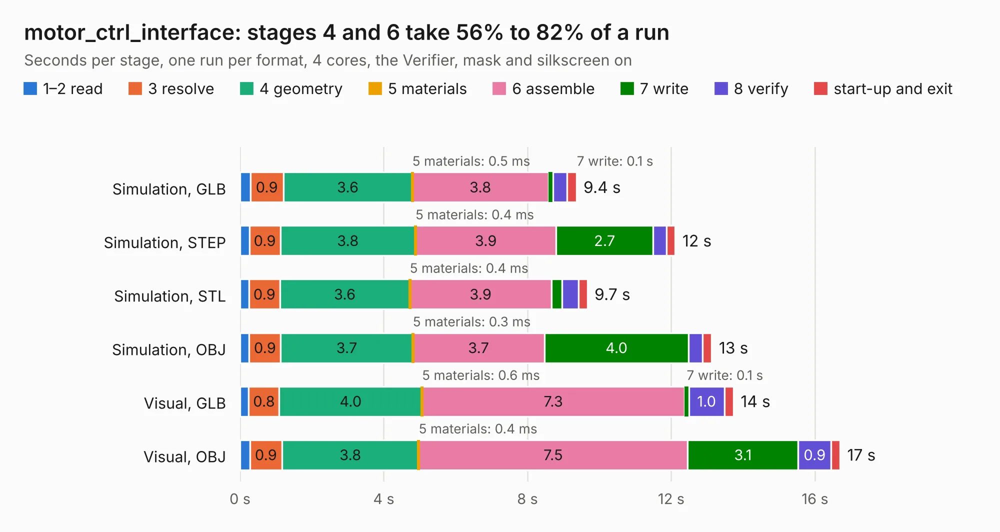

# 1990. motor_ctrl_interface

Board 1,990 of the 3,101 of [Corpus Testing](../Corpus-Testing.md), on [Corpus Page 19](../CorpusTestingPages/Corpus-Testing-19.md#1990-motor_ctrl_interface).

| Mode and format | 1–2 read | 3 resolve | 4 geometry | 5 materials | 6 assemble | 7 write | 8 verify | start-up and exit | Total |
|---|---:|---:|---:|---:|---:|---:|---:|---:|---:|
| Simulation, GLB | 0.3 | 0.9 | 3.6 | 0.5&nbsp;ms | 3.8 | 0.1 | 0.4 | 0.3 | 9.4 |
| Simulation, STEP | 0.3 | 0.9 | 3.8 | 0.4&nbsp;ms | 3.9 | 2.7 | 0.4 | 0.2 | 12.1 |
| Simulation, STL | 0.3 | 0.9 | 3.6 | 0.4&nbsp;ms | 3.9 | 0.3 | 0.5 | 0.2 | 9.7 |
| Simulation, OBJ | 0.3 | 0.9 | 3.7 | 0.3&nbsp;ms | 3.7 | 4.0 | 0.4 | 0.3 | 13.1 |
| Visual, GLB | 0.2 | 0.8 | 4.0 | 0.6&nbsp;ms | 7.3 | 0.1 | 1.0 | 0.3 | 13.7 |
| Visual, OBJ | 0.3 | 0.9 | 3.8 | 0.4&nbsp;ms | 7.5 | 3.1 | 0.9 | 0.2 | 16.7 |

<table align="center"><tr><td valign="top">

| Board | Repo: [olin-electric-motorsports/olin-electric-motorsports](https://github.com/olin-electric-motorsports/olin-electric-motorsports) Board: `motor_ctrl_interface.kicad_pcb` |
|---|---|
| Folder | vehicle / gokart / hardware / motor_ctrl_interface |
| Complexity | 257&nbsp;/&nbsp;1000 (size&nbsp;202, features&nbsp;55) |
| KESE&nbsp;features | through vias, rounded, trapezoid or chamfered pads, filled zones, copper text |
| Tested | 9th November 2026 |
| Copper&nbsp;layers | 2 |
| File&nbsp;format | KiCad 6 (20211014) |
| Parts,&nbsp;tracks,&nbsp;vias | 49, 364, 53 |
| Triangles,&nbsp;simulation | 824,476 in 79 parts |
| Verifier | PASS in all six runs |

</td><td valign="top">

<table>
<tr><th>File type</th><th>File size</th><th>Peak memory used</th></tr>
<tr><th colspan="3" align="left">Simulation</th></tr>
<tr><td>GLB</td><td align="right">29&nbsp;MB</td><td align="right">409&nbsp;MB</td></tr>
<tr><td>STEP</td><td align="right">144&nbsp;MB</td><td align="right">520&nbsp;MB</td></tr>
<tr><td>STL</td><td align="right">41&nbsp;MB</td><td align="right">415&nbsp;MB</td></tr>
<tr><td>OBJ</td><td align="right">85&nbsp;MB</td><td align="right">607&nbsp;MB</td></tr>
<tr><th colspan="3" align="left">Visual</th></tr>
<tr><td>GLB</td><td align="right">23&nbsp;MB</td><td align="right">586&nbsp;MB</td></tr>
<tr><td>OBJ</td><td align="right">68&nbsp;MB</td><td align="right">572&nbsp;MB</td></tr>
</table>

</td></tr></table>

| Previous | Next |
|:---|---:|
| [1989. bms_core](b1989b_olin-electric-motorsports_vehicle-gokart-hardware-bms-core_bms-core.md) | [1991. throttle](b1991b_olin-electric-motorsports_vehicle-gokart-hardware-throttle_throttle.md) |
