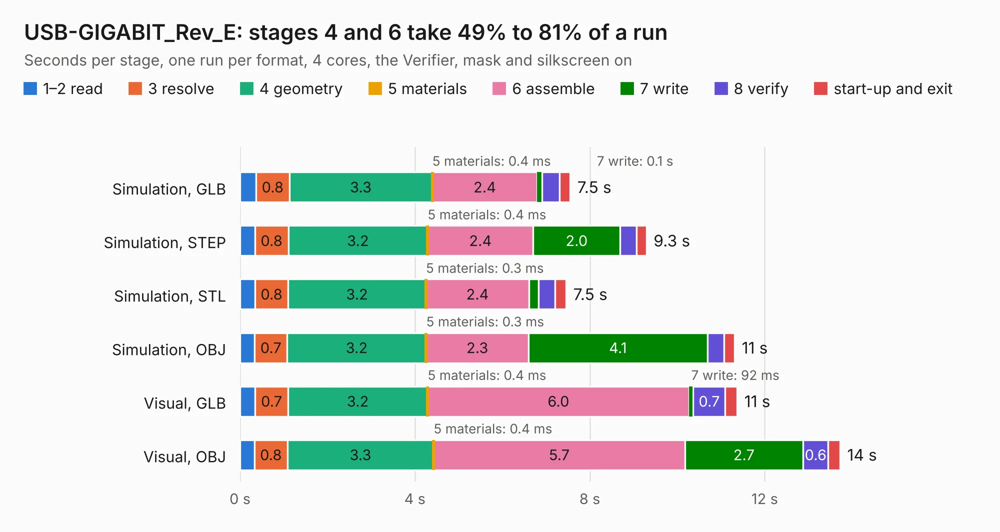

# 1993. USB-GIGABIT_Rev_E

Board 1,993 of the 3,118 of [Corpus Testing](../Corpus-Testing.md), on [Corpus Page 19](../CorpusTestingPages/Corpus-Testing-19.md#1993-usb-gigabit_rev_e).

| Mode and format | 1–2 read | 3 resolve | 4 geometry | 5 materials | 6 assemble | 7 write | 8 verify | start-up and exit | Total |
|---|---:|---:|---:|---:|---:|---:|---:|---:|---:|
| Simulation, GLB | 0.4 | 0.8 | 3.3 | 0.4&nbsp;ms | 2.4 | 0.1 | 0.4 | 0.2 | 7.5 |
| Simulation, STEP | 0.3 | 0.8 | 3.2 | 0.4&nbsp;ms | 2.4 | 2.0 | 0.4 | 0.2 | 9.3 |
| Simulation, STL | 0.3 | 0.8 | 3.2 | 0.3&nbsp;ms | 2.4 | 0.2 | 0.4 | 0.3 | 7.5 |
| Simulation, OBJ | 0.3 | 0.7 | 3.2 | 0.3&nbsp;ms | 2.3 | 4.1 | 0.4 | 0.2 | 11.3 |
| Visual, GLB | 0.3 | 0.7 | 3.2 | 0.4&nbsp;ms | 6.0 | 92&nbsp;ms | 0.7 | 0.3 | 11.4 |
| Visual, OBJ | 0.3 | 0.8 | 3.3 | 0.4&nbsp;ms | 5.7 | 2.7 | 0.6 | 0.3 | 13.7 |

<table align="center"><tr><td valign="top">

| Board | Repo: [OLIMEX/USB-GIGABIT](https://github.com/OLIMEX/USB-GIGABIT) Board: `USB-GIGABIT_Rev_E.kicad_pcb` |
|---|---|
| Folder | HARDWARE / USB-GIGABIT-Rev.E |
| Complexity | 311&nbsp;/&nbsp;1000 (size&nbsp;226, features&nbsp;85) |
| KESE&nbsp;features | through vias, slotted holes, filled zones, copper text, stack-up, dielectric εr and tanδ |
| Tested | 9th November 2026 |
| Copper&nbsp;layers | 4 |
| File&nbsp;format | KiCad 7 (20221018) |
| Parts,&nbsp;tracks,&nbsp;vias | 48, 637, 69 |
| Triangles,&nbsp;simulation | 685,636 in 65 parts |
| Verifier | PASS in all six runs |

</td><td valign="top">

<table>
<tr><th>File type</th><th>File size</th><th>Peak memory used</th></tr>
<tr><th colspan="3" align="left">Simulation</th></tr>
<tr><td>GLB</td><td align="right">24&nbsp;MB</td><td align="right">354&nbsp;MB</td></tr>
<tr><td>STEP</td><td align="right">115&nbsp;MB</td><td align="right">401&nbsp;MB</td></tr>
<tr><td>STL</td><td align="right">34&nbsp;MB</td><td align="right">338&nbsp;MB</td></tr>
<tr><td>OBJ</td><td align="right">71&nbsp;MB</td><td align="right">513&nbsp;MB</td></tr>
<tr><th colspan="3" align="left">Visual</th></tr>
<tr><td>GLB</td><td align="right">17&nbsp;MB</td><td align="right">408&nbsp;MB</td></tr>
<tr><td>OBJ</td><td align="right">49&nbsp;MB</td><td align="right">427&nbsp;MB</td></tr>
</table>

</td></tr></table>

| Previous | Next |
|:---|---:|
| [1992. USB-GIGABIT_Rev_D](b1992b_USB-GIGABIT_USB-GIGABIT-Rev-D.md) | [1994. USB-gLINK_Rev_C](b1994b_USB-gLINK_USB-gLINK-Rev-C.md) |
