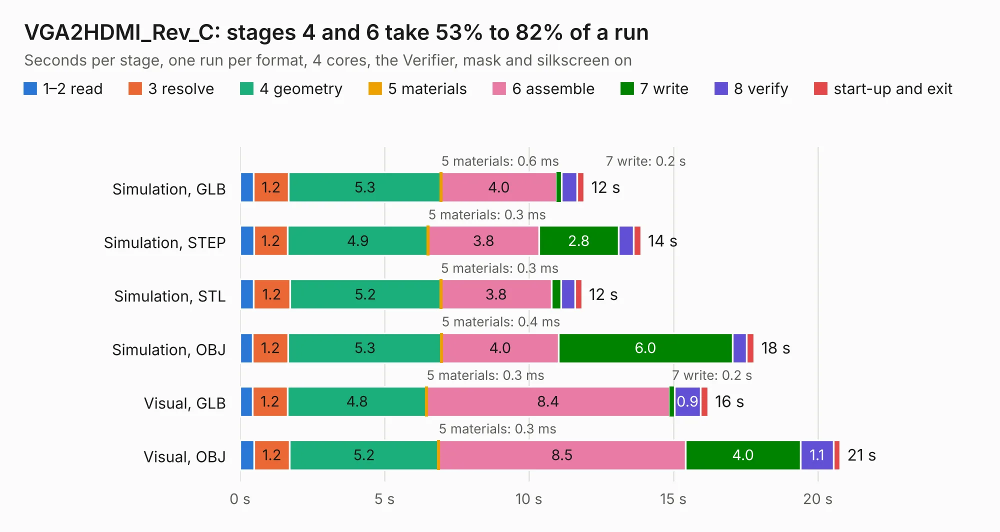

# 1993. VGA2HDMI_Rev_C

Board 1,993 of the 3,112 of [Corpus Testing](../Corpus-Testing.md), on [Corpus Page 19](../CorpusTestingPages/Corpus-Testing-19.md#1993-vga2hdmi_rev_c).

| Mode and format | 1–2 read | 3 resolve | 4 geometry | 5 materials | 6 assemble | 7 write | 8 verify | start-up and exit | Total |
|---|---:|---:|---:|---:|---:|---:|---:|---:|---:|
| Simulation, GLB | 0.5 | 1.2 | 5.3 | 0.6&nbsp;ms | 4.0 | 0.2 | 0.5 | 0.3 | 11.9 |
| Simulation, STEP | 0.5 | 1.2 | 4.9 | 0.3&nbsp;ms | 3.8 | 2.8 | 0.5 | 0.3 | 13.9 |
| Simulation, STL | 0.5 | 1.2 | 5.2 | 0.3&nbsp;ms | 3.8 | 0.3 | 0.5 | 0.2 | 11.8 |
| Simulation, OBJ | 0.4 | 1.2 | 5.3 | 0.4&nbsp;ms | 4.0 | 6.0 | 0.5 | 0.3 | 17.8 |
| Visual, GLB | 0.4 | 1.2 | 4.8 | 0.3&nbsp;ms | 8.4 | 0.2 | 0.9 | 0.2 | 16.2 |
| Visual, OBJ | 0.5 | 1.2 | 5.2 | 0.3&nbsp;ms | 8.5 | 4.0 | 1.1 | 0.2 | 20.8 |

<table align="center"><tr><td valign="top">

| Board | Repo: [OLIMEX/VGA2HDMI](https://github.com/OLIMEX/VGA2HDMI) Board: `VGA2HDMI_Rev_C.kicad_pcb` |
|---|---|
| Folder | HARDWARE / VGA2HDMI-REV.C |
| Complexity | 312&nbsp;/&nbsp;1000 (size&nbsp;237, features&nbsp;75) |
| KESE&nbsp;features | through vias, slotted holes, filled zones, stack-up, dielectric εr and tanδ |
| Tested | 9th November 2026 |
| Copper&nbsp;layers | 4 |
| File&nbsp;format | KiCad 7 (20221018) |
| Parts,&nbsp;tracks,&nbsp;vias | 75, 881, 131 |
| Triangles,&nbsp;simulation | 1,066,580 in 85 parts |
| Verifier | PASS in all six runs |

</td><td valign="top">

<table>
<tr><th>File type</th><th>File size</th><th>Peak memory used</th></tr>
<tr><th colspan="3" align="left">Simulation</th></tr>
<tr><td>GLB</td><td align="right">38&nbsp;MB</td><td align="right">476&nbsp;MB</td></tr>
<tr><td>STEP</td><td align="right">168&nbsp;MB</td><td align="right">529&nbsp;MB</td></tr>
<tr><td>STL</td><td align="right">53&nbsp;MB</td><td align="right">481&nbsp;MB</td></tr>
<tr><td>OBJ</td><td align="right">111&nbsp;MB</td><td align="right">766&nbsp;MB</td></tr>
<tr><th colspan="3" align="left">Visual</th></tr>
<tr><td>GLB</td><td align="right">25&nbsp;MB</td><td align="right">570&nbsp;MB</td></tr>
<tr><td>OBJ</td><td align="right">74&nbsp;MB</td><td align="right">607&nbsp;MB</td></tr>
</table>

</td></tr></table>

| Previous | Next |
|:---|---:|
| [1992. USB-SERIAL-L_Rev_B](b1992b_USB-SERIAL-L_USB-SERIAL-L-Rev-B.md) | [1994. firmware_tester_board](b1994b_olin-electric-motorsports_firmware-tester-board.md) |
