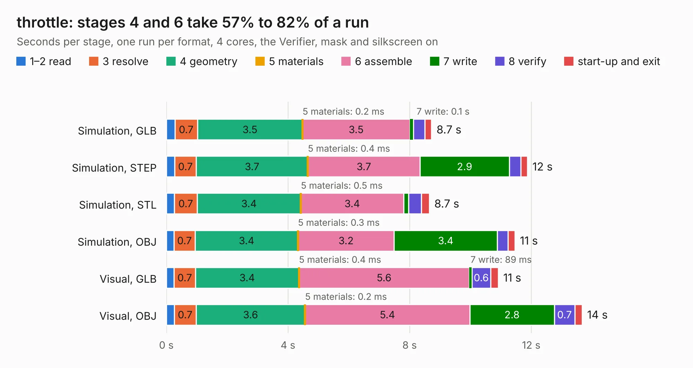

# 1993. throttle

Board 1,993 of the 3,103 of [Corpus Testing](../Corpus-Testing.md), on [Corpus Page 19](../CorpusTestingPages/Corpus-Testing-19.md#1993-throttle).

| Mode and format | 1–2 read | 3 resolve | 4 geometry | 5 materials | 6 assemble | 7 write | 8 verify | start-up and exit | Total |
|---|---:|---:|---:|---:|---:|---:|---:|---:|---:|
| Simulation, GLB | 0.3 | 0.7 | 3.5 | 0.2&nbsp;ms | 3.5 | 0.1 | 0.4 | 0.2 | 8.7 |
| Simulation, STEP | 0.3 | 0.7 | 3.7 | 0.4&nbsp;ms | 3.7 | 2.9 | 0.4 | 0.2 | 11.9 |
| Simulation, STL | 0.3 | 0.7 | 3.4 | 0.5&nbsp;ms | 3.4 | 0.2 | 0.4 | 0.3 | 8.7 |
| Simulation, OBJ | 0.2 | 0.7 | 3.4 | 0.3&nbsp;ms | 3.2 | 3.4 | 0.4 | 0.2 | 11.5 |
| Visual, GLB | 0.3 | 0.7 | 3.4 | 0.4&nbsp;ms | 5.6 | 89&nbsp;ms | 0.6 | 0.3 | 10.9 |
| Visual, OBJ | 0.3 | 0.7 | 3.6 | 0.2&nbsp;ms | 5.4 | 2.8 | 0.7 | 0.2 | 13.7 |

<table align="center"><tr><td valign="top">

| Board | Repo: [olin-electric-motorsports/olin-electric-motorsports](https://github.com/olin-electric-motorsports/olin-electric-motorsports) Board: `throttle.kicad_pcb` |
|---|---|
| Folder | vehicle / gokart / hardware / throttle |
| Complexity | 251&nbsp;/&nbsp;1000 (size&nbsp;196, features&nbsp;55) |
| KESE&nbsp;features | through vias, rounded, trapezoid or chamfered pads, filled zones, curved board outline |
| Tested | 9th November 2026 |
| Copper&nbsp;layers | 2 |
| File&nbsp;format | KiCad 6 (20211014) |
| Parts,&nbsp;tracks,&nbsp;vias | 52, 263, 31 |
| Triangles,&nbsp;simulation | 606,876 in 62 parts |
| Verifier | PASS in all six runs |

</td><td valign="top">

<table>
<tr><th>File type</th><th>File size</th><th>Peak memory used</th></tr>
<tr><th colspan="3" align="left">Simulation</th></tr>
<tr><td>GLB</td><td align="right">21&nbsp;MB</td><td align="right">397&nbsp;MB</td></tr>
<tr><td>STEP</td><td align="right">102&nbsp;MB</td><td align="right">416&nbsp;MB</td></tr>
<tr><td>STL</td><td align="right">30&nbsp;MB</td><td align="right">363&nbsp;MB</td></tr>
<tr><td>OBJ</td><td align="right">63&nbsp;MB</td><td align="right">457&nbsp;MB</td></tr>
<tr><th colspan="3" align="left">Visual</th></tr>
<tr><td>GLB</td><td align="right">17&nbsp;MB</td><td align="right">481&nbsp;MB</td></tr>
<tr><td>OBJ</td><td align="right">50&nbsp;MB</td><td align="right">483&nbsp;MB</td></tr>
</table>

</td></tr></table>

| Previous | Next |
|:---|---:|
| [1992. motor_ctrl_interface](b1992b_olin-electric-motorsports_motor-ctrl-interface.md) | [1994. dashboard](b1994b_olin-electric-motorsports_vehicle-mkv-hardware-dashboard-dux_dashboard.md) |
