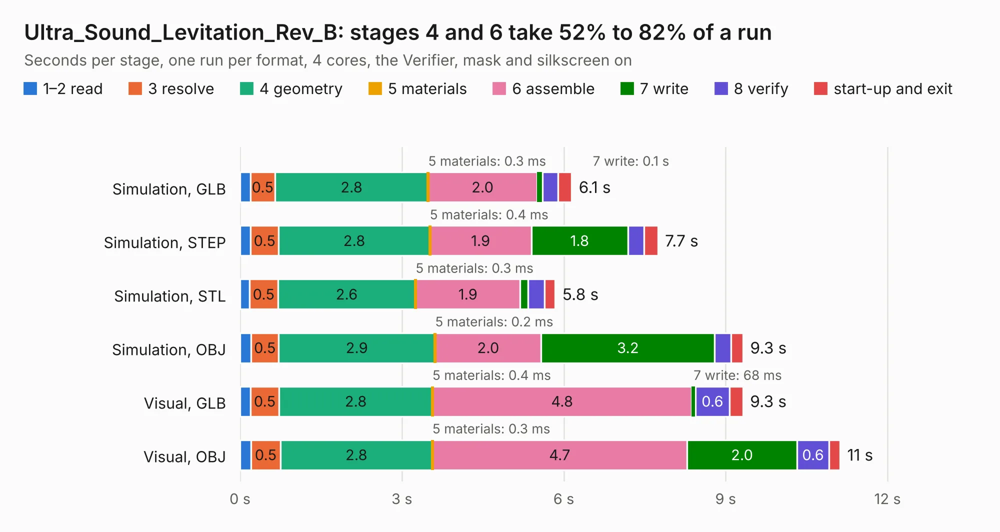

# 1994. Ultra_Sound_Levitation_Rev_B

Board 1,994 of the 3,125 of [Corpus Testing](../Corpus-Testing.md), on [Corpus Page 19](../CorpusTestingPages/Corpus-Testing-19.md#1994-ultra_sound_levitation_rev_b).

| Mode and format | 1–2 read | 3 resolve | 4 geometry | 5 materials | 6 assemble | 7 write | 8 verify | start-up and exit | Total |
|---|---:|---:|---:|---:|---:|---:|---:|---:|---:|
| Simulation, GLB | 0.2 | 0.5 | 2.8 | 0.3&nbsp;ms | 2.0 | 0.1 | 0.3 | 0.2 | 6.1 |
| Simulation, STEP | 0.2 | 0.5 | 2.8 | 0.4&nbsp;ms | 1.9 | 1.8 | 0.3 | 0.3 | 7.7 |
| Simulation, STL | 0.2 | 0.5 | 2.6 | 0.3&nbsp;ms | 1.9 | 0.1 | 0.3 | 0.2 | 5.8 |
| Simulation, OBJ | 0.2 | 0.5 | 2.9 | 0.2&nbsp;ms | 2.0 | 3.2 | 0.3 | 0.2 | 9.3 |
| Visual, GLB | 0.2 | 0.5 | 2.8 | 0.4&nbsp;ms | 4.8 | 68&nbsp;ms | 0.6 | 0.2 | 9.3 |
| Visual, OBJ | 0.2 | 0.5 | 2.8 | 0.3&nbsp;ms | 4.7 | 2.0 | 0.6 | 0.2 | 11.1 |

<table align="center"><tr><td valign="top">

| Board | Repo: [OLIMEX/Ultra-Sound-Levitation](https://github.com/OLIMEX/Ultra-Sound-Levitation) Board: `Ultra_Sound_Levitation_Rev_B.kicad_pcb` |
|---|---|
| Folder | HARDWARE / Ultra_Sound_Levitation_Rev_B |
| Complexity | 183&nbsp;/&nbsp;1000 (size&nbsp;148, features&nbsp;35) |
| KESE&nbsp;features | through vias, filled zones |
| Tested | 9th November 2026 |
| Copper&nbsp;layers | 2 |
| File&nbsp;format | KiCad 5 (20171130) |
| Parts,&nbsp;tracks,&nbsp;vias | 22, 220, 50 |
| Triangles,&nbsp;simulation | 641,300 in 37 parts |
| Verifier | PASS in all six runs |

</td><td valign="top">

<table>
<tr><th>File type</th><th>File size</th><th>Peak memory used</th></tr>
<tr><th colspan="3" align="left">Simulation</th></tr>
<tr><td>GLB</td><td align="right">22&nbsp;MB</td><td align="right">330&nbsp;MB</td></tr>
<tr><td>STEP</td><td align="right">106&nbsp;MB</td><td align="right">373&nbsp;MB</td></tr>
<tr><td>STL</td><td align="right">32&nbsp;MB</td><td align="right">322&nbsp;MB</td></tr>
<tr><td>OBJ</td><td align="right">66&nbsp;MB</td><td align="right">467&nbsp;MB</td></tr>
<tr><th colspan="3" align="left">Visual</th></tr>
<tr><td>GLB</td><td align="right">15&nbsp;MB</td><td align="right">391&nbsp;MB</td></tr>
<tr><td>OBJ</td><td align="right">45&nbsp;MB</td><td align="right">393&nbsp;MB</td></tr>
</table>

</td></tr></table>

| Previous | Next |
|:---|---:|
| [1993. mod-oled-128x64](b1993b_UEXT-MODULES_mod-oled-128x64.md) | [1995. URC_revB](b1995b_URC_URC-revB.md) |
