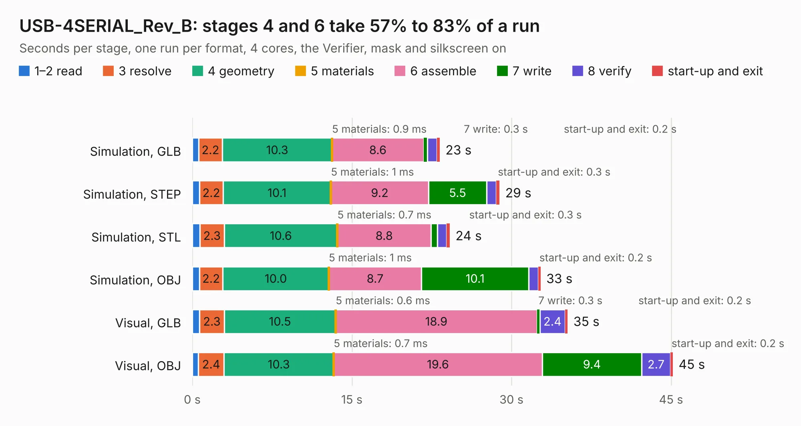

# 1998. USB-4SERIAL_Rev_B

Board 1,998 of the 3,129 of [Corpus Testing](../Corpus-Testing.md), on [Corpus Page 19](../CorpusTestingPages/Corpus-Testing-19.md#1998-usb-4serial_rev_b).

| Mode and format | 1–2 read | 3 resolve | 4 geometry | 5 materials | 6 assemble | 7 write | 8 verify | start-up and exit | Total |
|---|---:|---:|---:|---:|---:|---:|---:|---:|---:|
| Simulation, GLB | 0.6 | 2.2 | 10.3 | 0.9&nbsp;ms | 8.6 | 0.3 | 0.9 | 0.2 | 23.3 |
| Simulation, STEP | 0.7 | 2.2 | 10.1 | 1&nbsp;ms | 9.2 | 5.5 | 0.9 | 0.3 | 28.9 |
| Simulation, STL | 0.7 | 2.3 | 10.6 | 0.7&nbsp;ms | 8.8 | 0.6 | 0.9 | 0.3 | 24.2 |
| Simulation, OBJ | 0.7 | 2.2 | 10.0 | 1&nbsp;ms | 8.7 | 10.1 | 0.9 | 0.2 | 32.7 |
| Visual, GLB | 0.7 | 2.3 | 10.5 | 0.6&nbsp;ms | 18.9 | 0.3 | 2.4 | 0.2 | 35.3 |
| Visual, OBJ | 0.6 | 2.4 | 10.3 | 0.7&nbsp;ms | 19.6 | 9.4 | 2.7 | 0.2 | 45.2 |

<table align="center"><tr><td valign="top">

| Board | Repo: [OLIMEX/USB-4SERIAL](https://github.com/OLIMEX/USB-4SERIAL) Board: `USB-4SERIAL_Rev_B.kicad_pcb` |
|---|---|
| Folder | HARDWARE / USB-4SERIAL_Rev_B |
| Complexity | 288&nbsp;/&nbsp;1000 (size&nbsp;233, features&nbsp;55) |
| KESE&nbsp;features | through vias, slotted holes, filled zones, copper text |
| Tested | 9th November 2026 |
| Copper&nbsp;layers | 2 |
| File&nbsp;format | KiCad 5 (20171130) |
| Parts,&nbsp;tracks,&nbsp;vias | 88, 1,588, 271 |
| Triangles,&nbsp;simulation | 1,964,302 in 140 parts |
| Verifier | PASS in all six runs |

</td><td valign="top">

<table>
<tr><th>File type</th><th>File size</th><th>Peak memory used</th></tr>
<tr><th colspan="3" align="left">Simulation</th></tr>
<tr><td>GLB</td><td align="right">69&nbsp;MB</td><td align="right">689&nbsp;MB</td></tr>
<tr><td>STEP</td><td align="right">368&nbsp;MB</td><td align="right">930&nbsp;MB</td></tr>
<tr><td>STL</td><td align="right">98&nbsp;MB</td><td align="right">694&nbsp;MB</td></tr>
<tr><td>OBJ</td><td align="right">209&nbsp;MB</td><td align="right">1.3&nbsp;GB</td></tr>
<tr><th colspan="3" align="left">Visual</th></tr>
<tr><td>GLB</td><td align="right">58&nbsp;MB</td><td align="right">975&nbsp;MB</td></tr>
<tr><td>OBJ</td><td align="right">176&nbsp;MB</td><td align="right">1.3&nbsp;GB</td></tr>
</table>

</td></tr></table>

| Previous | Next |
|:---|---:|
| [1997. URC_revB](b1997b_URC_URC-revB.md) | [1999. USB-GIGABIT_Rev_C](b1999b_USB-GIGABIT_USB-GIGABIT-Rev-C.md) |
