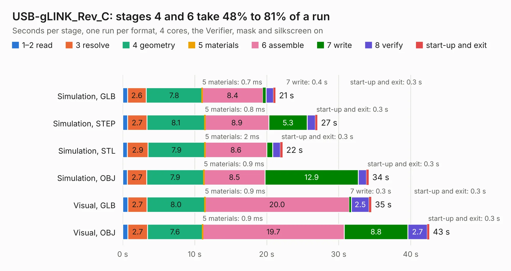

# 1998. USB-gLINK_Rev_C

Board 1,998 of the 3,122 of [Corpus Testing](../Corpus-Testing.md), on [Corpus Page 19](../CorpusTestingPages/Corpus-Testing-19.md#1998-usb-glink_rev_c).

| Mode and format | 1–2 read | 3 resolve | 4 geometry | 5 materials | 6 assemble | 7 write | 8 verify | start-up and exit | Total |
|---|---:|---:|---:|---:|---:|---:|---:|---:|---:|
| Simulation, GLB | 0.7 | 2.6 | 7.8 | 0.7&nbsp;ms | 8.4 | 0.4 | 1.0 | 0.3 | 21.2 |
| Simulation, STEP | 0.7 | 2.7 | 8.1 | 0.8&nbsp;ms | 8.9 | 5.3 | 1.2 | 0.3 | 27.0 |
| Simulation, STL | 0.7 | 2.9 | 7.9 | 2&nbsp;ms | 8.6 | 0.8 | 1.1 | 0.3 | 22.2 |
| Simulation, OBJ | 0.7 | 2.7 | 7.9 | 0.9&nbsp;ms | 8.5 | 12.9 | 1.1 | 0.3 | 34.2 |
| Visual, GLB | 0.7 | 2.7 | 8.0 | 0.9&nbsp;ms | 20.0 | 0.3 | 2.5 | 0.3 | 34.5 |
| Visual, OBJ | 0.7 | 2.7 | 7.6 | 0.9&nbsp;ms | 19.7 | 8.8 | 2.7 | 0.3 | 42.6 |

<table align="center"><tr><td valign="top">

| Board | Repo: [OLIMEX/USB-gLINK](https://github.com/OLIMEX/USB-gLINK) Board: `USB-gLINK_Rev_C.kicad_pcb` |
|---|---|
| Folder | HARDWARE / USB-gLINK_Rev.C |
| Complexity | 338&nbsp;/&nbsp;1000 (size&nbsp;273, features&nbsp;65) |
| KESE&nbsp;features | through vias, slotted holes, rounded, trapezoid or chamfered pads, filled zones, copper text |
| Tested | 9th November 2026 |
| Copper&nbsp;layers | 4 |
| File&nbsp;format | KiCad 5 (20171130) |
| Parts,&nbsp;tracks,&nbsp;vias | 96, 3,212, 435 |
| Triangles,&nbsp;simulation | 2,140,928 in 143 parts |
| Verifier | PASS in all six runs |

</td><td valign="top">

<table>
<tr><th>File type</th><th>File size</th><th>Peak memory used</th></tr>
<tr><th colspan="3" align="left">Simulation</th></tr>
<tr><td>GLB</td><td align="right">75&nbsp;MB</td><td align="right">797&nbsp;MB</td></tr>
<tr><td>STEP</td><td align="right">272&nbsp;MB</td><td align="right">919&nbsp;MB</td></tr>
<tr><td>STL</td><td align="right">107&nbsp;MB</td><td align="right">818&nbsp;MB</td></tr>
<tr><td>OBJ</td><td align="right">228&nbsp;MB</td><td align="right">1.5&nbsp;GB</td></tr>
<tr><th colspan="3" align="left">Visual</th></tr>
<tr><td>GLB</td><td align="right">49&nbsp;MB</td><td align="right">883&nbsp;MB</td></tr>
<tr><td>OBJ</td><td align="right">151&nbsp;MB</td><td align="right">1.1&nbsp;GB</td></tr>
</table>

</td></tr></table>

| Previous | Next |
|:---|---:|
| [1997. USB-GIGABIT_Rev_E](b1997b_USB-GIGABIT_USB-GIGABIT-Rev-E.md) | [1999. USB-gLINK_Rev_D](b1999b_USB-gLINK_USB-gLINK-Rev-D.md) |
