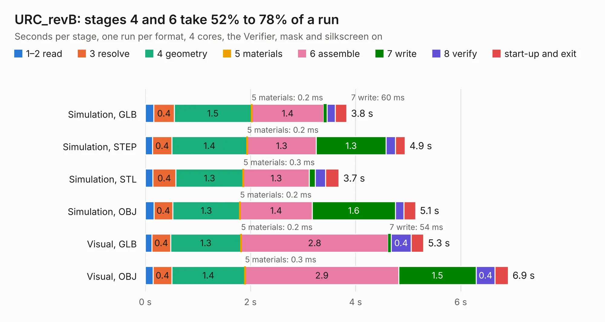

# 1999. URC_revB

Board 1,999 of the 3,131 of [Corpus Testing](../Corpus-Testing.md), on [Corpus Page 19](../CorpusTestingPages/Corpus-Testing-19.md#1999-urc_revb).

| Mode and format | 1–2 read | 3 resolve | 4 geometry | 5 materials | 6 assemble | 7 write | 8 verify | start-up and exit | Total |
|---|---:|---:|---:|---:|---:|---:|---:|---:|---:|
| Simulation, GLB | 0.2 | 0.4 | 1.5 | 0.2&nbsp;ms | 1.4 | 60&nbsp;ms | 0.2 | 0.2 | 3.8 |
| Simulation, STEP | 0.1 | 0.4 | 1.4 | 0.2&nbsp;ms | 1.3 | 1.3 | 0.2 | 0.2 | 4.9 |
| Simulation, STL | 0.1 | 0.4 | 1.3 | 0.3&nbsp;ms | 1.3 | 0.1 | 0.2 | 0.3 | 3.7 |
| Simulation, OBJ | 0.2 | 0.4 | 1.3 | 0.2&nbsp;ms | 1.4 | 1.6 | 0.2 | 0.2 | 5.1 |
| Visual, GLB | 0.1 | 0.4 | 1.3 | 0.2&nbsp;ms | 2.8 | 54&nbsp;ms | 0.4 | 0.2 | 5.3 |
| Visual, OBJ | 0.2 | 0.4 | 1.4 | 0.3&nbsp;ms | 2.9 | 1.5 | 0.4 | 0.3 | 6.9 |

<table align="center"><tr><td valign="top">

| Board | Repo: [OLIMEX/URC](https://github.com/OLIMEX/URC) Board: `URC_revB.kicad_pcb` |
|---|---|
| Folder | HARDWARE |
| Complexity | 204&nbsp;/&nbsp;1000 (size&nbsp;149, features&nbsp;55) |
| KESE&nbsp;features | through vias, rounded, trapezoid or chamfered pads, filled zones, curved board outline |
| Tested | 9th November 2026 |
| Copper&nbsp;layers | 2 |
| File&nbsp;format | KiCad 6 (20190421) |
| Parts,&nbsp;tracks,&nbsp;vias | 31, 215, 34 |
| Triangles,&nbsp;simulation | 328,142 in 31 parts |
| Verifier | PASS in all six runs |

</td><td valign="top">

<table>
<tr><th>File type</th><th>File size</th><th>Peak memory used</th></tr>
<tr><th colspan="3" align="left">Simulation</th></tr>
<tr><td>GLB</td><td align="right">12&nbsp;MB</td><td align="right">248&nbsp;MB</td></tr>
<tr><td>STEP</td><td align="right">60&nbsp;MB</td><td align="right">290&nbsp;MB</td></tr>
<tr><td>STL</td><td align="right">16&nbsp;MB</td><td align="right">255&nbsp;MB</td></tr>
<tr><td>OBJ</td><td align="right">34&nbsp;MB</td><td align="right">277&nbsp;MB</td></tr>
<tr><th colspan="3" align="left">Visual</th></tr>
<tr><td>GLB</td><td align="right">9.6&nbsp;MB</td><td align="right">276&nbsp;MB</td></tr>
<tr><td>OBJ</td><td align="right">28&nbsp;MB</td><td align="right">280&nbsp;MB</td></tr>
</table>

</td></tr></table>

| Previous | Next |
|:---|---:|
| [1998. Ultra_Sound_Levitation_Rev_B](b1998b_Ultra-Sound-Levitation_Ultra-Sound-Levitation-Rev-B.md) | [2000. USB-4SERIAL_Rev_B](b2000b_USB-4SERIAL_USB-4SERIAL-Rev-B.md) |
