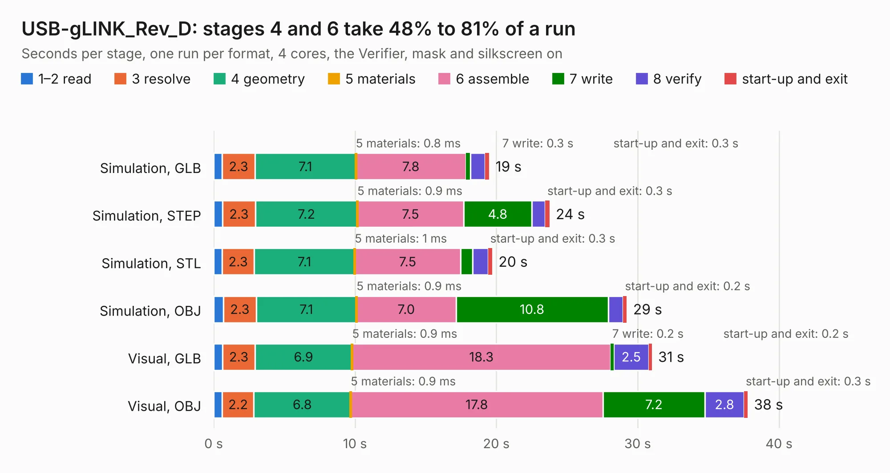

# 1999. USB-gLINK_Rev_D

Board 1,999 of the 3,122 of [Corpus Testing](../Corpus-Testing.md), on [Corpus Page 19](../CorpusTestingPages/Corpus-Testing-19.md#1999-usb-glink_rev_d).

| Mode and format | 1–2 read | 3 resolve | 4 geometry | 5 materials | 6 assemble | 7 write | 8 verify | start-up and exit | Total |
|---|---:|---:|---:|---:|---:|---:|---:|---:|---:|
| Simulation, GLB | 0.6 | 2.3 | 7.1 | 0.8&nbsp;ms | 7.8 | 0.3 | 1.0 | 0.3 | 19.5 |
| Simulation, STEP | 0.6 | 2.3 | 7.2 | 0.9&nbsp;ms | 7.5 | 4.8 | 1.0 | 0.3 | 23.8 |
| Simulation, STL | 0.6 | 2.3 | 7.1 | 1&nbsp;ms | 7.5 | 0.9 | 1.1 | 0.3 | 19.7 |
| Simulation, OBJ | 0.7 | 2.3 | 7.1 | 0.9&nbsp;ms | 7.0 | 10.8 | 1.1 | 0.2 | 29.2 |
| Visual, GLB | 0.6 | 2.3 | 6.9 | 0.9&nbsp;ms | 18.3 | 0.2 | 2.5 | 0.2 | 31.0 |
| Visual, OBJ | 0.6 | 2.2 | 6.8 | 0.9&nbsp;ms | 17.8 | 7.2 | 2.8 | 0.3 | 37.8 |

<table align="center"><tr><td valign="top">

| Board | Repo: [OLIMEX/USB-gLINK](https://github.com/OLIMEX/USB-gLINK) Board: `USB-gLINK_Rev_D.kicad_pcb` |
|---|---|
| Folder | HARDWARE / USB-gLINK_Rev.D |
| Complexity | 337&nbsp;/&nbsp;1000 (size&nbsp;272, features&nbsp;65) |
| KESE&nbsp;features | through vias, slotted holes, rounded, trapezoid or chamfered pads, filled zones, copper text |
| Tested | 9th November 2026 |
| Copper&nbsp;layers | 4 |
| File&nbsp;format | KiCad 5 (20171130) |
| Parts,&nbsp;tracks,&nbsp;vias | 102, 3,024, 408 |
| Triangles,&nbsp;simulation | 2,188,064 in 143 parts |
| Verifier | PASS in all six runs |

</td><td valign="top">

<table>
<tr><th>File type</th><th>File size</th><th>Peak memory used</th></tr>
<tr><th colspan="3" align="left">Simulation</th></tr>
<tr><td>GLB</td><td align="right">77&nbsp;MB</td><td align="right">830&nbsp;MB</td></tr>
<tr><td>STEP</td><td align="right">295&nbsp;MB</td><td align="right">978&nbsp;MB</td></tr>
<tr><td>STL</td><td align="right">109&nbsp;MB</td><td align="right">909&nbsp;MB</td></tr>
<tr><td>OBJ</td><td align="right">233&nbsp;MB</td><td align="right">1.5&nbsp;GB</td></tr>
<tr><th colspan="3" align="left">Visual</th></tr>
<tr><td>GLB</td><td align="right">51&nbsp;MB</td><td align="right">941&nbsp;MB</td></tr>
<tr><td>OBJ</td><td align="right">159&nbsp;MB</td><td align="right">1.2&nbsp;GB</td></tr>
</table>

</td></tr></table>

| Previous | Next |
|:---|---:|
| [1998. USB-gLINK_Rev_C](b1998b_USB-gLINK_USB-gLINK-Rev-C.md) | [2000. USB-NeoHUB_Rev_A](b2000b_USB-NeoHub_USB-NeoHUB-Rev-A.md) |
